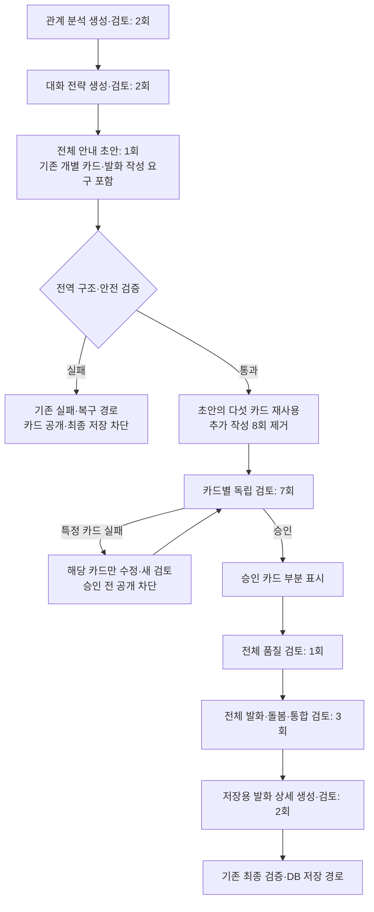

# O4 — 최종 초안 재사용

2026-10-31 구현. `MODEL_REUSE_FINAL_DRAFT=true`인 비긴급 전체 기능 경로에서 **최종 생성 요청 26→18회, 8회·30.8% 감소**를 로컬 mock HTTP 검사로 확인했다. 생성은 12→4회이고 **독립 검토 14회는 유지**한다. 실제 GPU 모델·운영 DB·배포 검증 결과는 아니다.

## 호출 순서와 변경점

| 구간 | 기존 | O4 | 변화 |
| --- | ---: | ---: | --- |
| 관계 분석·전략 생성 및 각각의 검토 | 4 | 4 | 유지 |
| 전체 안내 초안 | 1 | 1 | 개별 작성 요구를 함께 전달 |
| 대화문 도입·경청·제안·합성 | 4 | 0 | 초안의 대화문 재사용 |
| 돌봄·실천·피할 말·다음 단계 작성 | 4 | 0 | 초안의 카드 재사용 |
| 카드별 검토 5 + 돌봄·다음 단계 지원 검토 2 | 7 | 7 | 유지 |
| 품질 검토 | 1 | 1 | 유지 |
| 전체 발화·돌봄·통합 검토 | 3 | 3 | 유지 |
| 발화 상세 생성·검토 | 2 | 2 | 유지 |
| **합계** | **26** | **18** | **8회 감소** |

수치는 상태가 준비된 비긴급 사례에서 형식 실패·거절·품질 개선·네트워크 재시도가 없는 정상 경로다. 대화문 하나가 수정 1회와 재검토 1회를 필요로 하는 합성 사례는 **20회**였다. 다른 카드, 복합 오류, 전체 복구는 추가 호출 수가 다를 수 있다. 답변 처리·기관 분류·조건부 상태 보완은 이 수치와 별도다. 호출 감소율을 처리시간·토큰·전체 상담 감소율로 해석하지 않는다.

## 보존한 검증·저장 계약

- JSON·필수 키·타입·전역 안전 판단 오류는 기존 전체 초안 실패로 처리한다. 누락 값을 생성하거나 안전 판단을 덮어쓰지 않는다.
- 구조가 유효한 대화문의 마음 추정·제삼자 호칭·중복 허락·상담 목적 누락은 해당 카드의 수정 지시로 보낸다. 다른 카드도 각자 독립 검토를 통과해야 한다.
- `avoid`는 저장 시 문자열 배열을 유지한다. 각 항목에 피할 말·행동, 이유, 대신 할 말·행동이 모두 있어야 한다. 불완전한 묶음은 기존 구조화된 카드 수정 경로로 보낸다.
- 전체 초안 작성·품질 개선에도 supporter의 원문 감정·부담·대처·지원 자원을 고정 포함한다. 분석 변경 시 이전 카드 승인을 무효화하고 새 검토를 수행한다.
- 카드 작업 최대 3개, 카드 승인 후 부분 표시, 취소 시 공개 철회, 긴급 고정 안내 경로를 유지한다. 실제 GPU 추론 슬롯은 P0 bridge의 별도 계약이다.
- `guide`, `assessment`, 관계 분석·상태·메모리·이름 근거, `conversation_detail`을 기존 반환·저장 경로에 전달한다. O4를 실제 사용한 결과의 agent 메타데이터에만 `final_draft_reused:true`를 추가한다. 화면의 카드 디자인과 표시 정보는 변경하지 않았다.
- O5의 검토 승인 재사용은 구현하지 않았다. 기존 전체 검토를 제거하지 않는다.

## 활성화·복구

| 설정 | 계약 |
| --- | --- |
| `MODEL_REUSE_FINAL_DRAFT` | 미지정/`false`: 기존 경로, `true`: O4. 그 외 값은 구성 오류 |
| `MODEL_PROTOCOL` | O4는 `relationship_agent`에서만 허용 |
| `MODEL_SKIP_FINAL_EXTRAS` | O4와 동시 활성화 불가. 전략·품질·상세 생략으로 절감하지 않음 |
| 생성 Gateway | `reuseFinalDraft` 적용. 검토 Gateway의 독립 요청 유지 |
| 기본 Compose | 환경변수를 전달하며 기본값 `false` |
| `compose.gpu.yaml` | O4 `true`, extras 생략 `false`를 명시 |
| 총 시간 제한 | 기존 기본값 `MODEL_TIMEOUT_MS=0` 유지 |

기존 `.env`와 실행 중인 서비스는 변경하지 않았다. 서버 GPU 전용 모드는 [P0 설정](SERVER_GPU_P0.md)을 함께 따른다. GPU 서버 접속·기동·배포·실추론 전에 사용자 승인을 받는다. 승인된 배포에서 O4를 되돌릴 때는 실제 최종 설정의 `MODEL_REUSE_FINAL_DRAFT=false`를 확인해야 한다. GPU overlay가 `true`를 강제하므로 `.env`만 바꾸면 overlay 값을 덮어쓰지 못한다.

## 구현 후 검토·검증

구현을 마친 뒤 독립 검토 두 건으로 카드 오류 처리·검토 순서·저장 호환성과 프롬프트·설정 계약을 각각 확인했다. 후속 검토에서 품질 개선 `guide_refine`이 기존 초안 프롬프트를 사용해 O4의 세 문단 발화·avoid 완결 묶음 요구를 잃을 수 있음을 발견했다. 해당 요청에도 O4 프롬프트를 재사용하도록 수정했고, 실제 요청 본문의 검사 실패를 먼저 재현한 뒤 수정 후 통과를 확인했다. 기존 모드와 긴급 경로는 기존 프롬프트를 유지한다.

| 로컬 검사 | 결과 |
| --- | --- |
| 새 실제 Gateway + mock HTTP 회귀 검사 | 17 통과: 18/26회·검토 14회, 저장 payload 비교, 카드별 수정, 원문 보존, 잘못된 구조·JSON·안전 차단, 품질 개선, 분석 변경, 거절·취소·긴급 경로 |
| 새 O4 프롬프트 검사 | 4 통과: 카드·발화 요구, 역할·목적, 호칭 입력 격리, 기존 프롬프트 보존 |
| 설정 검사 | O4 기본값·활성화·잘못된 값·extras/프로토콜 충돌 거부 확인 |
| 앱 전체 `env -u TEST_DATABASE_URL node --test tests/*.test.js` | **1,880 통과, 0 실패, 85 건너뜀**. 실제 DB 검사는 미실행 |
| `node scripts/check.js` | JavaScript 구문·JSON 검사 통과 |
| Compose | YAML 파싱·O4 활성화 및 extras 유지 설정 확인. 컨테이너 미기동 |

지침에서 허용한 별도 Ollama 검토 API에는 원문·비밀값 없는 설계 요약만 보내려 했으나 `Host is down`으로 결과를 받지 못했다. 완료 판단은 네이티브 독립 검토와 로컬 검사에 근거한다. **실제 GPU에서의 호출·토큰·처리시간·품질, 운영 DB 저장은 미검증**이며 승인 후 분리된 합성 사례로 확인한다.

## 변경 파일

- [호출 흐름·검증](../src/relationship-agent.js), [통합 초안 프롬프트](../src/relationship-prompts.js)
- [Gateway 옵션](../src/model.js), [환경 설정](../src/model-config.js), [기본 Compose](../compose.yaml), [GPU overlay](../compose.gpu.yaml)
- [O4 회귀 검사](../tests/final-draft-reuse.test.js), [프롬프트 검사](../tests/o4-prompt.test.js), [설정 검사](../tests/model-config.test.js)
- [기존 대비 전체 순서도·호출 수](../../docs/archive/2026-10/모델_호출_흐름_비교_2026-10-31.md)
