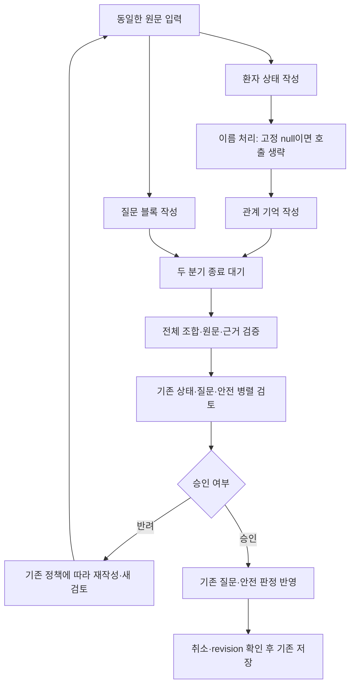

# 질문 작성과 상태 블록 처리 병렬화

후속 실제 로컬 모델 검증에서 Mac `gemma4:12b` 합성 4개 사례·실제 API 저장 사례가 모두 통과했고, DB 포함 전체 검사도 2,032개 통과했다. [별도 검증 기록](PARALLEL_TURN_LOCAL_VERIFICATION.md)을 따른다. 아래 검증 결과·미검증 범위는 최초 구현 당시의 기록이다.

2026-11-01. `combined_blocks`의 질문 블록 작성을 상태 블록 처리와 동시에 시작하도록 로컬에 반영했다. `combined` 모드에서 기존 조건에 따라 블록 생성으로 복구하는 경우에도 적용한다. 상태 블록의 내부 순서, 전체 검증, 독립 검토와 승인 후 저장은 유지한다.

## 이전과 현재

| 항목 | 이전 | 현재 |
| --- | --- | --- |
| 상태 블록 | 환자 상태 → 이름 → 관계 기억 | 동일한 순차 처리 |
| 질문 블록 | 관계 기억 완료 후 작성 | 환자 상태 작성과 동시에 시작 |
| 전체 조합 검증 | 네 블록 완료 후 실행 | 두 분기 모두 완료 후 실행 |
| 상태·질문·안전 검토 | 조건에 따른 병렬 검토 | 그대로 유지 |
| 정상 작성 호출 수 | 이름 추출 시 4회, 고정 null 이름이면 3회 | 동일 |
| 정상 최종 O4 호출 수 | 18회 | 동일, 이번 변경 대상 아님 |

모델 호출을 제거하는 변경은 아니다. 서버가 동시 처리를 지원한다면 작성 구간의 대기는 대략 `상태 체인 시간 + 질문 시간`에서 `max(상태 체인 시간, 질문 시간)`으로 바뀐다. 단일 추론 슬롯에서는 서버가 요청을 직렬로 처리할 수 있으므로 실제 시간 단축률을 주장하지 않는다. 비적응형·최종 상태 갱신에서는 질문 블록을 새로 생성하지 않는다.

## 입력·검토·저장 보존

- 질문 작성에는 기존과 같이 원문 기반 입력을 보내며 `generated_blocks`를 넣지 않는다.
- 상태 블록에는 앞선 상태 블록만 전달한다. 질문이 먼저 끝나도 이름·관계 기억 입력이나 복구 캐시 키에 질문 결과가 섞이지 않는다.
- 프롬프트·스키마·블록 검증과 전체 조합 검증을 유지한다. 일부 블록의 성공은 승인 상태가 아니다.
- 모든 생성이 끝난 뒤 기존 독립 검토를 실행한다. 의미적 반려의 초안·검토 쌍, 확인된 위험, 문맥에 따른 질문 생략과 재작성 정책을 유지한다.
- 저장용 `state_agent.stages`는 기존 상태 → 질문 → 검토의 논리 순서를 유지한다. 실제 요청·진행 이벤트는 병렬 순서를 따를 수 있다.
- `server.js`의 답변 pending 저장, `updateState()` 완료 대기, 취소·revision 확인과 `model_update` 저장 진입점은 변경하지 않는다. DB 스키마·최종 상세 저장·카드 화면도 변경하지 않는다.

## 실패·취소·복구

기존 병렬 검토의 실행 함수를 `parallelTurnTasks`로 공유한다. 분기별 operation 복사본으로 토큰 정책·재시도 상태를 분리한다. 개별 요청이 기존 재시도 범위를 소진하여 실패하면 형제 분기를 취소하고 모두 종료될 때까지 기다린 후 최초 원인 오류를 반환한다. 부모 operation은 형제 오류 때문에 직접 취소하지 않는다.

구조 오류의 복구 캐시는 **취소 전에 검증이 완료된 블록만** 담는다. 상태는 완료한 선행 블록을, 질문은 독립적으로 완료한 질문 블록을 재사용할 수 있다. 요청·문맥·프롬프트·입력·스키마·재작성 단계가 일치해야 하고 재사용 값도 다시 검증한다. 실패한 블록, 취소 후 늦게 도착한 값, 통신 실패·사용자 취소 결과는 보존하지 않는다. 재사용 후에도 전체 조합 검증과 새 독립 검토를 거친다.

병렬 시작 때문에 오류 상황에서 기존에는 시작하지 않던 질문 요청이 실행될 수 있다. 실패 시 총 호출 수까지 줄어드는 최적화는 아니다.

## 구현 후 검토

신규 회귀 10개는 직접 블록 모드·구조 복구 모드의 동시 시작, 상태 내부 순서, 질문 선완료 시 입력 격리, 고정 null 이름·비활성 질문, 실패·외부 취소 종료 대기, 늦은 응답 폐기, 완료 블록 복구, 원문 변경 무효화와 전체 조합 검증 차단을 확인한다. 변경 전 격리 소스에서는 핵심 동시 시작 검사 2개가 실패했고 변경 후 통과했다.

구현 후 독립 코드 검토에서 추가 결함은 발견되지 않았다. 기존 회귀 중 순차 요청 순서·마지막 요청 위치·실패 호출 수를 가정한 검사를 병렬 동작에 맞게 수정했다. 원문·스키마·반려 조건과 승인 전 검토 차단 검사는 유지했다.

사용자가 허용한 로컬 Ollama `gemma4:12b` 검토 API에 코드 검토를 요청했지만 연결 시간 초과로 결과를 받지 못했다. 따라서 실제 모델 검토나 추론 성능 검증을 완료했다고 보고하지 않는다.

## 검증 결과

| 검사 | 결과 |
| --- | --- |
| 신규 질문 작성 병렬 회귀 | 10개 통과 |
| 독립 검토자가 실행한 생성·검토 병렬 회귀 | 19개 통과 |
| 순차 실행 가정 수정 후 관련 회귀 | 62개 통과 |
| 전체 앱 `env -u TEST_DATABASE_URL node --test tests/*.test.js` | **1,947개 통과, 실패 0개, 85개 건너뜀** |
| `node scripts/check.js`, `node --check app/src/relationship-turn.js` | JavaScript 구문·JSON 검사 통과 |
| `git diff --check` | 통과 |

전체 검사 로그는 `/private/tmp/hop-question-parallel-verified.log`에 남겼다. 실행 검사는 합성 응답과 로컬 테스트 HTTP 서버를 사용했으며 실제 DB가 필요한 85개는 실행하지 않았다.

## 적용 경계

로컬 소스·검사·문서만 수정했다. GPU 서버·SSH·운영 DB를 사용하지 않았고 실행 서비스 재시작·배포·GitHub 푸시도 하지 않았다. 실제 DB가 필요한 검사는 별도 검증 범위로 남는다.

관련 파일: [실행 코드](../src/relationship-turn.js), [신규 회귀](../tests/parallel-turn-draft-blocks.test.js), [블록 복구 회귀](../tests/validated-block-recovery.test.js), [이전 검토 병렬화](PARALLEL_TURN_REVIEWS.md).
