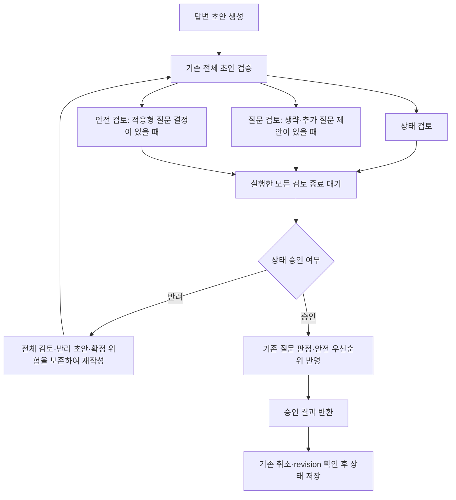

# 답변 상태·질문·안전 검토 병렬화

후속 요청의 질문 작성·상태 처리 병렬화는 [별도 구현 기록](PARALLEL_TURN_DRAFT_BLOCKS.md)을 따른다. 아래는 검토 병렬화 작업 당시의 범위와 검증 기록이다.

사용자가 요청한 답변 검토 병렬화를 로컬 소스에 반영했다. `combined`와 `combined_blocks`에서 **전체 초안 검증이 끝난 뒤** 상태 검토, 조건부 질문 검토, 안전 검토를 함께 시작한다. 질문 작성·상태 블록 작성·최종 카드·기관 분류의 실행 순서는 이번 변경 대상이 아니다.

## 실행 흐름

그림의 재작성·검토 재시도 횟수는 기존 정책을 따른다. 새로운 무제한 루프나 시간 제한을 추가하지 않는다.

| 조건 | 이전 | 현재 | 정상 검토 호출 수 |
| --- | --- | --- | ---: |
| 적응형 답변, 생략·추가 질문 제안 있음 | 상태 → 질문 → 안전 | 상태 / 질문 / 안전 동시 시작 | 3 → 3 |
| 적응형 답변, 질문 제안 없음 | 상태 → 안전 | 상태 / 안전 동시 시작 | 2 → 2 |
| 비적응형 상태 갱신 | 상태 검토 | 상태 검토 | 1 → 1 |

별도 활성화 옵션 없이 해당 두 모드의 검토 실행에 적용한다. `staged` 경로와 기존 상태 모드 선택은 변경하지 않는다. 실제 실행 중인 앱 복사본·환경 설정은 변경하지 않았다.

## 기존 검토·저장 계약

- 각 검토의 프롬프트, 입력, 원문·근거, 스키마, 검증기와 개별 요청 재시도는 유지한다. 질문 제안이 없으면 질문 검토를 새로 만들지 않는다.
- 세 검토는 같은 검증된 초안과 원문을 읽는다. 질문 검증 중 원래 결정을 변경하지 않고, 모든 결과가 준비된 뒤 기존 `applyQuestionReview`와 안전 판단을 반영한다.
- 상태의 의미적 반려는 실행 실패와 구분한다. 다른 검토도 끝까지 받아 `previousReview`와 `previousDraft`의 짝을 유지하고, 이미 독립 검토에서 확인한 위험을 `previousDanger`로 다음 재작성에 전달한다.
- 긴급 판정이 나면 기존과 같이 생략 목록과 추가 질문을 비운다. 문맥상 불필요한 질문을 생략하는 기존 기능도 유지하며, 생략을 답변 사실로 저장하지 않는다.
- 완료 순서와 관계없이 저장용 `state_agent.stages`는 상태·질문·안전의 논리 순서를 유지한다. HTTP 진단·진행 이벤트는 실제 실행 순서를 따를 수 있다.
- 기존 서버는 `updateState()` 완료와 취소 확인 뒤 승인 상태 저장을 시작한다. 원답변의 pending 저장은 기존대로 유지하며, 일부 검토만 성공했다고 승인 상태를 반환하거나 저장하지 않는다.
- DB 스키마, 저장 함수, 카드 디자인, 최종 `conversation_detail` 계약은 변경하지 않는다.

## 실패·취소 경계

최대 세 검토가 공통 자식 취소 controller를 사용한다. 검토가 개별 재시도를 소진한 뒤 통신·인증·형식 오류로 실패하면 나머지 분기를 취소하고 `Promise.allSettled`로 모두 정리될 때까지 기다린다. 그 뒤 최초 원인 오류를 반환한다. 부모 operation은 자식 오류 때문에 직접 취소하지 않으므로 기존 재시작 정책이 원래 오류를 판단할 수 있다.

사용자 취소·부모 deadline은 자식 검토로 전달된다. 취소 후 늦게 도착한 정상 응답도 폐기하며, 다른 분기가 남아 있는 동안 재작성·operation 재시작·승인 반환으로 진행하지 않는다.

검토마다 operation의 얕은 복사본을 사용한다. `tokenPolicy`와 `tokenPolicyDirty`는 분리하고 취소 controller·계측·검증된 정책 캐시·복구 컨텍스트는 공유한다. 한 검토가 서버 정책을 갱신해도 다른 검토의 이전 출력 예산에 새 revision이 섞이지 않는다.

## 구현 후 검토·수정

구현과 회귀 검사를 추가한 뒤 두 독립 검토를 수행했다. 한 검토에서 **토큰 정책 갱신과 다른 검토의 형식 재시도가 겹치는 경합**을 발견했다. 같은 operation 객체를 공유하면 새 revision과 옛 출력 한도를 함께 전송해 요청이 실패했다.

합성 HTTP로 수정 전 `MODEL_UPSTREAM_ERROR`를 재현한 뒤, 검토별 operation 상태를 분리해 수정했다. 수정 후에는 각 요청이 자기 revision·예산을 유지하고 서버의 409 응답을 통해 새 정책을 받아 정상 완료했다. 재검토에서 추가 지적은 없었다.

기존 회귀 검사의 순차 요청 수·발송 순서·동일 operation 객체 가정도 병렬 동작에 맞게 수정했다. 감사 누락·unknown 오류·잘못된 질문·구조 오류의 거절 조건은 유지했다. 기존에는 상태 검토 실패 때문에 시작하지 않던 안전 검토가 이미 실행될 수 있으므로, 실패 사례의 호출 수까지 감소한다고 주장하지 않는다.

## 검증 결과

| 검사 | 결과 |
| --- | --- |
| 신규 병렬 검토 회귀 | **9개 통과**. 변경 전 코드에서 동시 시작 검사 2개 실패, 정책 경합 수정 전 새 회귀 검사 실패를 각각 확인 |
| 정책 경합 수정 후 관련 검사 | **225개 통과**, 실패 0개 |
| 전체 앱 `env -u TEST_DATABASE_URL node --test tests/*.test.js` | **1,937개 통과, 실패 0개, 85개 건너뜀** |
| `node scripts/check.js` | JavaScript 구문·JSON 검사 통과 |
| 독립 재검토 | 미해결 지적 없음 |

신규 검사는 세 응답을 보류한 상태에서 모든 검토가 시작됐는지 확인한다. 응답을 역순으로 완료해도 입력·스키마·최종 결과·저장용 단계 순서가 같은지, 원래 오류와 부모 재시작 경계가 유지되는지, 취소 후 늦은 응답이 버려지는지 확인한다. 독립 검토 Gateway 라우팅과 guarded token policy 조회 공유도 포함한다.

실제 DB가 필요한 85개 검사는 실행하지 않았다. 기존 DB API 검사의 발송 순서 기대도 수정했지만 실제 DB 통과로 보고하지 않는다. 모든 실행 검사는 합성 응답 또는 로컬 테스트 서버를 사용했다.

## 적용 경계

사용자 지정대로 **로컬 소스·테스트·문서만 변경**했다. GPU 서버·SSH·실제 모델 API·운영 DB에 접속하지 않았고, 실행 서비스·GPU 대기열·배포 설정을 변경하거나 GitHub에 추가 푸시하지 않았다.

현재 GPU bridge 구현은 물리 추론 1슬롯이다. 이번 변경은 앱의 독립 검토를 동시에 제출하게 하며, 실제 GPU 추론의 병렬 실행이나 처리시간 단축을 보장하지 않는다. 정상 모델 호출 수는 동일하고 최종 O4 18회도 그대로다.

관련 코드: [검토 실행](../src/relationship-turn.js), [회귀 검사](../tests/parallel-turn-reviews.test.js), [기존 저장 진입점](../src/server.js), [이전 최적화](REMAINING_MODEL_OPTIMIZATIONS.md).
