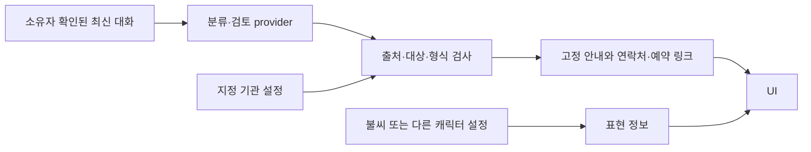

# 당사자 도움 연결 및 캐릭터 계약 v1

2026-10-18. 이 문서는 서버 연결 계층의 구현 계약이다. 위험 분류 모델과 UI는 별도 담당자가 이 계약에 맞춰 연결한다. 불씨 이미지는 아직 없으며 기본값은 글 안내다. 기관 연락처와 별도 이용 자격 설정은 모델 담당자가 추가했으며, 로컬 실제 추론으로 연결 경로를 검증했다. 서비스 기본 실행 경로의 provider 주입과 UI 연결은 별도다.

## 역할과 경계



- `src/referral-guidance.js`: 현재 대화 조회, 서버 provider 호출, 응답 검증, 수정·삭제 경합 방지, 고정 안내, 표현 메타데이터 결합.
- `src/referral-directory.js`, `seeds/referral-institutions.json`: 지정 기관 등록과 연락처 검증. 모델은 기관 ID만 선택한다. 모델이 URL·전화번호·안내 문장을 만들어 반환할 수 없다.
- `src/guide-characters.js`, `seeds/guide-characters.json`: 이름·이미지·상태별 자산. 판단·기관·안내 문장·모델 프롬프트를 캐릭터 설정에 넣을 수 없다.
- `server.js`: 기존 세션·CSRF·소유자 검사를 통과한 요청만 위 모듈로 연결한다.

기관 접수, 상담 내용 전송, 자동 전화, 예약 확정은 구현하지 않는다. 반환 링크는 사용자가 선택해서 여는 방식이다. 이 API는 저장을 수행하지 않으므로 기존 암호화 대화·기록·리비전과 DB 스키마를 변경하지 않는다. 분류 결과도 영구 저장하지 않는다.

## 모델 담당자 연결

`createApp({referralProvider: async input => plan})`으로 서버에서 주입하거나, `ModelGateway`에 `async referralGuidance(input)`을 구현한다. 명시적으로 주입한 provider가 우선한다. 현재 기존 모델에 이 메서드는 없으므로 기본 응답은 `model_unavailable`이다. 테스트의 합성 provider는 모델 성능 검증을 뜻하지 않는다.

입력:

```js
{
  schema_version: '1.0',
  subject: 'patient',
  context,            // buildContext(현재 저장된 intake)
  sources,            // safetySources(context): id, subject, question_id, components
  institutions,       // 현재 활성 지정 기관의 ID·이름·지원 긴급성·정적 연락처
  existing_safety,    // {urgent:boolean, evidence_source_ids:[]} 서버가 현재 전체 근거로 검증
  intake_id, revision,
  request_id,
  signal              // 20초 기본 deadline의 AbortSignal; provider도 취소를 준수
}
```

아래 기본 응답 필드는 모두 필수다. 선택적 `safety_alert` 이외의 추가 필드는 거절한다:

```js
{
  schema_version: '1.0',
  subject: 'patient',
  urgency: 'undetermined',
  reviewed: false,
  evidence_source_ids: [],
  institution_ids: [],
  model_version: 'your-version'
}
```

`urgency`는 미래의 자해·자살 확률이나 진단이 아니라 **현재 필요한 도움의 긴급성**이다.

| 값 | 연결 목적 |
| --- | --- |
| `immediate` | 즉시 안전 확보와 긴급 도움. 일반 예약을 기다리게 하지 않음 |
| `soon` | 가능한 빠른 상담 연락 |
| `planned` | 상담 연락처·예약 방법 안내. 안전 판정이나 치료 제외를 뜻하지 않음 |
| `undetermined` | 정보·검토가 부족해 긴급성을 판단할 수 없음 |

`reviewed`는 모델이 스스로 선언하는 승인 토큰으로 쓰지 않는다. 모델 담당 provider가 별도 검토를 수행하고, 부정·과거·인용·정정·실제 행위자 및 불확실성을 확인한 뒤 채워야 한다. 서버는 형식·출처 존재를 검증하며 의미적·임상적 타당성을 입증하지 않는다. 모든 응답의 `clinically_validated`는 `false`다.

- `subject`는 반드시 `patient`. 질문의 `sources[].subject`가 `supporter`여도 그 답변 속에 당사자 보고가 포함될 수 있다. 질문 분류만으로 실제 위험 대상자를 판단하면 안 된다. provider는 보고된 당사자의 상황과 지지자 자신의 상황을 구분해야 한다.
- `sources`의 문항 전체 `safety_…` ID를 선택한다. 개별 검색 조각의 ID와 혼용하지 않는다. 인용문을 잘라 돌려주지 않는다. 후속 정정·부정이 포함된 전체 문항으로 판단한다.
- `undetermined` 이외의 결과에는 현재 `sources`에 존재하는 근거가 한 개 이상 필요하다. 중복·존재하지 않는 근거와 미등록 기관 ID는 502다.
- 검토되지 않은 `planned`는 `undetermined`로 보류한다. 검토되지 않은 `soon/immediate` 우선순위는 지우지 않고 `needs_review:true`를 함께 반환한다. `soon`은 검토 일치 여부와 관계없이 전문가 확인이 필요한 상태로 표시한다.
- 기존 `guide.top`이나 `assessment.safety:false`를 위험 분류로 변환하지 않는다. 현재 위험이 확인된 상황에서 provider 오류·검토 실패를 안전 판정으로 해석하지 않는다.
- 기관의 지역·연령·서비스 자격 등 실제 적합성은 명시된 운영 기준을 확보한 뒤 provider에서 확인해야 한다. 현재 자격 기준은 `seeds/referral-eligibility.json`에 분리돼 있다. 이러한 기준이나 임상 판단을 임의로 만들어 활성화하지 않는다.
- provider의 오류·시간 초과는 개인정보 없는 `model_unavailable`로 반환한다. 내부 오류 메시지를 사용자나 로그에 넘기지 않는다. 형식이 잘못된 정상 응답은 `REFERRAL_INVALID_RESPONSE` 502로 거절한다. 단, 현재 전체 근거로 검증된 기존 긴급 안내가 있으면 HTTP 200의 `model_unavailable`, `failure_code:REFERRAL_INVALID_RESPONSE`와 함께 그 안내를 보존한다. 이는 모델 성공을 뜻하지 않으며 마지막 리비전·삭제 검사는 그대로 적용한다.

같은 소유자·대화·리비전의 동시 요청은 provider 실행을 공유한다. 실행 완료 뒤 결과를 캐시하지 않는다. 모델 입력에는 캐릭터를 전달하지 않는다. 동일 입력에 캐릭터만 바꾼 호출의 판단 차이를 막으려면 UI가 이미 받은 안내를 그대로 유지하고 표현 정보만 교체한다. 모델 자체의 비결정성은 캐릭터 계층에서 통제하지 않는다.

### 병행 개발 중인 분류 모듈과의 접점

별도 모델 작업에서 `risk-classification.js`, `referral-provider.js`, `institution-routing.js`가 추가됐다. 이 서버 작업은 해당 파일을 수정하거나 자동 호출하지 않았다. `classifyForReferral`의 분류·정책과 본 문서의 HTTP 전달 계층은 역할이 다르며, 서버 provider에서 명시적으로 변환한다.

- `intake_id/revision/context`로 모델 측 snapshot을 만들고 `assertCurrentTriage` 검증을 유지한다.
- **당사자** `patient_action`의 `emergency/prompt_assessment/routine_support/insufficient_information`을 각각 `immediate/soon/planned/undetermined`로 대응한다. 지지자 등 다른 사람의 응급상황을 포함할 수 있는 전체 `action`을 당사자 분류로 복사하면 안 된다. 비당사자·행위자 불명 안전 안내는 아래 `safety_alert`로 별도 전달한다.
- 모델 측 `triage_…` ID는 본 서버의 `safety_…` ID와 다르다. 단순 접두사 교체는 금지한다. 같은 주체·문항·전체 components임을 대조한 근거만 서버 입력 `sources`의 ID로 반환한다. 대응 불가하면 보류한다.
- 기관 연락처는 이 서버의 directory 한 곳에만 둔다. 모델 측 `routeInstitutions`는 `institutions:directory.list().institutions`와 ID별 `eligibilityById`를 결합해 지역·연령·서비스·검증 유효기간을 확인한다. 사용자가 명시한 자격 정보만 전달하고 결과 기관 ID를 이 서버에서 조회한다. 미등록 ID는 거절한다. 단순한 `urgencies` 설정을 상세 자격 검증의 대체물로 쓰지 않는다.
- 분류·기관 계약이 확정되기 전에는 자동 연결하지 않는다. 현재 provider 미연결 기본값이 이를 유지한다.

### 위험 대상의 분리

provider는 선택적으로 아래 필드를 추가할 수 있다. 생략 또는 `null`이면 별도 경고가 없다. 이 필드를 브라우저 요청으로 받지 않는다.

```js
safety_alert: {
  urgency: 'immediate', // immediate 또는 soon
  subjects: ['supporter'], // patient/supporter/other/unclear, 중복 없이 최소 1개
  evidence_source_ids: ['safety_…'] // 현재 서버 sources의 검증 가능한 근거 최소 1개
}
```

`assessment.urgency`는 당사자의 분류를 유지한다. `guidance.urgency`는 당사자 분류와 별도 경고 중 높은 대응 우선순위이며 기관 선택·고정 안내·attention 표정에 사용한다. 예를 들어 당사자는 `planned`, 지지자 경고가 `immediate`면 당사자를 응급으로 재분류하지 않으면서 긴급 도움 안내를 유지한다. API는 `safety_alert`의 urgency/subjects만 반환하고 내부 근거 ID는 표시하지 않는다. 별도 경고는 항상 `needs_review:true`다. 기존 긴급 안내는 현재 상태가 `ready`이고 독립 검토 근거가 `current_physical_danger`이며 모든 근거가 최신 전체 문항과 일치할 때만 provider에 전달한다. 불일치하면 `REFERRAL_SAFETY_STALE` 409다. provider에는 복사본을 전달하므로 provider의 변경으로 기존 경고를 지울 수 없다. 새 경고와 기존 경고가 함께 있으면 새 `safety_alert`의 대상·긴급성을 유지하고, 기존 행위자 불명의 긴급 경고는 `preserved_safety_alert:{urgency:"immediate",subjects:["unclear"]}`로 별도 반환한다. 새 경고가 없으면 기존 경고가 `safety_alert`에 들어간다. `guidance.urgency`는 두 경고를 모두 반영한다. UI는 `subject:patient`만 보고 경고 대상자를 단정하지 않는다.

## 기관 등록

`seeds/referral-institutions.json`에 실제로 지정·확인한 기관만 추가한다. 아래는 **연결하면 안 되는 합성 예시**다. 실제 운영 목록에는 포함하지 않는다.

```json
{
  "schema_version": "1.0",
  "institutions": [{
    "id": "synthetic-center",
    "name": "합성 검증 기관",
    "active": false,
    "urgencies": ["planned", "undetermined"],
    "phone": null,
    "booking_url": "https://counselling.example.org/book",
    "last_verified_on": "2026-10-18"
  }]
}
```

`phone` 또는 `booking_url`이 필요하다. 예약 링크는 인증정보·fragment 없는 HTTPS만 허용한다. 상담 내용이나 개인정보를 URL에 넣지 않고, 요청 값을 링크에 추가하지 않는다. 기관별 지원 범위가 확인된 경우에만 `urgencies`에 값을 추가한다. 특히 긴급 응대가 검증되지 않은 일반 기관에 `immediate`를 넣지 않는다. `last_verified_on`은 확인일 기록이지 현재 운영 중임을 자동 보증하지 않는다. 운영자가 연락처와 범위를 유지·검증해야 한다.

`immediate` 응답에는 전화 액션만 포함하고 일반 예약 액션 및 남는 연락 수단이 없는 기관은 제외한다. 긴급성에 맞는 활성 기관이 없으면 빈 배열과 `no_matching_institution` 또는 `institutions_unconfigured`를 반환하며 긴급 안내 문장은 유지한다. UI는 이를 기관 연결 성공으로 표시하면 안 된다. 설정 변경은 앱을 새로 시작한 뒤 반영된다. 기존 실행 중인 앱은 이번 작업에서 재시작하지 않았다.

## UI 담당자 연결

1. 기존 `/api/bootstrap`으로 세션·CSRF를 얻는다.
2. `GET /api/guidance/characters`로 기본 캐릭터와 선택지를 받는다.
3. `GET /api/guidance/institutions`로 등록된 연락처를 조회할 수 있다. 미분류·모델 실패 상태여도 수동 연락 방법을 찾을 수 있다.
4. `POST /api/intakes/{id}/guidance`, JSON `{ "revision": 0, "character_id": "bulssi" }`와 `X-CSRF-Token`으로 안내를 요청한다. `character_id`는 생략 가능하다.

응답:

```js
{
  schema_version:'1.0', revision:0, subject:'patient', status:'model_unavailable',
  assessment:{urgency:'undetermined', needs_review:true, clinically_validated:false},
  safety_alert:null, preserved_safety_alert:null, failure_code:null,
  guidance:{
    message:'…', urgency:'undetermined', urgent:false, institutions:[], connection_mode:'contact_links',
    automatically_contacted:false, conversation_shared:false
  },
  presentation:{
    id:'bulssi', display_name:'불씨', avatar_path:null, state_assets:{},
    state:'speaking', asset_path:null, fallback:'text', animation_optional:true
  }
}
```

상태는 `ready`, `needs_review`, `model_unavailable`, `no_matching_institution`, `institutions_unconfigured`다. 어느 상태든 `guidance.urgency`, `guidance.urgent`와 `message`를 먼저 존중한다. 당사자 분류는 `assessment.urgency`, 별도 경고 대상은 `safety_alert.subjects`로 구분한다. 상세 검증·모델 버전·개발 정보는 서비스 화면에 나열하지 않는다.

- 401: 세션 필요. 403: CSRF·동일 출처 위반. 404: 다른 소유자 또는 삭제된 대화. 409: 오래된 리비전 또는 `REFERRAL_INPUT_PENDING`/`REFERRAL_SAFETY_STALE`. 422: 잘못된 요청. 502: provider 응답 검증 실패.
- 409 이후에는 최신 대화를 다시 읽는다. 기존 안내를 최신 결과처럼 유지하지 않는다. 대화 수정·삭제 시 UI에 남아 있는 안내도 지운다.
- `presentation`만 교체한다. 캐릭터 대사로 `guidance.message`를 재작성하거나 경고·기관 연락처를 생략하지 않는다. 글을 먼저 표시하고 애니메이션 재생을 기다리지 않는다. 이미지 로드 실패·움직임 줄이기·캐릭터 비활성화에서도 동일한 안내와 링크를 표시한다.
- 기관 링크는 명시적 사용자 클릭으로만 연다. `booking`은 `rel="noopener noreferrer"`, `referrerpolicy="no-referrer"`를 적용한다. 자동 팝업이나 상담 내용을 채운 URL을 만들지 않는다. 전화 링크도 버튼을 누르기 전에는 실행하지 않는다.
- 이름·안내는 `textContent` 등 일반 텍스트로 렌더링한다. 이미지 대체 텍스트를 제공하되 긴급 안내는 이미지나 음성에만 넣지 않는다.

## 새 캐릭터 추가

`seeds/guide-characters.json`의 `characters` 배열에 고유 `id`, `display_name`, `avatar_path`, `state_assets`를 추가한다. `default_character_id`로 기본 안내자를 바꾼다. `state_assets`의 키는 `idle`, `listening`, `speaking`, `attention`만 허용한다. 파일은 `public/characters/{id}/` 아래에 넣고 `/characters/{id}/avatar.webp`처럼 참조한다. PNG/WebP/JPG/JPEG/GIF/AVIF를 지원한다. 외부 URL·SVG·HTML·스크립트·경로 이동은 허용하지 않는다.

빠진 상태 이미지는 기본 이미지, 이미지가 없으면 글로 대체한다. 삭제된 캐릭터 ID는 기본 캐릭터로 대체되어 도움 안내를 막지 않는다. 캐릭터 이미지는 UI 담당자가 제공할 수 있으며 모델·기관 규칙을 수정할 필요가 없다.

## 검증 및 설계 근거

단위 테스트: `node --test tests/guide-characters.test.js tests/referral-directory.test.js tests/referral-guidance.test.js`.
HTTP 테스트: 별도 합성 DB의 `TEST_DATABASE_URL`을 지정하고 `node --test tests/referral-api.test.js`. 실제 서비스의 `.env`나 기존 DB를 사용하지 않는다. HTTP 테스트는 매번 임의 스키마·암호화 키·포트를 만들고 자신이 만든 스키마만 삭제한다.

[NICE NG225 §1.6](https://www.nice.org.uk/guidance/ng225/chapter/Recommendations#risk-assessment-tools-and-scales)는 미래 자살·반복 자해 예측과 치료 제공 판단에 전역적 저·중·고 위험 분류를 쓰지 않도록 권고한다. 이 때문에 본 연결 계약은 도움의 긴급성으로 범위를 한정하고 안전 판정·치료 배제에 사용하지 않는다. [WHO 보건 AI 윤리 지침](https://www.who.int/publications/i/item/9789240029200)의 자율성과 사람의 감독 원칙을 참고해 자동 접수와 데이터 전송을 넣지 않았다. 이 설계와 합성 테스트가 임상 검증을 대신하지 않는다.

## 실제 앱 자동 전달과 개발자 등록 문장 (2026-10-18)

사용자 지정: 모델 담당은 모델 개발에 집중하고, 이 연결 계층이 UX/UI와 내부 로직을 담당한다. 경고를 수동 버튼으로 요청하는 방식이 아니라 확인된 답변 이후 자동으로 판단하고 불씨에게 전달한다. 불씨는 모델이 생성한 대사를 말하지 않는다.

- `seeds/referral-messages.json`: 개발자가 등록하는 네 긴급성별 `id`와 `text`. `text`를 수정하고 앱 서버를 다시 시작하면 적용된다. 공백·줄바꿈을 그대로 전달하며 변수 치환·추가 생성·캐릭터 재작성은 없다. 비어 있거나 중복된 ID·빠진 유형·임의 추가 필드는 시작 시 거절한다.
- `src/referral-messages.js`: 설정 검증 및 복사본 관리. 응답 `guidance.message_id`가 선택된 문장을 식별한다. 사용자 입력이나 모델 출력으로 문장을 등록·수정할 수 없다.
- `public/js/components/ReferralGuide.js`: 서버가 `referral_available:true`로 보낸 서버에 저장된 대화 리비전에서 자동 호출한다. 이름만 입력한 단계에는 호출하지 않는다. 대화 모델이 실패해도 구조 검증·저장이 끝난 `modelPending.prepared` 답변은 독립 분류할 수 있다. 대화 모델의 실패 복구 또는 미완료 대화 이어가기에서 최신 저장 리비전을 받아 자동 요청한다. `immediate`/`soon` 또는 별도 안전 경고가 있을 때 불씨와 등록 문장을 보여 준다. 판단 보류를 긴급 경고로 과장하지 않으며 모델 실패는 확인 실패와 재시도로 표시한다.
- 질문 답변 입력·되돌리기·수정·대화 삭제·화면 이동·새 대화 시 이전 요청의 표시 권한을 무효화한다. 늦은 결과는 새 화면에 경고를 복원하지 못한다. 같은 확정 리비전 중복 호출을 방지하며 질문 답변을 기다리게 하지 않는다.
- 현재 `bulssi`의 실제 이미지 자산은 미등록이므로 이름과 텍스트로 표시한다. 캐릭터 등록은 `guide-characters.json`을 사용하며 경고 문장·기관 정책과 분리되어 있다.

실행 설정은 서버 환경변수로 명시한다:

```text
REFERRAL_GUIDANCE_ENABLED=true
REFERRAL_MODEL_BASE_URL=http://127.0.0.1:11434/v1
REFERRAL_MODEL_NAME=gemma4:12b
REFERRAL_COUNTRY=KR
```

위 예시는 로컬 설치 모델을 안내 분류에 사용하는 설정이다. `REFERRAL_MODEL_BASE_URL`을 생략하면 이미 구성된 앱 gateway를 사용한다. 외부 HTTPS 제공자를 지정하면 별도 `REFERRAL_MODEL_API_KEY`가 필요하다. 키는 브라우저에 전달하지 않는다. 국가가 명시되지 않으면 기관 자격을 추측하지 않는다. 현재 설정은 한국 서비스 운영 범위를 명시하며 나이·세부 지역은 미상으로 전달해 해당 정보가 필요한 기관을 임의 추천하지 않는다.

원격 모델의 실패를 기다렸다가 자동으로 다른 모델을 선택하는 정책은 추가하지 않았다. 모델 이용이 어려울 때는 위 명시적 로컬 설정으로 실제 앱을 실행한다. 기존 질의응답 모델 설정과 안내 분류 모델 설정은 분리할 수 있다. 안내 분류 제한은 활성화 시 120초다.

미완료 대화는 실제 앱의 「내 기록 → 이어가기」에서 복귀한다. 조회·복귀는 기존 답변이나 기록을 덮어쓰지 않으며, 삭제·화면 이동과 경합하면 이전 조회 결과를 반영하지 않는다. 대화 모델이 생성한 다음 질문이 승인되지 않았더라도 이미 저장된 사용자 답변을 위험 분류 근거로 읽을 수 있다. 이는 그 모델 출력을 승인하거나 대화를 완료 처리하는 동작이 아니다.

### 자연스러운 대화와 개입 강도 (2026-10-18 사용자 요청)

- 별도 위험 설문이나 위험한 답변을 유도하는 문항을 추가하지 않는다. 일반 대화에 제출한 답변을 기존 근거·인물·시점 검증 경로로 살핀다. 점수나 위험 등급을 사람의 라벨처럼 표시하지 않는다.
- `planned`/`undetermined`에 별도 경고가 없으면 불씨 경고를 표시하지 않는다. `soon`은 개발자가 정한 짧은 제안으로 표시하며 기관 정보는 사용자가 `도움받을 곳 살펴보기`를 열면 보인다.
- `immediate`와 이미 확인된 긴급 경고는 필요한 문장과 전화 링크를 곧바로 표시한다. 비긴급 표현 개선을 이유로 긴급 안내를 접거나 숨기지 않는다. 대상이 서로 다른 경고는 자연스러운 문장으로 구별한다.
- 모델 연결 실패를 심리적 위험의 증거로 취급하지 않는다. 중립적인 확인 실패와 재시도만 표시하며 이미 확인된 긴급 안내는 유지한다. 실패를 안전 판정으로 해석하지 않는다.
- `007_natural_prompts.sql`은 병원·상담을 먼저 제시하던 예시와 회복·어려움을 전제하던 기본 질문 5개의 문구를 조정한다. 기존 기본값 전체와 설정이 일치하는 질문만 갱신하며, 관리자 편집 및 저장된 대화의 질문 스냅샷·답변·기록은 변경하지 않는다. 새 대화부터 적용한다. 과거 초기 시드와 적용된 마이그레이션은 이력 보존을 위해 수정하지 않는다.
- 분류 임계값과 모델 프롬프트는 이 UI 변경에서 수정하지 않았다. `reviewed:false`만으로 `soon`을 숨기지 않는다. 분류 근거와 자연스러운 후속 질문 개선은 모델 담당자와 별도로 맞춘다.

## 대화 중 제안과 종료 후 원문 카드 통합 (2026-10-22 사용자 요청)

이 절은 위의 2026-10-18 표시 범위 및 기본 비활성 설정을 대체한다. 버전 선택 없이 두 동작을 함께 제공한다.

- 모델 gateway가 있으면 기본적으로 자동 분류를 연결한다. `REFERRAL_GUIDANCE_ENABLED=false`로 명시적으로 끌 수 있다. 모델이 없으면 안내 근거를 만들어 내지 않는다. 별도 분류 모델과 국가를 지정하는 기존 설정은 계속 사용할 수 있다.
- 대화 중에는 `soon`과 `planned` 모두 불씨의 짧은 상담 제안을 표시한다. `undetermined`도 모델이 실제 답변에서 선택한 상담 우려(`guidance.concerns`)가 있으면 같은 제안을 표시한다. 별도 안전 경고·우려가 없는 정보 부족은 숨긴다. 비긴급 문구는 모두 “혼자 감당하지 않아도 괜찮아요. 가까운 시일 안에 도움을 받을 수 있도록, 상담할 곳을 함께 살펴볼까요?”다. `immediate`와 기존 긴급 안내는 행동 안내·전화 링크를 유지한다.
- 대화 종료 후 결과 화면의 카드 영역에 불씨 카드를 추가한다. 같은 분류의 `guidance.concerns`를 원문 인용·이유·상담 추천으로 펼쳐 표시한다. 대화 중에는 원문을 반복 표시하지 않는다. 안내를 수정하거나 화면을 떠나면 이전 원문 카드도 무효화한다.
- provider는 선택 가능한 코드·실제 대상·현재 근거 ID만 전달한다. 선택 항목은 `concerns:[{code,subject,evidence_source_ids}]`이며 최대 100개다. 서버가 검증한 뒤 `guidance.concerns:[{subject,code,reason,quotes:[{question_id,text}]}]`로 반환한다. `reason`은 서버 등록 문장, `text`는 근거 문항의 전체 원문 구성 요소이며 공백·줄바꿈·부정·조건·후속 설명을 자르거나 다시 쓰지 않는다. 전체 문항 인용이므로 문장 단위 위험 위치를 확정했다는 뜻은 아니다.
- 부정·가정 신호와 이름만 있는 근거는 인용하지 않는다. 일반 상담 요청은 위험으로 단정하지 않는다. 이미 확인된 긴급 근거를 보존할 때는 확인되지 않은 신호 코드를 만들지 않고 `code:null`을 사용할 수 있다. 원문은 별도 로그나 기록 필드에 추가 저장하지 않는다.
- 현재 종료 결과 화면에 제공하며, 「내 기록」의 과거 기록 상세에는 이 카드를 별도로 저장하거나 추가하지 않는다. 분류 모델의 실제 의미 정확도와 실행 중인 서버의 재시작은 이 코드 변경의 자동 검증과 구분한다.

### 사용자 제공 불씨 이미지와 시간 제한 제거 (2026-10-22)

- 제공된 투명 PNG 5개를 원본 그대로 `public/characters/bulssi/`에 넣었다. 인사(`idle`/기본 이미지), 확인 중·정보 확인(`listening`), 상담 안내(`speaking`), 공감(`empathy`), 즉시 안전 안내(`attention`)에 등록했다. `planned`는 공감, `soon`은 상담 안내, 근거가 있는 `undetermined`는 확인 이미지, `immediate`는 안전 이미지로 표시한다. 이미지가 없거나 로드에 실패하면 이름과 안내 문장은 계속 표시한다.
- 종료 화면은 불씨 분류를 먼저 마친 뒤 원문 인용 카드를 표시하고 일반 안내 생성을 시작한다. 일반 안내가 지연되거나 실패해도 확인한 원문 카드를 유지한다.
- 사용자 요청으로 앱과 불씨 안내의 기본 총 처리 시간 제한을 제거했다(`timeoutMs:0`). 실패한 검증 결과를 승인하지 않으며, 일시적 실패와 응답 검증 실패는 내부에서 다시 시도한다. 취소·수정·삭제·연결 종료는 중단 신호로 전달한다. 인증·설정·입력 크기 문제는 재시도만으로 해결되는 오류로 취급하지 않는다. 위의 과거 120초 제한 기록은 당시 설정이다.
