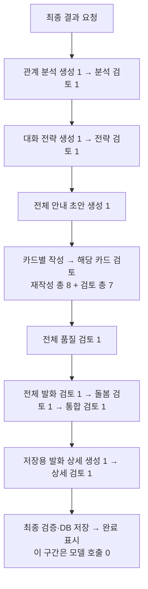
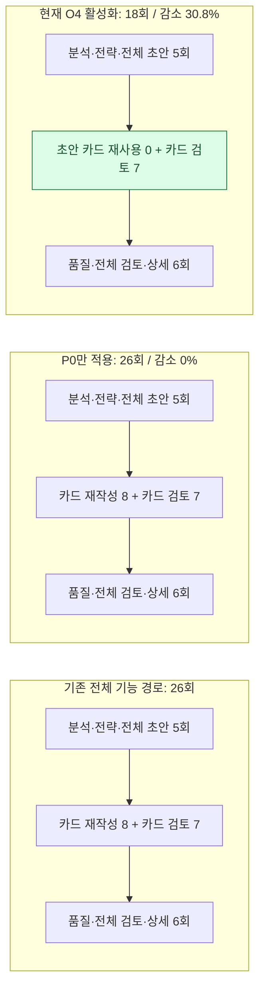
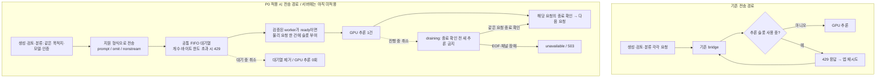

# 모델 사용 순서 — 기존·P0·O4 구현 비교

후속 [전체 모델 사용량 재조사](전체_모델_사용량_재조사_2026-10-31.md)는 답변·긴급·기관·테스트·수정 경로와 로컬 실행본의 적용 상태를 함께 정리한다. O4 구현과 현재 9060 별도 실행본을 구분해야 한다.

**O4를 구현해 정상 최종 생성 26→18회, 8회·30.8% 감소를 로컬 mock HTTP 검사로 확인했다. 생성은 12→4회이며 독립 검토 14회와 저장용 상세를 유지한다.** P0의 목적지·요청 형식·대기열·준비 상태·계측에 이어, O4는 전체 초안 뒤의 중복 카드 작성 8회를 제거한다. 16회는 아직 적용하지 않은 O5 조건부 후보다.

이 비교는 **서버 GPU만 사용하는 전체 기능 모드**를 기준으로 한다. 수정본은 로컬 구현·검증까지 완료했고, 실제 서버 접속·배포는 사용자 승인 전이다. 26/18회는 실제 Gateway에 합성 HTTP 응답을 공급한 정상 경로 검사값이며 실제 GPU 측정값이 아니다. O4는 `MODEL_REUSE_FINAL_DRAFT=true`로 명시적으로 활성화한다. 기본값은 false이며 GPU overlay에는 true를 준비했다. 실행 중인 서비스 설정은 바꾸지 않았다.

## 1. 비교 기준

- `relationship_agent`, `skipFinalExtras=false`, 비긴급 사례 기준이다.
- 최종 생성에 필요한 상태가 이미 있으며, 추가 안전 재검토·테스트 seed 재사용·품질 개선·거절·형식 복구·네트워크 재시도가 없는 경우다.
- **26회는 최종 안내 생성만의 수치다.** 앞선 답변 처리, 기관 분류, 조건부 상태 보완은 별도다.
- 생성과 검토는 같은 서버 모델을 사용하는 별도 요청이다. P0와 O4 모두 독립 검토 요청을 합치거나 삭제하지 않는다.
- 한 번의 생성 POST 시도와 실제 GPU 추론은 다르다. 400·429·연결 실패·대기 취소는 GPU가 추론하기 전에 끝날 수 있다. GET 상태·토큰 한도 조회도 생성 횟수에서 제외한다.

## 2. 최종 생성 순서: 기존 및 O4 비활성 경로

카드 구간의 세부 순서는 다음과 같다. 각 행 안의 순서는 고정되지만 행 사이의 호출은 섞일 수 있다. 앱은 카드 작업을 최대 3개 진행하고, P0 공용 bridge에 적용하면 실제 추론은 한 슬롯으로 직렬 처리한다. 카드별 검토를 통과하면 부분 표시할 수 있으며, 이 시점을 최종 저장 완료로 표시하지 않는다.

| 카드 | 기존·P0의 해당 카드 내부 순서 | 생성 | 검토 | 합계 |
| --- | --- | ---: | ---: | ---: |
| 대화문 `script` | 도입 작성 → 경청 작성 → 제안 작성 → 전체 발화 합성 → 카드 검토 | 4 | 1 | 5 |
| 돌봄 `care` | 카드 작성 → 카드 검토 → 지원 검토 | 1 | 2 | 3 |
| 이렇게 해 보세요 `doList` | 카드 작성 → 카드 검토 | 1 | 1 | 2 |
| 피하면 좋아요 `avoid` | 카드 작성 → 카드 검토 | 1 | 1 | 2 |
| 다음 단계 `next` | 카드 작성 → 카드 검토 → 지원 검토 | 1 | 2 | 3 |
| **카드 구간 합계** | 전체 안내 초안 뒤에 추가로 발생 | **8** | **7** | **15** |

기존에도 카드별 거절은 해당 카드를 고치는 경로가 있다. O4가 제거한 부분은 **거절 여부와 관계없이 전체 초안 뒤에 수행하던 추가 작성 8회**다.

## 3. 기존·P0·O4를 나란히 비교

| 단계 | 기존 | P0만 적용 | O4 활성화 | O4에서 줄인 부분 |
| --- | ---: | ---: | ---: | --- |
| 관계 분석 + 검토 | 2 | 2 | 2 | 유지 |
| 대화 전략 + 검토 | 2 | 2 | 2 | 유지 |
| 전체 안내 초안 | 1 | 1 | 1 | 유지 |
| 대화문 3부분 + 합성 | 4 | 4 | 0 | 초안의 대화문 사용 |
| 나머지 카드 4개 작성 | 4 | 4 | 0 | 초안의 카드 사용 |
| 카드별 검토 | 7 | 7 | 7 | 유지 |
| 전체 품질 검토 | 1 | 1 | 1 | 유지 |
| 전체 발화·돌봄·통합 검토 | 3 | 3 | 3 | 유지 |
| 저장용 발화 상세 + 검토 | 2 | 2 | 2 | 유지 |
| **합계** | **26** | **26** | **18** | **정상 경로 절감 8회** |

O4에서도 카드가 실패하면 해당 카드 수정·재검토 호출이 추가된다. 대화문 하나의 수정 1회·재검토 1회가 필요한 합성 사례는 **20회**였다. 초안 작성과 품질 개선에 기존 카드·발화 작성 요구를 보존했다. JSON·필수 구조·안전 오류는 기존 전체 실패로, 특정 카드 의미 오류는 해당 카드 수정으로 처리한다. 카드별 검토를 통과한 뒤 부분 표시하고, 전체 검토와 상세 생성·검토가 끝난 뒤 기존 저장 경로로 넘긴다.

## 4. P0에서 실제 수정한 전송 순서

FIFO는 **도착한 물리 요청의 순서**를 관리한다. 카드 작업 전체나 operation 전체가 슬롯을 보유하지 않아, 작성 후 같은 GPU로 검토를 요청할 때 교착하지 않는다. 별도 bridge 여러 개를 같은 worker에 붙이면 자동으로 하나의 대기열이 되지는 않는다.

| 변경 | 기존 문제·동작 | P0 수정 | 확정할 수 있는 절감 |
| --- | --- | --- | --- |
| 목적지 | 역할별 설정으로 로컬·서버 혼합 가능 | GPU 전용 opt-in에서 공통 목적지 강제, 충돌 설정 거절 | 전체 논리 호출 수는 그대로. 적용 후 로컬 추론 0이 목표 |
| 요청 형식 | 검토 기본 형식이 GPU API와 맞지 않아 400 가능 | 지원 프로필 적용, 실제 body를 서버 validator와 대조 | 비호환 요청 방지. 실운영 재시도 절감량 미측정 |
| 대기열 | 슬롯 경합 시 즉시 429 | 한도 안에서는 FIFO 대기 | 경합 재전송 감소 목적. P0만으로는 정상 호출 수를 줄이지 않음 |
| 준비·취소 | 정적인 ready 표시·취소 접수만으로는 원격 종료 불확실 | identity·프로세스·종료 계약 확인, 대기 취소 제거, draining | 대기 취소의 실행 0회는 로컬 계약 검사로 확인. 전체 절감률 미측정 |
| 종료·장애 | 막힌 파이프·종료 경합·서버 장애의 400 분류 | 비차단 전송, 파일 번호 무효화, 준비 상태 장애 503 | 정확성 수정이며 정상 호출 감소 아님 |
| 계측 | 자동 복구·검토 위임의 누적 호출 비교 어려움 | operation ID, HTTP 시도 순번, 역할·family 계수 | 계측 자체의 절감 0회. 이후 실측에 사용 |

## 5. 답변 처리·기관 분류는 별도 계산

답변 처리의 정상 호출은 `MODEL_STATE_MODE`에 따라 달라진다. P0·O4는 이 모드를 변경하지 않았다. 기존 기획 표의 6~7회는 `combined_blocks` 기준이며 모든 설정에 공통인 수치가 아니다.

| 상태 생성 모드 | 적응형 질문이 있을 때 순서 | 정상 호출 |
| --- | --- | ---: |
| `combined_blocks` | 상태 → 이름 → 관계 → 질문의 생성 4회 → 상태 검토 → 조건부 질문 검토 → 안전 검토 | 6~7 |
| `combined` | 상태·이름·관계·질문 통합 생성 1회 → 상태 검토 → 조건부 질문 검토 → 안전 검토 | 3~4 |
| `staged` | 관찰·이름 생성 → 관계 생성 → 상태 검토 → 질문 생성 → 안전 검토 → 조건부 질문 검토 | 5~6 |

질문 검토는 생략·추가 질문 제안이 있을 때 실행한다. 적응형 질문이 없을 때는 위 모드 순서대로 4·2·3회다. `combined`가 구조 오류로 블록 생성으로 전환하거나 수정·재시작이 생기면 호출이 추가된다. 최종 생성 직전 상태가 없으면 별도 보완 3회, `safety_review_required`이면 추가 안전 검토 1회가 생길 수 있다.

기관 안내는 별도 `/guidance` 요청 경로다. 캐시와 기존 긴급 신호·원문 유무를 확인한 후, 필요한 경우 **1차 분류 → 독립 2차 분류** 순서로 0~2회 호출한다. 1차가 긴급이면 2차를 생략한다. 최종 안내의 기존 26회·O4 18회에 포함하지 않으며, P0·O4에서 일반 상담의 독립 2차 분류를 제거하지 않았다.

## 6. 얼마나 줄었나

| 비교 | 최종 생성·검토 합계 | 기존 26회 대비 | 상태 |
| --- | ---: | ---: | --- |
| 기존 전체 기능 | 생성 12 + 검토 14 = 26 | 기준 | 비교 기준 |
| P0만 적용 | 생성 12 + 검토 14 = 26 | **0회 / 0%** | 소스 구현·로컬 검사 완료, 서버 미적용 |
| O4 | 생성 4 + 검토 14 = 18 | **8회 / 30.8%** | 명시적 활성화 시 구현·로컬 검사 완료. 수정 없는 정상 경로, 서버 미적용 |
| O4 + O5 | 생성 4 + 검토 12 = 16 | **10회 / 38.5%** | 조건부 후보. 전체 발화·지원 검토의 동등성 입증 전 적용 보류 |
| 기존 `skipFinalExtras=true` | 생성 2 + 검토 11 = 13 | 수치상 13회 / 50% | 전략·품질·저장 상세가 빠지는 기존 별도 모드. 이번 개선 성과가 아님 |

전체 상담의 합계는 `답변별 처리 합계 + 최종 생성 + 기관 요청별 분류 합계 + 조건부 보완 + 수정·재시도`다. 예를 들어 답변 10번을 각각 6회로 처리하고 기관 분류 2회, 나머지 추가 호출이 없다면 기존과 P0는 **88회**다. O4 활성화 시 같은 조건에서 **80회**, 전체 상담 기준 감소는 **9.1%**다. 최종 생성의 30.8%를 전체 상담의 감소율로 사용하지 않는다.

실제 HTTP 재시도·입력/출력 토큰·GPU 점유·대기시간의 감소량은 아직 측정하지 않았다. 서버 전용의 같은 모델·옵션·합성 사례를 기준으로 승인 후 비교해야 한다.

## 7. 근거와 적용 상태

- [O4 구현·검토 후 수정·검증 기록](../../app/docs/FINAL_DRAFT_REUSE.md): 앱 1,880 통과·85 건너뜀·0 실패. 기존 검토·상세 저장 payload 보존 및 품질 개선 프롬프트 수정 확인. 실제 DB·GPU 미검증.
- [P0 구현·독립 검토·검증 기록](../../app/docs/SERVER_GPU_P0.md): 앱 1,858 통과·85 건너뜀, Python 65 통과 기록. 실제 GPU 검증은 아님.
- [최종 생성 순서](../../app/src/relationship-agent.js), [답변 블록·검토](../../app/src/relationship-turn.js), [상태 모드·검토 위임](../../app/src/model.js), [기관 분류](../../app/src/risk-classification.js).
- [GPU 전용 설정](../../app/src/model-config.js), [공통 대기열](../../ai/trained_model_api/inference_queue.py), [HTTP 서버](../../ai/trained_model_api/server.py), [원격 worker 관리](../../ai/trained_model_api/remote_worker.py), [호환성 패치](../../ai/trained_model_api/live_worker_terminal_idle.patch).
- [전체 최적화 기획](모델_호출_최적화_검토_2026-10-31.md). 이번 비교 문서는 로컬 소스만 대조했으며 GPU 서버 접속·실제 모델 추론·배포를 수행하지 않았다.
