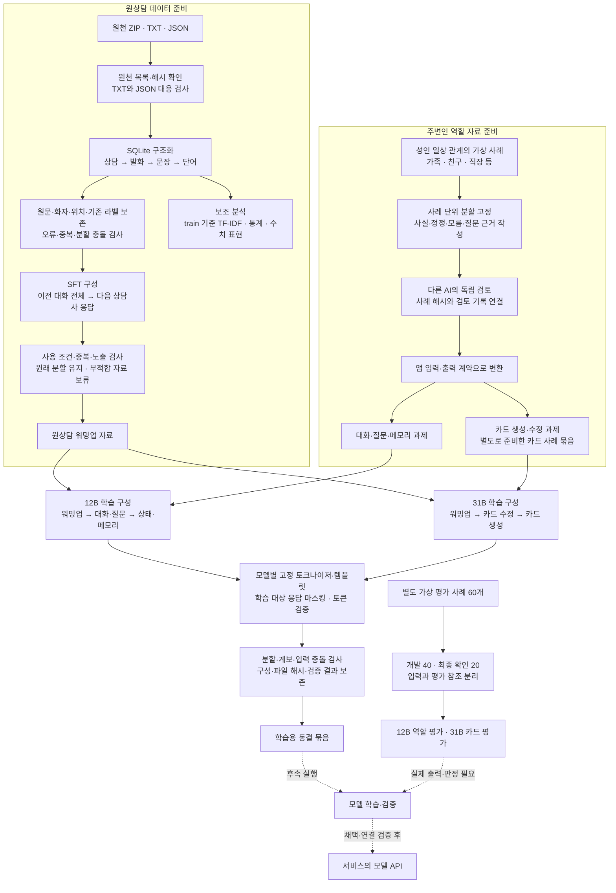
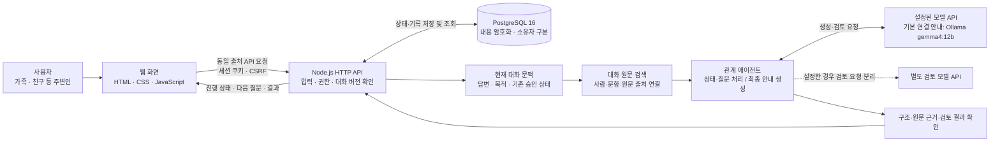
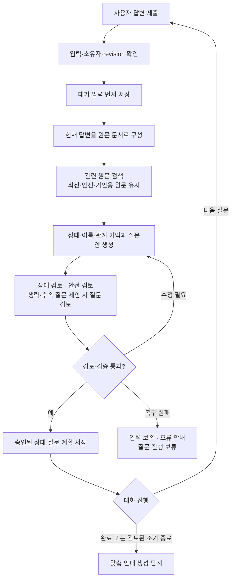
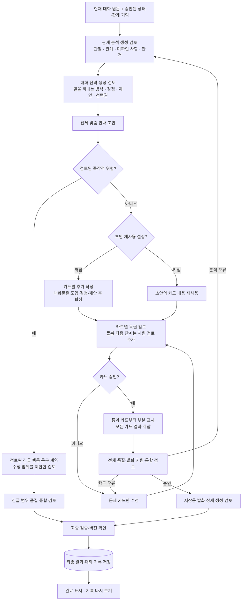

# 말씨 관계도 — 데이터 준비 · 서비스 구동 · 맞춤 안내

기준일: 2026-10-31. 로컬의 데이터 처리 코드, 학습 묶음의 구성·검증 메타데이터, 앱 소스를 확인해 작성했다. 실제 상담 원문이나 학습 정답을 이 문서에 옮기지 않았다.

| 구분 | 핵심 흐름 | 산출물 |
|---|---|---|
| **1. 데이터의 준비 과정** | 원천 보존 → 구조화·선별 → 역할별 학습 구성 → 토큰·분할 검증 | 12B 대화·상태 자료, 31B 카드 자료, 별도 역할 평가 자료 |
| **2. 서비스의 구동 방식** | 웹 입력 → 서버 저장 → 원문 검색 → 모델 상태 갱신·검토 → 다음 질문 | 현재 대화 문맥과 승인된 상태·질문 계획 |
| **3. 맞춤 안내** | 관계 분석 → 대화 전략 → 카드 생성 → 독립 검토·수정 → 결과 저장 | 대화문·실천·회피·돌봄·다음 단계 안내 |

데이터 준비의 12B·31B 구분은 **각 모델에 학습시키려는 역할**이다. 현재 앱이 두 모델을 이 역할대로 자동 분담해 실행한다는 뜻은 아니다. 준비한 학습 자료에서 학습·평가·모델 API 연결까지는 별도 실행과 검증이 필요하다.

## 1. 데이터의 준비 과정

### 1-1. 원천에서 학습 묶음까지

원상담과 가상 사례는 출처와 목적이 다르다. 원상담의 내담자를 주변인으로 바꾸어 학습시키지 않고, 상담사 응답을 이어 쓰는 기초 자료로 구성한다. 주변인의 대화·질문·카드 과제는 별도 역할 자료로 준비한다. 위 역할 자료 가지는 공통 준비 원칙을 요약한 것이며, 신규 대화 사례 200개를 그대로 31B 카드 사례로 사용하는 흐름은 아니다.

### 1-2. 원천을 정리하는 방법

| 단계 | 실제 처리 | 보존·검사 사항 |
|---|---|---|
| 원천 확인 | 파일·압축 멤버 목록과 해시 기록, TXT/JSON 대응 확인 | 원본 변경 없이 출처 추적 |
| 구조화 | SQLite에 상담·발화·문장·단어와 원래 라벨 분리 저장 | 화자, 원문 위치, 원래 분할 보존 |
| 품질·분할 검사 | 파싱 오류, 중복, train/validation 교차 그룹 확인 | 충돌·부적합 자료 보류·격리 |
| 원상담 SFT | 앞선 대화 문맥을 입력으로, 다음 상담사 발화를 정답으로 구성 | 내담자·상담사 역할과 정답 이전 맥락 유지 |
| 사용 후보 선별 | 민감·절차성 내용 등의 사용 조건, 정답·문맥 중복, 부분 노출 검사 | 보류 사유와 선별 이력 기록 |
| 수치화·토큰화 | 보조 수치 표현과 모델 학습용 토큰을 각각 구성 | train 기준 수치화, 모델별 토크나이저·템플릿 확인 |
| 묶음 검증 | 행·토큰 인덱스·바이트·출처 계보·분할 연결 대조 | `COURSE.json`, `MANIFEST.json`, `VERIFICATION.json` 등 보존 |

원천 분석용 TF-IDF·수치 행렬과 앱의 대화 원문 검색은 서로 다른 구현이다. 문장·단어로 나눈 분석 단위 역시 독립적인 상담 사례나 별개의 학습 정답 수로 합산하지 않는다.

### 1-3. 학습 데이터 구성

아래 수량은 로컬 `COURSE.json`의 단계별 `rows`를 직접 읽어 합산한 값이다. **단위는 학습 행이며 독립 사례 수가 아니다.** 원문·전체 토큰을 재검증하거나 학습을 실행한 결과는 아니다.

#### 12B: 주변인 대화·질문·상태 기억

묶음: `training_data/gemma4_12b_expanded_20261031/`

| 순서 | 단계 | 학습 목적 | Train | Validation |
|---|---|---|---:|---:|
| 1 | `01_dialogue_warmup` | 원상담 문맥에 이어 상담사 응답 작성 | 37,065 | 3,618 |
| 2 | `02_supporter_dialogue` | 주변인 응답, 다음 질문 선택, 질문 검토·반복 질문 반려 | 843 | 229 |
| 3 | `03_state_memory` | 보고 사실 추출, 화자별 메모리, 상태·질문 통합 초안 | 492 | 132 |
| **합계** | | | **38,400** | **3,979** |

신규 가상 대화는 **200사례: train 160, validation 40**으로 준비한다. 한 사례에서 다음 **8행**을 만든다.

| 사례당 구성 | 파생 과제 | 행 수 |
|---|---|---:|
| 대화·질문 | 첫 응답, 후속 응답, 질문 선택, 근거 있는 질문 검토, 반복 질문 반려 | 5 |
| 상태·메모리 | 보고 사실 추출, 화자별 메모리, 상태·질문 통합 초안 | 3 |
| **합계** | 200사례에서 1,600행 생성 | **8** |

기존 역할 자료 **train 55 / validation 41행**에 신규 **1,280 / 320행**을 더해 역할 자료는 **1,335 / 361행**이 된다. 원상담 워밍업은 기존 12B 묶음의 메시지·토큰 인덱스·토큰 바이트를 보존해 가져온다.

상태·메모리 과제는 작성된 원문 조각을 앱의 구조화된 문맥으로 변환한다. 전처리되지 않은 긴 원문에서 모든 사실을 스스로 찾아내는 과제와는 범위가 다르다.

#### 31B: 맞춤 카드 생성·수정

묶음: `training_data/gemma4_31b_expanded_20261025/`

| 순서 | 단계 | 학습 목적 | Train | Validation |
|---|---|---|---:|---:|
| 1 | `00_original_warmup` | 원상담 문맥과 상담사 응답의 기초 학습 | 37,065 | 3,618 |
| 2 | `01_card_repair` | 오류가 지적된 카드의 내용 수정 | 20 | 5 |
| 3 | `02_card_generation` | 대화문·실천·회피·다음 단계·돌봄 카드 생성 | 688 | 170 |
| **합계** | | | **37,773** | **3,793** |

31B 카드 자료는 별도로 준비한 카드 사례 묶음이다. 준비 문서가 설명하는 카드 가상 원천 150개와 이번 대화 가상 원천 200개는 구분한다. 두 모델의 원상담 워밍업 행이 겹치므로 모델별 총합을 더해 고유 데이터 수라고 발표하지 않는다.

#### 학습 입력·정답과 검증 기준

- **학습 대상:** 마지막 assistant 응답에만 손실을 적용하고, 앞선 대화는 문맥으로 제공한다.
- **과제 균형:** 역할 자료는 과제와 연결된 원천 사례의 영향이 치우치지 않도록 가중치를 구성한다.
- **토큰 검증:** 모델별 고정 토크나이저·템플릿으로 입력과 정답 경계를 확인한다. 새 12B 역할 자료는 별도 인코딩 경로로 바이트와 경계를 대조한다.
- **분할 보존:** 사례·원천 계보가 train과 validation을 넘나들지 않는지 검사한다. 묶음의 절단·패킹·분할 재배정 금지 계약을 유지한다.
- **보관:** 원문·학습 행·토큰 파일은 Git 제외 로컬 경로에 둔다. 코드·설정·원문 없는 집계와 검증 문서는 별도로 관리한다.

#### 별도 역할 평가 자료

묶음: `training_data/role_evaluation_20261031/`. `COVERAGE.json`에서 **고유 사례군 60개**, 개발 40·최종 확인 20 구성을 확인했다.

| 평가 대상 | 사례당 요청 | 개발 40사례군 | 최종 확인 20사례군 | 평가 내용 |
|---|---:|---:|---:|---|
| 12B | 8 | 320요청 | 160요청 | 대화·질문·보고 사실·메모리 관련 과제 |
| 31B | 5 | 200요청 | 100요청 | `script`, `doList`, `avoid`, `next`, `care` |

두 모델은 같은 60개 평가 원천의 서로 다른 역할을 평가받는다. 120개 독립 사례로 세지 않는다. 평가 입력과 평가자용 참조를 분리하며, 구조·인용 자동 검사와 실제 출력의 의미적 적합성 판정을 함께 사용한다. 최종 확인 자료에 맞춰 모델이나 프롬프트를 수정하면 그 자료는 더 이상 독립 최종 확인으로 취급하지 않는다.

확인한 저장 검증 메타데이터는 두 학습 묶음 모두 `status: passed`, `training_started: false`이며, 평가 메타데이터는 `model_runs_performed: false`다. 이는 **묶음 작성·검증 당시의 기록**이며 현재 프로세스의 학습·추론 상태를 증명하지 않는다. 가상 사례의 독립 AI 검토도 사람·임상 전문가 승인과 구분한다. 새 평가 자료는 급성 위기, 임상 진단, 실제 사용자 분포, 전체 31B 다단계 실행, `not_needed` 생략·상태 검토·안전 검토를 충분히 평가하는 범위가 아니다.

근거: [데이터 파이프라인](../../../data/README.md), [원천 구조화](../../../data/counseling_pipeline/ingest.py), [원상담 SFT](../../../data/counseling_pipeline/source_sft.py), [역할별 데이터 준비 문서](../../../ai/scripts/chat_and_role_evaluation_README.md), [12B 묶음 생성·검증](../../../ai/scripts/expanded_chat_dataset.py), [역할 평가 구성](../../../ai/scripts/role_evaluation_data.py).

## 2. 서비스의 구동 방식

### 2-1. 웹·서버·DB·모델의 연결

별도 검토 API를 쓰는 경우 실제 요청은 서버의 Gateway가 해당 목적지로 보낸다. 설정을 생략하면 기본 모델이 생성과 검토를 별도 요청으로 처리한다.

| 구성 요소 | 로컬 구현 | 역할 |
|---|---|---|
| 웹 화면 | `app/public/` | 대화 입력, 생성 진행, 결과 카드, 기록 화면 |
| API 서버 | Node.js의 `node:http`, `app/src/server.js` | 세션·CSRF·입력 검증, 모델 작업 조정, 상태·기록 API |
| 데이터베이스 | PostgreSQL 16, `app/src/store.js` | 대화·상태 이력·최종 기록 저장, AES-256-GCM 내용 암호화 |
| 모델 연결 | `app/src/model.js`, `model-config.js` | 설정된 API에 구조화된 생성·검토 요청 전달 |
| 실행 구성 | `app/compose.yaml` | API·PostgreSQL 컨테이너와 저장 볼륨 구성 |

기본 실행 안내는 로컬 웹 `127.0.0.1:9000`, PostgreSQL 호스트 포트 `5433`, Ollama API `127.0.0.1:11434/v1`을 사용한다. Docker 안에서는 설정에 따라 로컬 모델 주소를 `host.docker.internal`로 연결한다. 이는 설치·코드의 기본 구성 설명이며 이번 문서 작업에서 서버를 시작하거나 모델을 호출하지 않았다.

### 2-2. 답변 한 번이 처리되는 순서

**문맥에 따른 질문 조정:** 이미 답한 내용은 반복하지 않도록 판단하고, 앞선 답변에 따라 아직 답하지 않은 질문도 불필요하면 생략할 수 있다. 필요한 내용은 후속 질문으로 확인한다. 생략된 질문의 답을 만들어 저장하거나 최종 사실 근거로 사용하지 않는다.

**현재 원문 기반 검색:** `conversation_lexical_v1`은 단어·문자 bigram의 겹침과 가중치로 현재 대화의 관련 답변을 찾는다. 이용 목적·최신 답변·안전 관련 원문·이미 인용한 원문을 유지하고, 사람·문항·인용문을 대조한다. 준비한 학습 데이터 전체를 서비스에서 검색하는 구조가 아니다.

**상태와 해석의 구분:** 이용자가 보고한 사실, 관계에 대한 잠정 해석, 미확인 정보를 구분한다. 정정 전 답변에서 나온 해석이 최신 상태를 덮어쓰지 않도록 대화 버전과 문맥을 확인한다.

**실행 모드:** `combined`는 상태·질문 초안을 통합 생성하고, `combined_blocks`는 상태·이름·관계·질문을 블록별로 생성해 검토한다. `staged`는 단계별 경로를 사용한다. 코드 기본값은 `combined`, 새 로컬 설치 안내는 `combined_blocks`이므로 기본값과 실행 설정을 구분한다.

학습용 12B/31B 역할 구분, 현재 `app/` 소스, 별도 실행 복사본은 같은 상태가 아니다. 기존 로컬 실행본이 최신 소스를 자동으로 반영하는지도 별도로 확인해야 한다.

근거: [앱 실행 안내](../../../app/README.md), [Compose](../../../app/compose.yaml), [브라우저 API](../../../app/public/js/core/api.js), [서버](../../../app/src/server.js), [원문 검색](../../../app/src/relationship-retrieval.js), [상태·질문 처리](../../../app/src/relationship-turn.js), [저장소](../../../app/src/store.js).

## 3. 맞춤 안내

### 3-1. 분석에서 최종 카드까지

일반 전체 기능 경로를 기준으로 설명한 도표다. 카드 작업은 최대 3개가 함께 진행되며, 각 작업 내부에서는 작성 → 검토 → 필요 시 수정 순서를 지킨다. 모델 서버의 실제 추론 병렬성은 별도 설정이다. 검토·복구가 끝내 통과하지 못하면 실패한 결과를 최종 기록으로 저장하지 않는다.

### 3-2. 무엇을 개인화하는가

| 사용자의 정보 | 안내에 반영하는 방식 |
|---|---|
| 대상자와의 관계·호칭 | 상대를 부르는 방식, 거리감, 대화 상황 |
| 실제로 관찰한 말·행동 | 단정 대신 원문에 있는 장면을 대화의 출발점으로 사용 |
| 이용자의 감정·부담 | 공감 문단과 자기 돌봄·한계 설정 제안 |
| 이미 시도한 방법과 반응 | 반복을 피하고 다른 작은 행동·대안 구성 |
| 원하는 도움의 방향 | 대화 시작, 경청, 지원 제안 등 이용 목적 반영 |
| 동의·거절·지원 범위 | 상대가 선택하거나 거절할 수 있는 표현 구성 |
| 검토된 안전 신호 | 일반 제안 또는 긴급 행동 문구 계약 적용 |

### 3-3. 안내의 다섯 구성 요소

| 필드 | 안내 내용 | 핵심 검토 사항 |
|---|---|---|
| `script` · 대화문 | 실제로 건넬 수 있는 전체 발화 | 관찰과 추정 구분, 화자, 직접 발화, 상대 선택권 |
| `care` · 돌봄 | 이용자에 대한 공감과 자기 돌봄 제안 | 보고되지 않은 감정·성품 단정, 무제한 지원 부담 |
| `doList` · 이렇게 해 보세요 | 현재 상황에서 해 볼 구체적 행동 | 상황 적합성, 행동 방법, 근거 없는 사실 |
| `avoid` · 피하면 좋아요 | 피할 말·행동, 이유, 대안 | 피할 예문과 권장 대안의 구분, 대안의 안전·근거 |
| `next` · 다음 단계 | 이어서 선택할 수 있는 행동 | 동의, 조건, 지원 범위, 다음 행동의 적절성 |

생성 필드 수와 화면 카드 수는 구분한다. 저장용 단계 설명·인용 근거가 존재해도 사용자 화면에 모두 노출하는 것은 아니다. 기존 돌봄 카드·대화문 카드·실천/회피 카드의 표시 디자인을 따른다.

### 3-4. 검토·수정·저장의 연결

1. **형식 검사:** JSON, 필수 키, 타입, 문자열·배열 계약을 확인한다.
2. **원문 근거 검사:** 사람·문항·출처와 실제 인용을 대조한다.
3. **별도 모델 검토:** 원문에 없는 사실, 마음·원인 단정, 화자 혼동, 동의·지원 범위, 카드 역할을 확인한다.
4. **수정과 재검토:** 카드 오류는 해당 카드를 수정한다. 관계 분석이 바뀌면 그 분석에 의존하는 안내를 다시 구성·검토한다.
5. **최종 저장:** 승인된 결과의 현재 버전·소유자를 확인하고 저장한다. 재요청에는 기존 기록을 반환해 중복 저장을 방지한다.

카드가 먼저 보이더라도 최종 저장이 완료된 것은 아니다. 전체 검토에서 오류가 확인되면 부분 표시를 회수·갱신할 수 있으며, 저장이 끝난 뒤 최종 완료를 표시한다. 여기서 독립 검토는 별도 모델 요청을 뜻한다.

`MODEL_REUSE_FINAL_DRAFT=true`는 비긴급 경로에서 전체 초안의 카드 내용을 재사용하는 옵션이다. 카드별·전체 검토와 실패 카드 수정은 유지한다. 코드 기본값은 `false`다. 전략·품질·발화 상세를 생략하는 `MODEL_SKIP_FINAL_EXTRAS`는 별도 모드이므로 두 옵션을 같은 기능으로 설명하지 않는다.

### 3-5. 조건부 기관 안내

기관 안내는 별도 `/guidance` 요청으로 처리한다. 현재 원문·캐시·안전 신호를 확인하고, 필요한 경우 1차 분류와 같은 원문에 대한 독립 2차 분류를 수행한다. 기존 긴급 신호 또는 1차 긴급 판정이면 긴급 안내를 우선한다. 일반 상담 안내는 원문과 분류·표시 조건에 맞을 때 제공하며, 모든 상담에 자동으로 기관을 권하는 필수 단계는 아니다.

근거: [맞춤 안내 에이전트](../../../app/src/relationship-agent.js), [생성·검토 프롬프트](../../../app/src/relationship-prompts.js), [초안 재사용](../../../app/docs/FINAL_DRAFT_REUSE.md), [기관 분류](../../../app/src/risk-classification.js), [화면 정보 원칙](../../../app/docs/UI_CONTENT_POLICY.md).

관련 자료: [세부 서비스 분기 관계도](말씨_상세_서비스_관계도.md) · [발표용 간단 이미지](malssi-service-flow-simple.svg).
