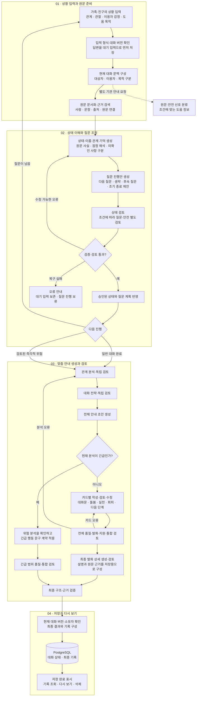
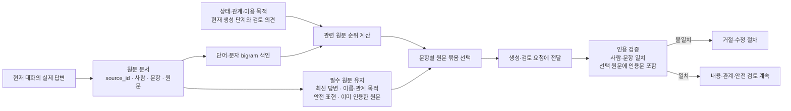
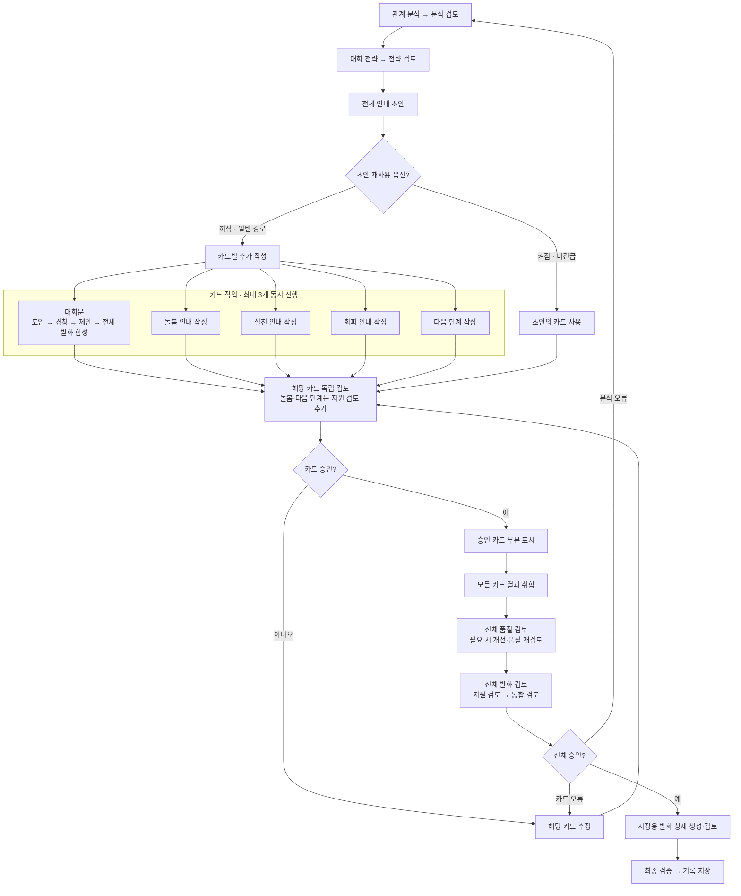
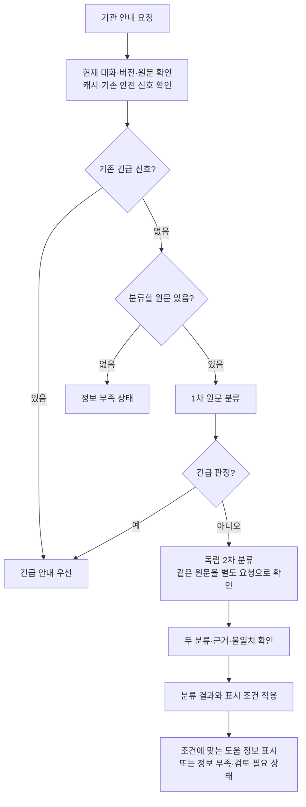
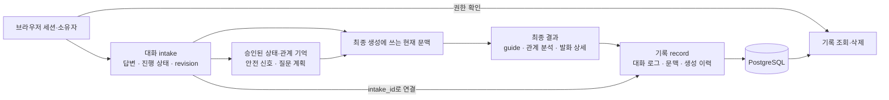

# 말씨 상세 서비스 관계도

데이터 준비·학습 데이터 구성까지 포함한 전체 설명은 [데이터 준비 · 서비스 구동 · 맞춤 안내 관계도](말씨_데이터준비_서비스구동_맞춤안내_관계도.md)를 참고한다.

기준: 2026-10-31 작업 트리의 `app/` 구현. 실제 운영 서버의 설정·배포 상태를 조회한 문서는 아니다.

말씨는 어려움을 겪는 사람 곁의 가족·친구가 **상황을 설명하고, 대화 원문에 근거한 말과 행동을 준비하도록 돕는 서비스**다. 아래 관계도는 사용자 입력부터 질문 조정, 안내 생성·검토, 기록 저장까지의 연결을 보여 준다.

## 1. 전체 서비스 흐름

이 도표는 책임 단위의 흐름이다. 상태·질문 초안을 한 요청으로 만드는 설정도 있으며, 모든 상자를 각각 한 번의 모델 호출로 해석하지 않는다. 일반 최종 생성은 `skipFinalExtras=false`를 기준으로 표시했다. 이 설정에서 긴급 경로도 분석·전략·초안은 생성하지만, 비긴급 카드 확장·발화 상세 경로는 생략하고 긴급 범위의 검토를 적용한다.

## 2. 입력·상태·질문은 어떻게 연결되는가

| 단계 | 입력 | 처리 | 다음 단계에 전달하는 내용 |
|---|---|---|---|
| 상황 입력 | 선택 답변, 직접 입력, 후속 답변 | 대상자와 이용자의 말·상황을 구분 | 실제 답변과 응답 상태 |
| 입력 저장 | 현재 대화 ID와 revision, 제출한 답변 | 형식과 버전을 확인하고 대기 입력 저장 | 모델 처리 실패 후에도 보존되는 입력 |
| 문맥 구성 | 현재 답변, 이전 승인 상태, 이용 목적 | 정정된 현재 문맥을 구성 | 현재 원문과 기존 상태 |
| 상태 갱신 | 원문과 검색 근거 | 이름·호칭, 관찰, 관계 기억, 미확인 정보를 구성 | 검토할 상태 초안 |
| 질문 조정 | 현재 답변 맥락과 남은 질문 | 다음 질문, 생략, 후속 질문 등을 제안 | 질문 진행안과 판단 근거 |
| 검토·반영 | 상태 초안과 질문 진행안 | 상태 검토, 조건부 질문 검토, 안전 검토 | 승인된 상태·질문 계획·안전 신호 |
| 다음 턴 | 승인된 계획 | 질문 계속 또는 결과 생성 준비 | 다음 질문 또는 완료 상태 |

### 사실·해석·모름의 구분

- **원문 사실:** 이용자가 실제로 보고한 내용을 사람·문항·인용에 연결한다. 이용자의 보고가 대상자 본인의 직접 진술과 같다는 뜻은 아니다.
- **잠정 해석:** 관계 양상이나 원인·마음에 대한 해석은 원문 관찰과 구분해 다룬다.
- **미확인 정보:** 확인되지 않은 사항은 미확인 상태로 유지한다.
- **모름·거절·건너뜀:** 확정된 사실 답변으로 바꾸지 않는다.

### 질문 생략의 의미

이미 답한 내용뿐 아니라 **앞선 답변 맥락상 불필요한 미응답 질문**도 생략할 수 있다. 다만 미응답이라는 사실 자체가 생략 근거는 아니다. 모델이 제안한 생략·후속 질문은 조건에 따라 별도 검토를 거친다.

생략은 질문 진행을 조정하는 기능이다. 생략 문항에 가상의 답변을 저장하거나 최종 안내의 사실 근거로 사용하지 않는다. 질문 판단에서 모름 원문을 별도 상태로 참고하는 경우에도 사실 근거로 승격하지 않는다.

## 3. 대화 원문 기반 검색과 근거 검증

현재 검색은 `conversation_lexical_v1`이다. 단어·문자 bigram의 겹침에 역문서빈도 가중치를 적용하고 문서 길이를 고려한다. 임베딩·벡터 DB 검색이나 외부 상담 사례 검색으로 구현된 흐름은 아니다.

검색 자료는 현재 대화의 답변에서 매번 구성한다. 생성한 안내·관계 기억, 다른 세션의 답변, 정정 전 원문을 새 사실 자료로 색인하지 않는다. 선택된 문항은 선택 답변·직접 입력·후속 답변을 함께 묶어 맥락을 유지한다. 현재 전체 답변도 원문 대조 자료로 유지한다.

**인용문이 실제 원문에 있다는 검증과, 그 인용으로 해석이 충분히 뒷받침되는지에 대한 검토는 별개다.** 위험 단어를 검색에 포함하는 것도 즉각적 위험을 확정하는 판정은 아니다.

## 4. 맞춤 안내의 상세 생성·검토 관계

도표의 카드 검토 노드는 반복되는 공통 절차를 표현한다. 실제로는 각 카드 작업 안에서 작성·검토·수정을 진행한다. 수정 후에는 필요한 전체 검토도 다시 거친다. 정해진 복구 범위에서 통과하지 못하면 오류로 종료하며 실패한 결과를 최종 기록으로 저장하지 않는다.

### 생성하는 안내의 역할

| 필드 | 역할 | 검토 초점 |
|---|---|---|
| `script` | 상대에게 건넬 전체 대화문 | 실제 관찰과 추정 구분, 발화 주체, 상대의 선택권, 근거 없는 전제 |
| `care` | 이용자에 대한 공감과 자기 돌봄 | 보고되지 않은 감정·성품 단정, 지원 부담, 자기 한계 |
| `doList` | 구체적으로 해 볼 행동 | 현재 상황과의 관련성, 실행 방법, 원문에 없는 사실 |
| `avoid` | 피할 표현·행동과 이유·대안 | 피할 예문과 권장 대안의 구분, 대안의 사실·안전 문제 |
| `next` | 다음에 취할 수 있는 단계 | 선택 가능한 제안인지, 지원 범위와 부담이 적절한지 |

생성 구조에는 위 **5개 필드**가 있다. 화면의 주요 카드 수와 생성 필드 수는 같은 개념이 아니다. 대화문의 단계별 설명·근거는 저장 계약에 따라 보존하며, 이를 사용자 화면에 추가 노출하는 디자인 변경을 뜻하지 않는다.

### 부분 표시와 최종 완료

카드별 검토를 통과하면 해당 카드를 먼저 표시할 수 있다. 이후 전체 품질·통합 검토에서 수정이 필요하면 부분 표시를 회수하거나 갱신할 수 있다. **카드가 보이는 시점과 최종 저장 완료 시점은 다르다.** 최종 완료는 서버의 기록 저장이 끝난 뒤 표시한다.

최대 3개 동시 진행은 앱의 카드 작업 수다. 모델 서버가 같은 수의 추론을 동시에 실행한다는 뜻은 아니다.

## 5. 기관 안내는 별도 요청 경로

기관 안내는 `/api/intakes/:id/guidance` 경로로 처리한다. 일반 안내 카드 작성 단계와 분리되어 있으며, 모든 이용자에게 기관을 권하는 필수 단계가 아니다. 2차 분류는 1차 결론을 전달받아 추종하는 방식이 아니라 같은 원문을 별도로 분류한다. 여기서 독립 검토는 별도 모델 요청을 뜻하며 전문가 검토 완료를 뜻하지 않는다.

## 6. 저장되는 정보와 접근 관계

| 저장 대상 | 주요 내용 | 보호·일관성 처리 |
|---|---|---|
| 대기 입력 | 제출 답변, 원래 revision | 모델 오류 시 입력 보존, 동일 제출의 중복 처리 조정 |
| 대화 상태 | 답변, 질문 진행, 상태·관계 기억, 안전 신호 | 현재 revision 확인, 정정 시 이전 해석 무효화 |
| 최종 기록 | 안내, 로그, 관계 분석, 선택적 발화 상세, 문맥, 생성 이력 | 소유자와 대화 연결 확인, 기록 내용 암호화 저장 |
| 재저장 요청 | 이미 저장된 대화의 결과 | 동일 대화의 기존 기록을 반환해 중복 저장 방지 |
| 조회·삭제 | 소유자가 접근하는 대화·기록 | 소유자 범위를 확인하고 관련 실행 취소 처리 |

모델 생성 완료 후에도 대화 버전이 바뀌었거나 삭제됐다면 오래된 결과가 최신 대화에 반영되지 않도록 확인한다. 기록 내용에는 검토와 추적을 위한 데이터가 포함되지만 화면에는 이용에 필요한 안내를 중심으로 표시한다.

## 7. 설정에 따라 달라지는 부분

| 설정·조건 | 흐름의 차이 |
|---|---|
| `MODEL_STATE_MODE=combined` | 상태·이름·관계·질문 초안을 통합 요청으로 생성하고 검토한다. 설정을 생략했을 때 코드 기본값이다. |
| `MODEL_STATE_MODE=combined_blocks` | 같은 상태 구성 요소를 블록별로 생성한 뒤 결합·검토한다. |
| `MODEL_STATE_MODE=staged` | 상태·관계·질문 관련 생성을 단계별 경로로 처리한다. |
| `MODEL_REUSE_FINAL_DRAFT=true` | 비긴급 최종 생성에서 전체 초안의 카드 내용을 재사용한다. 카드별 독립 검토와 실패 카드 수정은 유지한다. 코드 기본값은 `false`다. |
| `MODEL_SKIP_FINAL_EXTRAS=true` | 대화 전략·전체 품질·저장용 발화 상세 등 추가 단계를 생략하는 별도 경로다. 위 일반 전체 흐름과 구분한다. 코드 기본값은 `false`다. |
| 검토된 즉각적 위험 | 긴급 행동 문구 계약과 제한된 수정 범위를 적용한다. 일반 카드 확장·발화 상세 경로를 그대로 따르지 않는다. |

실제 호출 수는 상태 모드, 질문 검토 조건, 초안 재사용, 안전 보완, 형식 복구·내용 수정·네트워크 재시도에 따라 달라진다. 따라서 이 관계도에서는 하나의 고정 호출 수를 전체 상담의 값으로 제시하지 않는다.

## 8. 구현 근거

아래 링크는 이 Markdown 파일 위치를 기준으로 한 저장소 상대 경로다.

| 구현 파일 | 이 문서에서 확인한 책임 |
|---|---|
| [server.js](../../../app/src/server.js) | 답변 선저장, revision 확인, 모델 실행, 최종 결과 구성·저장, 기관 안내 API |
| [intake.js](../../../app/src/intake.js) | 대화 문맥과 입력·질문 진행 상태 |
| [relationship-turn.js](../../../app/src/relationship-turn.js) | 통합·블록 상태 생성, 상태·질문·안전 검토 |
| [relationship-retrieval.js](../../../app/src/relationship-retrieval.js) | 현재 대화 원문 문서화, 어휘 검색, 인용 범위 확인 |
| [relationship-agent.js](../../../app/src/relationship-agent.js) | 분석·전략·초안, 카드 작업, 독립 검토·수정, 최종 발화 상세 |
| [model.js](../../../app/src/model.js) | 상태 모드별 실행 경로와 모델 요청 처리 |
| [model-config.js](../../../app/src/model-config.js) | 상태 모드, 초안 재사용, 추가 단계 옵션과 기본값 |
| [risk-classification.js](../../../app/src/risk-classification.js) | 기관 안내용 1차·독립 2차 분류와 긴급 분기 |
| [referral-guidance.js](../../../app/src/referral-guidance.js) | 기관 안내 요청과 결과 구성 |
| [store.js](../../../app/src/store.js) | 소유자 범위, 암호화 저장, 중복 저장 방지, 조회·삭제 |

관련 도식: [발표용 간단 관계도](malssi-service-flow-simple.svg) · [상세 이미지 관계도](malssi-service-flow.svg).
