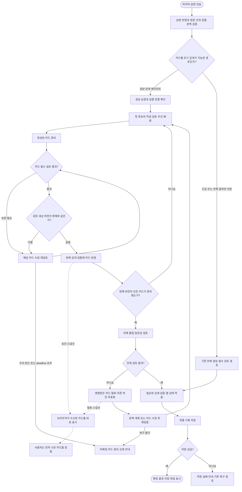
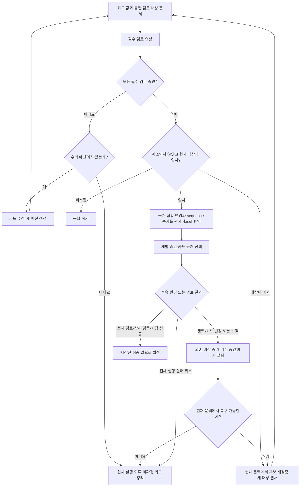
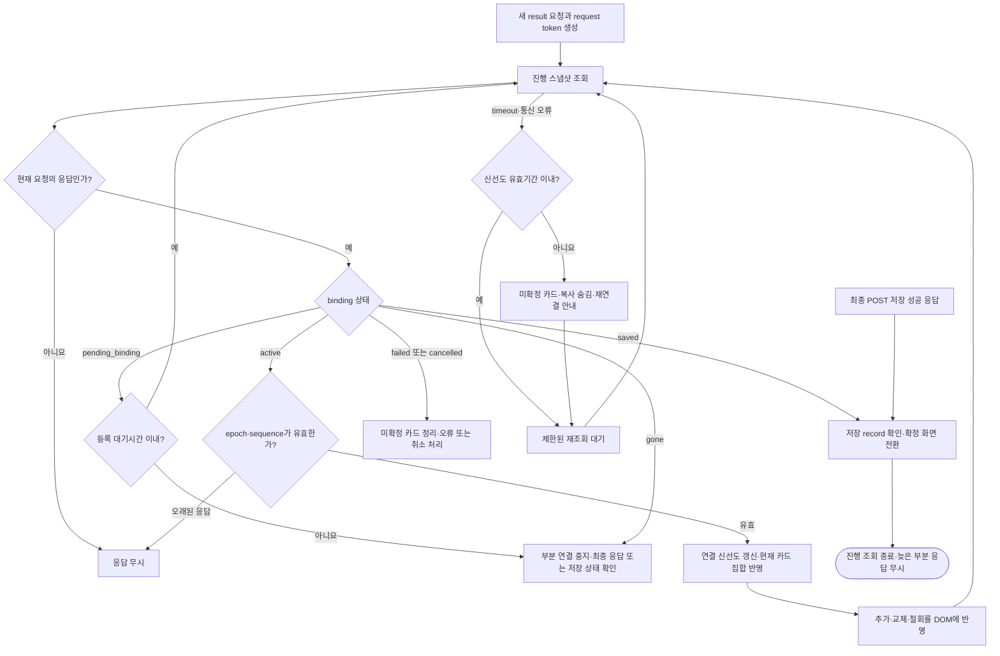
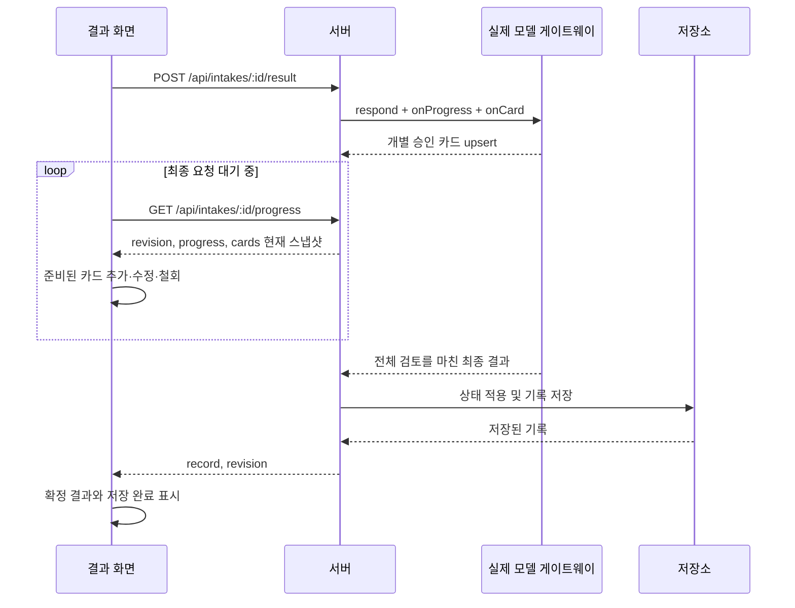

# 최종 카드 반 스트리밍 상세 설계

작성일: 2026-11-03(KST) · 상태: 구현 전 설계 및 기존 코드 조사

사용자 요청: “첫번째 카드가 나오면 그 카드 보여주고 다음 카드 다음카드 이런식으로 반 스트리밍 형식으로 가능한지 문서부터 디테일하게 작성”.

추가 사용자 요구(2026-11-03): “가능한 사용자에게 출력물이 보이는 시간을 줄여야해”. 이에 따라 아래 설계는 **첫 유효 카드의 실제 화면 표시 시간을 최소화**하는 것을 최우선 성능 목표로 삼는다.

## 1. 가능 여부와 권장 방향

**가능하다. 현재 프로젝트에도 카드 단위 공개 경로가 이미 있으며, 일부 생성·검토 설정에서 생기는 대기 구간과 완료 전후의 화면 전환을 보완하는 작업이다.**

여기서 반 스트리밍은 글자를 한 자씩 보여주는 방식이 아니다. 카드의 내용과 해당 카드에 필요한 검토가 끝나면 카드 전체를 표시하고, 나머지는 계속 생성·검토하는 방식이다. 여러 카드가 한 번에 준비되면 함께 보여주며, 한 장씩 보이게 하려고 인위적인 지연을 넣지 않는다.

권장안은 기존 `onCard → progress → ResultScreen.partial` 경로를 재사용하는 것이다. 카드 공개 전 필요한 검토와 전체 결과를 확정하는 검토를 구분하고, 전체 결과 검토가 아직 끝나지 않았다는 이유만으로 모든 카드 공개를 일괄 보류하지 않도록 한다. 전체 검토·상태 적용·DB 저장 계약은 유지한다.

단, 먼저 표시된 카드는 **개별 검토를 통과한 현재 버전**이다. 후속 전체 검토가 관계 해석·안전 판단·카드 간 모순을 발견하면 철회하거나 새 승인 버전으로 교체할 수 있다. 한 번 표시한 내용이 절대로 바뀌지 않는 확정 스트림을 요구한다면, 현재처럼 전체 내용을 다시 수정할 수 있는 검토 구조에서는 전체 검토 완료까지 기다려야 한다.

| 요구 | 이번 설계의 처리 |
| --- | --- |
| 먼저 준비된 카드부터 보기 | 개별 공개 조건을 만족한 카드부터 표시 |
| 기존 카드 모양 유지 | 기존 공용 `GuideCards`와 사용자 지정 디자인 유지 |
| 모델 호출 수·병렬 처리 변경에도 동작 | 호출 번호·고정 횟수가 아닌 카드 상태와 승인 버전에 연결 |
| 나머지 카드는 계속 준비 | 기존 점 세 개 대기 표시 유지 |
| 먼저 나온 카드가 거절됨 | 해당 버전 철회 후 재검토, 오래된 복사 버튼도 제거 |
| 저장 성공 여부 | 최종 기록 저장 확인 이후에만 저장 완료 표시 |
| 이번 작업 범위 | 설계 문서 작성. 앱 구현·환경 설정 변경은 수행하지 않음 |

“첫번째”는 **가장 먼저 공개 조건을 만족한 카드**로 해석한다. 항상 돌봄 카드부터 순서대로 기다리는 방식은 먼저 준비된 다른 카드를 지연시킨다. 생성 중에는 완료 순서를 사용하되, 실천·주의 카드의 두 열 배치와 최종 결과·기록의 기존 순서는 유지한다.

### 1.1 최우선 목표: 사용자가 실제로 읽기 시작하는 시간

성능의 1차 기준은 전체 모델 요청 수나 전체 JSON 생성 시간이 아니라 **마지막 답변을 보낸 뒤 첫 유효한 핵심 카드를 실제 화면에서 읽을 수 있을 때까지의 시간**이다. 생성 시작 버튼 등 별도 진입이 있는 화면은 그 사용자 동작을 시작점으로 구분한다. 마지막 답변의 상태 검토, 불씨 선행 처리, 요청 큐 대기, 모델 작성·검토, 전달, 화면 반영까지 사용자가 겪는 대기를 모두 포함한다.

관계 요약, 로딩 문구, 빈 카드, 고정된 일반 문구를 먼저 띄운 것은 첫 유효 핵심 카드로 세지 않는다. 해당 사용자 입력에 근거한 핵심 카드가 기존 내용·검토 계약을 만족해야 한다. 이 목표를 달성하기 위해 카드 내용을 임의로 줄이거나 검토를 생략하지 않는다.

최적화 우선순위는 다음과 같다.

1. 첫 카드에 필요 없는 **선행 대기**를 제거한다. 다른 카드·전체 검토 묶음·부가 결과를 기다리느라 이미 승인 가능한 카드가 묶이지 않게 한다.
2. 첫 카드를 완성하는 데 필요한 **작성→검토 요청의 실행 기회**를 먼저 확보한다. 전체 초안을 많이 병렬 생성하느라 이미 작성된 카드의 검토가 밀리면 안 된다.
3. 승인 즉시 전달·화면 반영한다. 폴링·렌더링·등장 효과가 만드는 추가 대기도 별도로 줄인다.
4. 첫 카드 이후에도 다음 카드가 계속 준비되도록 한다. 첫 한 장만 빠르고 나머지가 멎는 정책은 채택하지 않는다.

전체 저장 시간·오류·철회율도 함께 관리하되, 전체 호출 수 감소가 첫 카드 지연을 늘린다면 무조건 더 좋은 최적화로 판단하지 않는다. 실제 감소 폭은 같은 모델·입력·실행 조건의 비교 측정으로 확정하며, 측정 전에는 몇 초 또는 몇 % 개선된다고 약속하지 않는다.

### 1.2 전체 실행 순서도

아래는 **구현 목표 흐름**이다. 현재 코드에 모든 보호 필드·스케줄러가 구현됐다는 뜻은 아니다. 점선은 화면으로 전달되는 비동기 경로이며, 서버의 다음 작업이 사용자의 수신·열람을 기다린다는 의미가 아니다.



첫 카드가 화면에 나타나는 지점은 `U`이며 최종 저장 `P`보다 앞에 있다. 나머지 카드 생성은 계속 진행한다. `E`는 공정한 자원 배분을 뜻하며, 화살표가 다음 카드까지 반드시 순차 실행한다는 뜻은 아니다. 전체 초안이 필요한 최소 변경안과 첫 카드 독립 생성 비교안 모두 `F`에서 각자의 필수 구조 검증을 마친다.

공통 문맥이 바뀐 `R`은 새 문맥·안전·계획 검증을 완료한 뒤에만 `E`로 돌아간다. 부분 카드 공개가 필요 없는 기존 경로 `X`도 검토 생략 경로가 아니다. 모든 노드에는 기존 취소·실패·deadline 처리가 적용되며, 한도 초과를 성공·빈 카드로 처리하지 않는다.

### 1.3 카드 한 장의 공개·철회 순서도



care·next처럼 두 종류의 검토가 필요한 카드는 둘 다 **같은 대상 버전**에 승인돼야 한다. 값이 같더라도 원문·계획·안전 버전이 바뀌면 이전 승인을 사용할 수 없다. 취소와 저장이 경합할 때는 이미 commit된 기록을 뒤늦게 오류 상태로 되돌리지 않는다.

### 1.4 브라우저 수신과 연결 장애 순서도



`OLD` 응답은 상태·신선도를 변경하지 않는다. 실행이 여전히 활성일 때만 기존 조회 루프를 계속한다. 같은 sequence의 정상 재응답은 DOM을 다시 만들지 않고 신선도만 갱신할 수 있다. 모든 반복은 화면 이탈·취소·최종 완료·공통 deadline에서 종료하며, 이미 확정된 record에는 부분 카드 숨김 규칙을 적용하지 않는다.

### 1.5 사용자에게 보이는 시간 흐름 예시

아래 예시는 완료 순서를 설명하며 실제 소요 시간이나 동시에 실행할 요청 수를 나타내지 않는다. care가 항상 먼저 나온다는 보장은 없다.

| 시점 | 모델·서버 작업 | 사용자가 보는 화면 |
| --- | --- | --- |
| 시작 | 답변 반영·공통 검증 | 기존 대기 표시 |
| 첫 승인 | care의 필수 검토 완료·공개 | care 카드 전체 + 나머지 대기 표시 |
| 다음 승인 | doList 검토 완료·공개 | care + doList |
| 다음 승인 | script 검토 완료·공개 | 앞선 카드 유지 + 전체 대화문 |
| 나머지 승인 | avoid·next 승인·공개 | 준비된 카드 모두 표시, 실천·주의는 기존 두 열 |
| 전체 확인 | 품질·일관성·상세 검증 | 기존 카드 유지; 변경이 필요하면 해당 버전 철회·재검토 |
| 저장 성공 | 확정 기록 저장·반환 | 기존 최종 배치로 전환·저장 완료 안내 |

## 2. 조사 기준과 현재 작업 상태

최초 조사 기준은 [`5d441846130036365b24b0336dfa2eabea64328d`](https://github.com/seonizz/HOP_Biohealth_AI-Challenge/commit/5d441846130036365b24b0336dfa2eabea64328d)이다. 조사 당시 `model.js`, `relationship-agent.js`, `relationship-prompts.js` 등을 포함한 기존 병합 충돌과 별도의 추가 대화 작업이 있었다. 충돌 파일은 `git show HEAD:<경로>`로 확정본을 읽었고, 충돌 없는 서버·UI의 현재 파일도 함께 확인했다.

문서 작성 중 다른 작업이 병합을 완료하여 HEAD가 `a40a14de67766c3b0947bf84b86456f535cb13eb`로 변경됐다. 이 병합본도 추가 대조했다. 최초 최종 결과의 카드별 공개·초기 검토 묶음 대기 구조는 유지된다. 새 `continuation_context_review`는 서버가 만든 추가 대화 원문이 있을 때 활성화되는 후속 전체 가이드 검토이며, 최초 결과에 무조건 추가되는 검토가 아니다. 아래 줄 번호는 별도 표기가 없으면 최초 조사 커밋 기준이다.

`app/.env`에서는 아래 비밀이 아닌 설정값만 확인했다. 키·주소·원문은 문서에 복사하지 않았다. 파일 내용 확인이므로 이미 실행 중인 프로세스에 동일 설정이 적용됐다는 뜻은 아니다.

| 로컬 파일 설정 | 확인값 | 관련 의미 |
| --- | --- | --- |
| `MODEL_PROTOCOL` | `relationship_agent` | 카드별 작성·검토 경로 사용 가능 |
| `MODEL_REUSE_FINAL_DRAFT` | `true` | 전체 초안의 카드 내용을 재사용 |
| `MODEL_BUNDLE_FINAL_REVIEWS` | `true` | 초안 재사용과 결합하면 최초 전체 검토 묶음을 먼저 기다릴 수 있음 |
| `MODEL_SKIP_FINAL_EXTRAS` | `false` | 품질·상세 검토 등 현재 계약 유지 |
| `MODEL_STREAM_JSON` | `true` | 모델 응답 수신 옵션. 브라우저 카드 공개 옵션과 다름 |
| `MODEL_STREAM_COMPLETE_JSON` | `true` | 완성된 모델 JSON 처리 옵션. 카드별 승인 생략을 뜻하지 않음 |

관련 기준: [UI 정보·카드 디자인 원칙](../app/docs/UI_CONTENT_POLICY.md), [관계 에이전트 계약](../app/docs/RELATIONSHIP_AGENT.md), [초안 재사용](../app/docs/FINAL_DRAFT_REUSE.md), [AI 질문셋 테스트 도구](../ai/docs/MODEL_QUESTION_TESTS.md).

## 3. 이미 있는 경로와 실제 대기 지점

### 3.1 기존 구성



| 구현 위치 | 현재 역할 |
| --- | --- |
| `app/src/relationship-agent.js` | `publishCard/removeCard/resetCards`; 일반 카드별 검토 승인 직후 이벤트 발생 |
| `app/src/model.js` | `operation`에서 취소·실패·재시도 처리, 늦은 카드 이벤트 차단 및 실패 시 reset |
| `app/src/generation-progress.js` | 카드 ID별 Map, 깊은 복사 스냅샷, upsert/remove/reset 처리 |
| `app/src/server.js` | `onCard` 연결, owner·intake·revision별 실행 공유, 진행 조회, 최종 저장 |
| `app/public/js/core/conversation.js` | 결과 요청과 진행 조회를 병행하고 동일 대화·revision에만 반영 |
| `app/public/js/components/ResultScreen.js` | 부분 카드 DOM 보존·교체·철회, 완료 순서, 두 실천 카드 묶기 |
| `app/public/js/components/GuideCards.js` | 결과·기록·부분 표시가 공유하는 기존 카드 형태와 복사 동작 |

모델 경로의 핵심 위치는 기준 커밋의 `relationship-agent.js:987`(이벤트), `:1386`(전체 초안), `:1394`(초기 묶음 검토), `:1453`(카드 작업), `:1471`(개별 공개), `:1502`(품질 보완 시 철회), `:1581`(전체 승인 후 공개)이다. 줄 번호는 위 커밋에만 적용한다.

### 3.2 왜 지금도 한꺼번에 보일 수 있는가

1. **전체 초안 선행:** 현재는 어떤 일반 카드 검토보다 먼저 `guide_write`의 전체 JSON 구조·안전 검증을 마친다. 초안의 첫 JSON 필드가 닫혔다고 공개하지 않는다.
2. **검토 묶음 선행:** `reuseFinalDraft && bundleFinalReviews && !skipFinalExtras`이면 개별 카드 검토와 전체 품질·가이드 검토를 포함한 `final_review_bundle_initial`을 먼저 기다린다. 이후 여러 카드가 이미 준비된 검토 결과를 소비해 거의 함께 공개될 수 있다. 현재 로컬 설정 파일이 이 조합이다.
3. **조회 간격:** 최초 진행 조회는 250ms 후, 이후에는 각 조회가 끝난 뒤 1,500ms 후에 수행한다. 한 조회 사이에 카드 여러 장이 준비되면 함께 받는다. 1.5초는 표시 지연의 절대 상한이 아니다. 네트워크·탭 상태·조회 실패의 영향을 받는다.
4. **불씨 선행 처리:** `finish()`는 결과 화면에서 `ReferralGuide.observe`를 기다린 뒤 최종 POST·진행 조회를 시작한다. 첫 카드 대기 시간에는 이 구간도 들어간다. 최초 카드의 안전·근거 검증에 필요하지 않은 부가 요청까지 앞에 있는지 확인하여 재배치 대상으로 삼는다. 같은 모델을 무조건 동시 호출하면 경합으로 더 느려질 수 있으므로 5.3의 자원별 정책으로 비교한다.
5. **완료 화면 재작성:** 최종 `ResultScreen.open()`은 현재 전체 DOM을 다시 만들고 기존 고정 순서와 등장 효과를 적용한다. 부분 카드가 잘 나타나도 완료 순간 화면이 다시 그려지는 경험은 별도 보완이 필요하다.

따라서 프런트엔드 애니메이션이나 SSE만 추가하는 것으로는 초기 검토 묶음의 대기가 사라지지 않는다.

## 4. 카드별 공개 조건과 의존성

공개 후보는 완성된 값이어야 한다. JSON 조각, 일부 문장, 초안, 검토 응답의 일부는 브라우저로 보내지 않는다. 대상자·원문·관계 분석·안전 판단·카드 값이 검토 당시 버전과 같은지도 확인해야 한다.

| 카드 ID | 화면 | 공개 전 조건·의존성 |
| --- | --- | --- |
| `care` | 당신의 마음도 소중해요 | 구조·원문 근거 확인 + 현재 카드의 speech 검토 + support 검토 모두 승인 |
| `script` | 이렇게 시작해 보세요 | 전체 발화 통합·형식·화자·선택권 등 기존 검증 + 해당 카드 검토 승인. 부분 발화를 이어 붙여 보여주지 않음 |
| `doList` | 이렇게 해 보세요 | 전체 항목의 형식·근거·제안 경계 검증 + 해당 카드 검토 승인 |
| `avoid` | 피하면 좋아요 | 기존 주의 항목 구조·원문 검증 + 해당 카드 검토 승인. 병합본의 `avoid-card-structure.js` 계약도 보존 |
| `next` | 다음 단계 | 해당 카드 speech·support 검토 승인. `care.tips.slice(1)` 부가 표시에는 승인된 care가 필요 |
| `relationship` | 함께 살펴본 관계 | 현재 관계 분석 검토 승인. 핵심 다섯 카드와 별도 집계하며 기존 접힌 형태 유지 |

`relationship`은 현재 일반 카드보다 먼저 공개될 수 있다. 성능 기록에서 이것만 나타난 것을 “첫 핵심 카드가 준비됨”으로 세지 않는다. 핵심 카드 집합은 `care/script/doList/avoid/next`이다.

`next`는 care가 아직 없으면 승인된 next 본문만 먼저 표시하고, care 승인 후 기존 부가 문구를 추가한다. care가 철회되면 그 부가 문구도 제거한다. next 본문 자체의 검토가 care 또는 다른 변경된 문맥에 의존했다면 next 승인도 무효화한다. 이 의존성 때문에 카드 ID만 보고 “이 카드는 끝났다”고 판정하면 안 된다.

`conversation_detail`은 공개된 script 뒤에 생성·검토될 수 있다. 화면에 단계별 설명을 새로 노출하지 않으며, 상세 저장 계약을 생략하거나 최종 저장 성공으로 미리 처리하지 않는다. script 본문이 바뀌면 이전 본문에 붙은 detail 승인을 재사용할 수 없다.

### 긴급 안전 경로

현재 긴급 경로는 일반 카드 worker를 거치지 않고 전체 가이드 검토 이후 카드를 공개한다. **1차 구현에서는 이 보수적인 공개 경계를 유지한다.** 일반 카드 반 스트리밍을 위해 긴급 판정을 건너뛰거나 일반 대화 카드를 먼저 내보내지 않는다.

긴급 안내를 별도로 더 빨리 표시하려면 현재 원문에 대한 승인된 안전 신호, 기존 긴급 안내, 일반 카드 억제 및 철회, 최종 저장값 일치에 대한 별도 설계·검증이 필요하다. `generationProgress`의 기존 카드 ID에 safety가 없으므로 이 문서만으로 새 safety 이벤트가 이미 지원된다고 간주하지 않는다. 불씨의 “결과 화면에서만 표시” 원칙도 유지한다.

## 5. 권장 모델 실행 구조

### 5.1 전송 변경보다 공개 전 대기부터 분리

일반 경로의 목표 흐름은 다음과 같다.

```text
입력·안전·관계 분석 검증 → 계획 → 전체 초안 구조 검증
  ├─ script 준비 → script 필수 검토 → 공개
  ├─ care 준비 → speech + support 필수 검토 → 공개
  ├─ doList 준비 → 필수 검토 → 공개
  ├─ avoid 준비 → 필수 검토 → 공개
  └─ next 준비 → speech + support 필수 검토 → 공개
          ↓ 전체 카드 버전 집합이 준비됨
     전체 품질·카드 간 일관성·근거 검토
          ↓ 필요하면 철회·수정·재검토
     상세 생성·검토 → 상태 반영 → 기록 저장 → 완료
```

이는 의존성 설명이며 동시에 다섯 모델 요청을 보내라는 지시가 아니다. 실제 동시 작업 수는 앱의 스케줄러와 실행 환경이 결정한다. 현재 worker 수는 3이지만 테스트와 프런트엔드 계약에 이 숫자를 고정하지 않는다.

초안 재사용은 유지할 수 있다. 변경의 핵심은 `final_review_bundle_initial`에 모든 공개 조건을 묶어 기다리지 않는 것이다. 예를 들어 care 자체에 필요한 speech·support 검토는 같은 카드 범위에서 묶을 수 있지만, 다른 카드의 품질 검토 완료를 care 공개 조건으로 넣지 않는다. 전체 품질·전체 가이드 검토는 완성된 동일 버전 집합을 대상으로 계속 수행한다.

개별 검토를 나누면 HTTP 호출 수나 전체 완료 시간이 늘 수 있다. 반 스트리밍의 목적은 유효한 첫 결과를 더 일찍 보여주는 것이며, 전체 실행이 항상 빨라진다는 약속은 아니다. 총 호출 수·수정률·첫 핵심 카드 시간·최종 저장 시간은 함께 측정한다.

### 5.2 설정 조합별 처리

| 조건 | 현재 특성 | 설계 방향 |
| --- | --- | --- |
| 일반 생성, 검토 묶음 꺼짐 | 개별 작성·검토 후 공개 가능 | 기존 경로 보존, 전달·완료 전환 검증 |
| 초안 재사용, 검토 묶음 꺼짐 | 작성 확장 없이도 각 카드별 검토 후 공개 가능 | 비교 기준으로 사용 가능; 현장 설정을 자동 변경하지 않음 |
| 초안 재사용 + 최종 검토 묶음 | 초기 전체 묶음이 공개를 늦출 수 있음 | 카드 공개용 검토와 전체 확정 검토의 묶음 경계 분리 |
| 긴급 안전 결과 | 일반 worker 생략, 전체 승인 뒤 공개 | 기존 경계 유지 |
| `json_schema` / `json_prompt` | 검증된 전체 가이드 반환, 카드별 조기 승인 지점 없음 | `final_only`로 취급. 전체 응답을 시간차로 나눠 실제 조기 생성으로 표시하지 않음 |
| 부가 검토 생략 옵션 | 별도의 기존 실행 계약 | 반 스트리밍 구현을 위한 검토 우회 수단으로 사용하지 않음 |

최소 변경의 첫 비교본은 전체 초안을 기다리는 구조를 유지한다. 그러나 이 초안이 첫 카드 시간의 주된 병목으로 남으면 여기서 최적화를 완료했다고 판단하지 않는다. 필요한 공통 문맥을 검증한 뒤 첫 핵심 카드를 독립된 완성 스키마로 생성·검토하는 대안을 다음 비교본에 포함한다. 이 경우 나머지 카드와의 일관성 검토·안전 계약·최종 저장 구조를 유지해야 하며, 입력 공유·호출 비용·철회율을 함께 확인한다. 전체 JSON의 중간 필드나 토큰을 잘라 승인된 카드로 취급하지 않는다.

호환성 비교가 필요하면 `MODEL_PROGRESSIVE_CARDS` 같은 내부 opt-in 설정을 추가할 수 있으나, **이 이름은 제안이며 현재 지원하는 설정이 아니다.** 도입 시 `MODEL_BUNDLE_FINAL_REVIEWS`와의 우선순위를 문서화하고, 과거 경로와 새 경로를 각각 테스트해야 한다. 사용자 화면에는 이런 설정을 노출하지 않는다.

### 5.3 첫 카드를 빠르게 만드는 실행 우선순위

아래 항목은 구현·비교 대상이며, 현재 설정을 변경했다는 뜻은 아니다.

| 우선순위 | 줄일 대기 | 실행 방안과 채택 조건 |
| --- | --- | --- |
| 1 | 최초 전체 검토 묶음 | 개별 카드의 필수 검토가 끝나면 공개. 그 카드와 무관한 전체 검토 응답을 기다리는 의존성 제거 |
| 2 | 작성된 카드의 검토 큐 대기 | 아직 공개된 핵심 카드가 없으면 첫 후보를 승인하는 검토를 미시작 카드 작성보다 우선. 이미 실행 중인 요청을 무작정 취소·재생성하지 않음 |
| 3 | 선택적 부가 요청의 선행 대기 | 최종 가이드의 안전 검증과 독립된 불씨 작업은 첫 핵심 카드 이후 또는 별도 실행 여유가 있을 때 처리하는 대안 비교. 기존 긴급 안내를 늦추는 재배치는 금지 |
| 4 | 긴 전체 초안 | 초안 재사용을 보존한 비교본과 첫 카드 독립 생성 비교본 대조. 공통 문맥·안전 검토를 생략하지 않고 의미 있는 카드 전체를 먼저 완성 |
| 5 | 승인 후 전달 대기 | 폴링 응답 지연을 분리 측정. 짧은 적응형 조회 또는 SSE가 실제 표시 시간을 줄이면 적용. 브라우저에 도착한 카드는 추가 타이머 없이 렌더링 |
| 6 | 첫 카드 이후 정체 | 남은 카드와 전체 검토에도 실행 기회를 보장. 별도 상세·저장은 첫 표시를 막지 않되 최종 완료에 필요한 작업으로 끝까지 수행 |

**하나의 모델 서버를 공유할 때:** 병렬 요청 수를 늘리는 것과 실제 추론 처리량은 다르다. 길이가 긴 script 작성과 다수 부가 작업이 검토 슬롯을 모두 차지하지 않도록 첫 공개를 만드는 요청 묶음을 우선한다. 후보 카드의 선택은 누적된 실제 작성·검토 시간과 필요한 검토 수를 참고하되, 항상 특정 카드가 가장 빠르다고 고정하지 않는다. 짧지만 내용이 부족한 카드나 일반 문구를 만들어 지표를 개선하지 않는다.

**작성기와 검토기가 독립 자원을 쓸 때:** 첫 카드 작성이 끝나는 즉시 검토기를 사용하고, 작성기는 다음 카드를 준비한다. 같은 endpoint를 다른 gateway 객체로 감싼 것만으로 독립 자원이라고 간주하지 않는다. 동일 자원에서는 과도한 병렬화가 첫 카드와 전체 완료를 모두 늦추는지 비교한다.

**부가 불씨 작업:** 현재 선행 호출은 제거 대상으로 단정하지 않고 실제 역할을 확인한다. 최종 카드의 안전 판정에 필요한 검토는 유지하고, 별도 기관·추가 안내를 위한 비긴급 작업의 순서만 분리한다. 결과 화면에서만 불씨를 보여주는 원칙과 승인된 긴급 신호의 기존 대응은 그대로 둔다. 동시에 시작하는 안, 핵심 결과를 먼저 처리하는 안을 실제 자원 조건에서 비교해 첫 유효 카드가 빨라지는 쪽을 선택한다.

**분류 전에는 비긴급이라고 알 수 없다.** 아직 `guidance` 응답이 없다는 이유나 부가 기능이라는 이름만으로 호출을 뒤로 보내지 않는다. 동일 원문 버전에서 필요한 긴급 여부가 이미 검토됐고, 뒤로 미룰 작업이 그 판단을 추가·수정하는 단계가 아니라는 코드 근거가 있어야 한다. 이 분리가 입증되지 않은 경로는 기존 순서를 유지하며, 1차 속도 개선은 카드 검토 묶음 분리부터 수행한다.

또한 현재 최종 저장은 intake revision을 바꾸고 이전 revision의 referral 실행을 취소한다(`server.js:404~406`). `ReferralGuide.current()`도 응답 revision이 현재 화면과 다르면 버린다. 따라서 단순히 `await`를 제거하면 앞에서 수행한 분류가 취소·폐기되고 같은 작업을 다시 호출할 수 있다. 재배치 구현은 source/saved revision을 구분하고, 최종 저장 후에도 필요한 안내가 정확히 한 번 표시되는 경로를 검증해야 한다. revision이 달라졌다는 이유만으로 이전 근거를 무검증 재사용하지 않는다. 의존성 확인이 끝나기 전에는 불씨 지연 제거를 달성된 개선으로 계산하지 않는다.

첫 표시 최적화를 위해 기존 검토를 통째로 꺼버리는 설정 변경이나 고정 고속 응답 캐시는 사용하지 않는다. 이전 카드의 값·원문·검토 버전이 모두 유효하다는 기존 재사용 조건을 통과한 경우에만 재사용하고, 다른 대화의 결과를 섞지 않는다.

### 5.4 공유 모델 실행 큐: 적용 위치와 공정성

현재 카드 worker 수 제한은 프로세스 전체의 추론 자원 큐가 아니다. 아래는 검토 우선 실행을 구현할 때 필요한 새 계약이다.

- **자원 단위:** 운영 설정에서 같은 추론 자원을 사용하는 writer/reviewer/부가 provider를 같은 `resource_group`으로 묶는다. 이는 설계상 이름이며 기존 환경변수 이름이 아니다. URL이 다르다고 다른 자원으로 추정하거나 API 키를 자원 ID·로그에 사용하지 않는다. 구성을 모르면 새 병렬 수를 늘리지 않는다.
- **슬롯 범위:** 용량 제한은 실제 모델 HTTP 요청 시작 직전부터 응답 본문·스트림 소비 또는 취소 정리가 끝날 때까지 적용한다. 헤더 수신만으로 반환하지 않는다. 바깥 `ModelGateway.operation` 전체, 자식 reviewer를 기다리는 구간, 재시도 backoff 동안 슬롯을 보유하지 않는다. 같은 자원 용량 1에서 writer가 슬롯을 쥔 채 reviewer 슬롯을 기다리는 교착을 테스트한다.
- **사용자·실행 간 공정성:** 먼저 owner 간, 다음 같은 owner의 활성 run 간 순환 배분한다. 여러 탭·재시도로 만든 run 수가 자원 점유 비율을 무한히 늘리지 않게 한다. 한 run 안에서는 첫 후보의 필수 검토를 우선하되, 해당 후보의 제한된 수리 루프가 다른 카드·다른 사용자의 실행 기회를 계속 가져가지 않게 한다.
- **지연 상한의 의미:** 첫 카드 이후에는 오래 기다린 남은 카드·전체 검토를 승격한다. `max_priority_burst`, `max_queue_age`, 자원별 동시 수·큐 길이·owner별 대기 상한을 기준 측정 후 후보 비교 전에 고정한다. 시간 상한에 도달한 작업은 다음 배분에서 우선하며 실행 중 추론을 강제로 선점하지 않는다. 따라서 이 값은 총 응답 시간 보장이 아니다.
- **취소·재시도:** 대기 작업도 AbortSignal로 즉시 제거한다. 재시도는 새 우선순위를 얻는 새 사용자처럼 입장하지 않으며, 기존 run의 순환 순서·예산을 유지한다. 슬롯 반환은 한 번만 수행한다. 로컬 연결 취소가 upstream 계산 중단을 보장하지 않는 서버는 그 차이를 기록하고 공격적으로 슬롯을 재충전하지 않는다.
- **유한한 작업 범위:** 무제한 전체 재시도를 빠른 공개의 전제로 삼지 않는다. 현재 timeout/retry 설정과 별개로 비교 실행에는 원래 요청 시작부터의 공통 deadline을 두고, epoch가 바뀌어도 다시 시작하지 않는다. 운영에 적용할 deadline·큐 초과 처리값은 성능 정책에 명시한다. 초과 시 생성하지 않은 카드를 완료로 만들지 않고 기존 오류·재시도 UI로 연결한다.

이 큐는 모델 호출 횟수를 고정하는 장치가 아니라 실행 기회를 배분하는 장치다. 동시 수 1·2·3 및 여러 owner에서 같은 공개·취소 불변식을 검증한다. SSE나 폴링 요청은 추론 슬롯을 점유하지 않는다.

## 6. 공개·철회·저장 상태 계약

### 6.1 카드 상태

```text
pending → generating → reviewing → visible
                              ↘ rejected → repairing → reviewing
visible → revoked → repairing → reviewing → visible(새 버전)
visible → committed (전체 검토와 기록 저장 확인 이후)
미확정 상태 → cancelled / failed (해당 실행의 공개 카드 정리)
```

`visible`은 최종 저장 완료가 아니다. `committed`는 서버가 저장한 record와 값이 일치할 때만 가능하다. 같은 카드의 늦은 응답이 철회된 버전을 되살리지 못하도록 카드 버전과 실행 시도를 함께 식별한다.

이미 commit된 기록을 늦은 취소·조회 오류 때문에 cancelled로 되돌리지 않는다. 화면 이탈은 우선 그 화면의 응답 반영을 중단하는 동작이다. 같은 실행에 다른 POST 구독자가 남아 있으면 생성·저장은 계속될 수 있다. 마지막 구독자 취소와 저장의 경합은 실제 저장 경계에서 판정해야 하며, commit이 먼저 끝난 경우 저장 성공 사실을 취소로 덮지 않는다.

### 6.2 무효화 범위

| 변경·실패 | 처리 |
| --- | --- |
| 한 카드의 독립적인 문구 보완 | 해당 카드와 실제 의존 표시 철회·재검토 |
| 품질 보완으로 여러 값 변경 | 변경된 값의 승인을 폐기. 의존성을 확실히 구분하지 못하면 기존처럼 일반 카드 전체 철회 |
| 관계 분석·공통 계획·안전 판단 변경 | 그 문맥을 사용한 모든 카드 승인 폐기. 전체 reset을 안전한 기본값으로 사용 |
| 한 병렬 branch 실패로 전체 operation 실패 | sibling 취소, reset, 늦게 끝난 응답 무시 |
| 전체 operation 재시도 | epoch 증가, 기존 카드 초기화, 이전 epoch 승인 재사용 금지 |
| 상세만 늦게 승인 | 본문이 같으면 카드 DOM·복사 상태 보존, 내부 detail만 갱신 |
| 최종 저장 실패 | 완료로 표시하지 않음. 기존 오류·재시도 경로 사용 |

의존성 검증 없이 “해시가 같으니 승인도 같다”고 재사용하지 않는다. 값이 같아도 입력 원문·안전 판단·계획이 달라졌으면 다른 검토 대상이다. 수정 범위에 대한 증거가 없으면 기존보다 좁게 철회하지 않는다.

### 6.3 공개 직전의 불변 검토 대상 확인

전체 재시도 epoch만으로는 충분하지 않다. 같은 epoch에서도 관계·계획·원문 검토 결과가 바뀌고, 이전에 시작한 reviewer가 나중에 성공할 수 있다. 서버가 각 검토 요청을 만들 때 다음 정보를 불변 대상으로 캡처한다.

```text
review_target = {
  generation_id, epoch, source_revision, source_fingerprint,
  analysis_version, plan_version, safety_version,
  card_id, card_version, value_hash, dependency_versions,
  review_policy_version
}
```

이 객체는 내부 검증용이며 원문 fingerprint와 검토 메타데이터 전체를 공개 API에 내보내지 않는다. 모델이 스스로 적은 `approved:true`, 카드 이벤트 또는 stage 이름을 승인 증명으로 사용하지 않는다. 기존 검증기를 통과한 결과를 서버가 정확한 요청 target에 연결한다. 필수 검토가 둘이면 둘 다 같은 target에 대해 승인돼야 한다.

공개는 다음 조건을 한 번의 상태 변경으로 수행한다.

1. 취소되지 않았고 target이 현재 source·analysis·plan·safety·card·dependency·policy 버전과 완전히 일치한다.
2. 해당 target의 필수 검토 결과와 현재 값의 구조·원문 검증이 모두 유효하다.
3. 위 확인 이후 다른 비동기 작업을 기다리지 않고 현재 카드 집합 변경과 sequence 증가를 함께 적용한다. 다른 저장 구조에서는 동등한 compare-and-set 경계를 사용한다.

의존 변경은 **먼저 버전을 증가시키고 승인을 무효화한 뒤** 수리 작업을 시작한다. 늦은 성공은 무시하고 새 target으로 재검토한다. 값이 우연히 같아도 승인 대상 토큰이 다르면 자동 공개하지 않는다. 전체 검토는 대상 카드 버전 벡터를 캡처하고, 그 결과를 채택할 때도 같은 검사를 한다. 마지막 저장값까지 canonical 값이 바뀌면 영향을 받는 검증을 다시 거친다.

초안 없이 첫 카드만 독립 생성하는 비교본도 이 계약을 따른다. 현재 전체 `guide`를 받는 validator를 통과시키려고 아직 없는 다른 카드·사실·안전값을 빈 값이나 가짜 초안으로 채우지 않는다. 카드별 완성 스키마와 공유 공통 문맥 검증을 명시적으로 분리하고, 최종 조립 때 기존 전체 검증기를 다시 통과시킨다. 이 경계를 분리하지 못하면 기존 전체 초안 경로를 유지한다.

## 7. 서버·브라우저 전달 계약

### 7.1 1차 구현: 기존 폴링 유지

`POST /api/intakes/:id/result`는 생성과 최종 저장을 담당하고 `GET /api/intakes/:id/progress`는 읽기 전용 현재 스냅샷을 반환하는 구조를 유지한다. 별도 WebSocket 서버나 새 라이브러리는 필요하지 않다.

현재 응답 `{revision, progress, cards}`에 실행 식별과 순서 정보를 추가하는 것을 제안한다. 아래 JSON은 **향후 계약 예시이며 아직 구현되지 않았다.** 값은 설명용 합성 문자열이다.

```json
{
  "revision": 12,
  "request_token": "synthetic-request-token",
  "binding": "active",
  "generation_id": "synthetic-run-id",
  "epoch": 1,
  "event_seq": 7,
  "card_delivery": "reviewed",
  "progress": {"status": "running"},
  "cards": [
    {"id": "next", "version": 2, "approved_seq": 7, "value": "합성 다음 단계 문구"}
  ]
}
```

| 필드 | 제안 의미 |
| --- | --- |
| `revision` | 생성에 사용한 intake revision. 저장으로 증가한 revision과 구분 |
| `request_token` | 아래 POST 등록에 연결된 해당 클라이언트 요청 식별값. 권한 토큰이 아님 |
| `binding` | 해당 요청과 실행의 연결 상태. `active` 스냅샷에서만 미확정 카드 집합을 적용 |
| `generation_id` | 실제 공유 생성 실행에 부여한 불투명 ID. 폴링마다 새로 만들지 않음 |
| `epoch` | 같은 공유 실행 안의 전체 모델 재시도 세대 |
| `event_seq` | 카드·progress·epoch·lifecycle 등 공개 스냅샷이 바뀔 때 증가하는 순서. epoch 변경에도 단조 증가 |
| `version` | 해당 카드의 내용·검토 의존 버전. 철회 후 번호 재사용 금지 |
| `approved_seq` | 현재 공개 버전의 승인 순서. 단순 조회로 바뀌지 않음 |
| `card_delivery` | `reviewed` 또는 `final_only`. UI 장식보다 API·테스트 계약에 사용 |

원시 원문·검토 사유·프롬프트·모델 설정·비밀값은 전달 메타데이터에 넣지 않는다. `progress`의 실제 기존 공개 필드와 함께 사용할 수 있는 부가 계약으로 설계한다. 전체 출력과 스키마는 구현 시 API 문서·OpenAPI·테스트를 동시에 갱신한다.

**POST와 진행 조회를 실제로 연결하는 계약:** 새 result POST마다 클라이언트가 예측하기 어려운 새 `request_token`을 만든다. POST body의 기존 revision에 함께 보내고, progress GET에는 전용 요청 헤더로 전달하는 방안을 사용한다. 서버는 POST의 권한·revision 검사와 실제 shared run 선택 후 `(owner, intake, request_token) → generation/source_revision`을 등록한다. 같은 run에 합류한 서로 다른 token은 같은 generation에 연결될 수 있다. token은 새로운 run을 강제로 만드는 키나 인증 수단이 아니며, 단독 소유권을 부여하지 않는다. GET으로 매핑을 생성하지 않는다.

| 연결 상태 제안 | 응답·화면 처리 |
| --- | --- |
| `pending_binding` | 아직 active를 확인하지 않은 최초 요청의 token이 미등록 상태. generation 없음, 카드 없음. 유한한 등록 대기 동안만 사용 |
| `active` | 등록된 generation의 source revision·epoch·sequence와 전체 현재 카드 집합 적용 |
| `saved` | 같은 owner의 저장 record를 확인한 뒤 record ID·saved revision 반환. 부분 cards로 저장 화면을 구성하지 않고 저장된 record를 읽어 확정 |
| `failed` / `cancelled` | 해당 generation 종료. 미확정 표시 정리, 이미 확인한 저장 record는 되돌리지 않음 |
| `gone` | 클라이언트가 이미 확인한 generation을 기대하지만 해당 owner/token 매핑이 없거나 불일치. 다른 run으로 자동 연결하지 않고 기존 intake/record 복원 경로로 확인 |

현재 run Map은 완료 후 삭제되므로, 새 연결 계약에는 종료 상태만 보관하는 크기·TTL 제한 메모리 항목이 필요하다. 원문 카드 전체를 종료 이력으로 복제하지 않는다. owner별 항목 상한, 만료·삭제·세션 종료 정리를 정의하고 GET 요청 폭주가 항목을 늘리지 않게 한다. 이는 서버 재시작 뒤 계속 실행되는 durable job을 도입한다는 뜻은 아니다. 이미 연결됐음을 확인한 요청의 종료 항목이 없어지면 아래 기대 generation 검사에 따라 `gone`으로 처리한다.

클라이언트는 첫 active 응답을 확인한 뒤 후속 조회에 `expected_generation_id`를 전용 헤더로 함께 보낸다. 서버는 이 값으로 새 매핑을 만들지 않고 현재 owner/token 매핑과 일치하는지만 확인한다. 이미 기대하는 generation이 있는데 매핑이 없으면 `gone`이다. 최초 미등록 요청에는 이 값이 없으므로 `pending_binding`을 반환할 수 있다. 처음 확인하기 전 매핑이 유실된 경우와 아직 등록되지 않은 경우는 구분할 수 없음을 인정한다. 최초 등록 대기는 비교 초기값 10초로 제한하고, 초과하면 부분 표시 연결을 포기한 채 기존 최종 POST·intake/record 확인 경로로 처리한다. GET만으로 새 생성을 시작하거나 성공 여부가 불명확한 POST를 자동 중복 제출하지 않는다. 이 10초는 모델 생성 deadline이 아니다.

source revision은 실행 중 고정하고 `saved_revision`은 저장 후 별도로 반환한다. 기존 필드를 유지하는 하위 호환 API와 새 계약 버전을 구분하며, 새 UI가 서버의 연결 계약 지원을 확인하지 못하면 부분 카드를 추측해서 연결하지 않고 최종 record 응답을 기다린다. `pending_binding/gone`은 remove 이벤트나 성공적인 빈 스냅샷이 아니다.

### 7.2 늦은 응답과 재시도

1. 브라우저는 현재 conversation token·intake ID·source revision이 일치하는 응답만 적용한다.
2. 같은 generation에서 더 작은 epoch 또는 더 오래된 `event_seq`는 버린다. 동일 sequence는 멱등 처리한다.
3. generation ID 자체는 시간순으로 비교할 수 없다. 새 result 요청을 시작할 때 로컬 요청 세대와 request token을 함께 바꾸고, 그 token의 서버 등록을 확인한 active 응답만 generation을 설정하게 한다. 로컬 요청 세대 검사만으로 서버의 POST 등록 전 GET 경합을 해결했다고 판단하지 않는다.
4. 서버는 branch 시작 시 캡처한 epoch를 이벤트와 함께 전달한다. 도착 시점의 최신 epoch를 서버가 무조건 붙이면, 오래된 branch가 새 세대 카드로 둔갑하므로 금지한다.
5. cards는 **전체 현재 집합**이다. 스냅샷에서 빠진 카드는 삭제하고, 없는 것을 단순히 “업데이트 없음”으로 처리하지 않는다. 오류 응답이나 통신 실패를 빈 스냅샷으로 바꾸지는 않는다.
6. 최종 저장 응답을 적용한 뒤에는 진행 조회를 중단하고, 늦은 부분 카드 스냅샷을 전부 무시한다.

현재 코드의 token·revision 검사와 취소 검사를 없애지 않고 위 조건을 더한다. 복수 서버 인스턴스에 대한 공유 상태·sticky routing은 별도 운영 범위이며, 현재 프로세스 내 Map이 배포 전역 상태라고 가정하지 않는다.

같은 generation·event sequence는 같은 공개 상태를 의미해야 한다. progress만 바뀌어도 sequence를 올리고, 카드를 바꾼 뒤 sequence를 나중에 갱신하지 않는다. 같은 sequence의 정상 응답을 다시 받으면 상태는 재적용하지 않아도 연결 신선도는 갱신할 수 있다. saved 전환은 agentRecord 준비만으로 만들지 않으며 실제 `store.saveRecord`와 읽기 가능한 기록 확인에 따른다.

### 7.3 SSE는 후속 선택지

카드 승인에서 화면 반영까지의 지연을 폴링보다 줄여야 한다는 측정 결과가 있을 때 SSE를 검토한다. SSE는 전달 경로의 선택이지 카드 생성·승인 경계를 바꾸는 수단이 아니다. 최초 구현의 필수 조건으로 두지 않는다.

도입 시에도 같은 owner 권한 검사, 동일 run·epoch·sequence, 최초 전체 스냅샷과 재접속 복원, 끊긴 연결 정리, 완성된 카드만 전송, 최종 저장 응답과의 충돌 처리가 필요하다. 스트림 구독은 생성 시작과 분리하고, 기존 POST 구독자 수에 따른 취소 정책을 무심코 바꾸지 않는다. 이 계약이 정해지기 전에는 새 endpoint를 지원한다고 문서화하지 않는다.

### 7.4 철회 전달 지연과 진행 채널 단절

서버에서 `remove/reset`한 즉시 원격 브라우저까지 제거됐다고 보장할 수 없다. 서버 무효화, 브라우저 수신, DOM 제거의 세 시점을 따로 기록한다. 보장할 수 있는 것은 **유효한 철회 스냅샷을 수신한 직후 추가 지연 없이 화면과 복사 동작을 제거하는 것**이다. 수신 전까지의 이미 읽은 내용·복사는 되돌릴 수 없다.

진행 채널이 오래 끊겼는데 마지막 승인 카드가 계속 유효한 것처럼 남는 문제를 막기 위해 다음 freshness 계약을 제안한다.

- 성공적으로 확인된 현재 binding의 응답 시간을 클라이언트 단조 시계로 기록한다. 모델 이벤트가 없어도 정상 스냅샷 조회는 freshness를 갱신한다. 잘못된 token·오래된 sequence·HTTP 오류는 갱신하지 않는다.
- 후보 비교의 초기값은 **조회 한 번의 timeout 3초, 마지막 확인 후 미확정 표시 유효기간 10초**로 둔다. 이는 현재 코드의 설정값이나 서비스 응답 SLA가 아닌 제안값이다. 측정으로 바꿀 수 있지만 비교 전에 고정하며 0/무한대로 설정하지 않는다.
- 유효기간을 넘으면 미확정 카드와 복사 버튼을 화면에서 숨기고 기존 점 세 개·짧은 재연결 안내만 유지한다. 내부의 마지막 버전은 비교를 위해 보관할 수 있지만 “서버가 철회했다”는 빈 스냅샷으로 조작하지 않는다. 이미 commit된 기록은 이 규칙으로 숨기지 않는다.
- 현재 binding의 최신 스냅샷을 다시 확인한 뒤 해당 집합만 복원한다. 백그라운드 탭에서 timer가 지연됐다면 탭 복귀·복사 동작 시에도 유효기간을 다시 확인한다. terminal saved/failed/cancelled와 대화 삭제가 freshness 복원보다 우선한다.
- 조회는 탭의 실행별 하나만 진행하고, timeout 후 다음 요청으로 넘어간다. 429는 Retry-After, 네트워크 실패는 상한 있는 backoff와 jitter를 적용한다. 그 때문에 재조회가 늦어져도 freshness 만료를 연장하지 않는다.

짧은 폴링은 현재 IP 단위 API 제한(`server.js` 기본값 분당 600회)과 DB 조회량을 함께 계산해야 한다. RTT를 제외하면 250ms 조회는 탭당 분당 240회이며 세 탭은 720회로 다른 API 요청 전부터 기본 제한을 넘을 수 있다. 지연을 줄이려고 API 제한을 무작정 완화하지 않는다. 다중 탭·동일 네트워크 사용자·최종 POST를 포함한 부하 시험을 거쳐 간격이나 전송 방식을 선택한다.

## 8. 화면 동작 상세

### 생성 중

- 결과 화면에 들어가면 기존 마스코트·호칭·연속 진행바·점 세 개를 표시한다.
- 첫 승인 카드가 오면 그 카드의 전체 내용을 기존 모양으로 즉시 표시한다. 나머지 카드 완료를 기다리는 별도 UI 장벽을 두지 않는다.
- 같은 조회에서 여러 장이 오면 모두 반영한다. 순차 등장 효과는 내용 노출을 인위적으로 막거나 생성 진행으로 오인하게 만들지 않는다.
- 카드가 추가되어도 이미 읽는 카드의 DOM·스크롤·펼침 상태를 가능한 한 유지한다. 새 카드마다 화면 전체를 지우거나 자동으로 아래로 스크롤하지 않는다.
- 동일 ID·동일 버전은 다시 렌더링하지 않는다. 새 버전만 교체하고, 전체 발화 복사 값도 그 표시 버전과 일치시킨다.
- `doList/avoid`는 각각 준비되는 즉시 표시하되 둘 다 준비되면 기존 두 열 묶음을 사용한다. 좁은 화면에서만 한 열이다. 한쪽 철회 시 철회된 카드 내용과 이벤트를 제거한다.
- 개발 단계·모델명·호출 수·검토 사유 목록은 사용자 화면에 추가하지 않는다. 부분 표시 중에는 저장 완료 문구를 표시하지 않는다.

### 철회·실패

브라우저가 철회를 수신하면 해당 카드를 즉시 제거하고 기존 대기 표시를 유지한다. 복사 버튼이 남아 거절된 문장을 복사할 수 없어야 한다. 서버에서만 철회되고 아직 수신하지 못한 구간은 7.4의 지연·freshness 계약으로 별도 관리한다. 화면 전체 오류가 발생하면 현재 `pendingError()`의 부분 카드 정리와 “다시 시도” 경로를 사용한다.

이미 사용자가 읽거나 복사한 내용까지 되돌릴 수는 없다. 따라서 원시 초안을 먼저 표시하고 나중에 고친다는 설계는 채택하지 않는다. 공개 전에 카드별 검토를 마쳐도 후속 전체 검토에서 변경될 수 있다는 한계는 남는다. 필요 시 생성 중 안내에 “나머지 내용을 확인하고 있어요” 같은 짧은 문구만 사용하고 기술적 판정표를 노출하지 않는다.

### 저장 완료 전환

최종 저장 record를 유일한 확정 값으로 삼는다. 카드가 다섯 장 보이거나 모델이 `complete`라고 응답한 사실만으로 저장을 성공 처리하지 않는다. 저장 후에는 기존 고정 순서 `안전 안내(해당 시) → care → script → doList/avoid → next → relationship`을 유지한다.

현재 `open()`의 전체 DOM 재작성 대신 완료 전환 전용 갱신 경로를 검토한다. 이미 표시한 값과 최종 값이 같으면 노드를 재사용하고, 저장 안내·이동 버튼 등 완료 요소만 추가한다. 순서 조정으로 위치가 바뀔 때 읽던 카드와 포커스를 기준으로 스크롤을 보존한다. 새로 기록을 여는 경우에는 기존 `open()` 경로를 유지할 수 있다. 전체 카드 등장 효과를 다시 실행해 이미 보던 내용이 사라졌다 나타나게 하지 않는다.

접근성 검증은 추가된 카드만 `aria-live`로 안내하는지, 반복 조회가 같은 문장을 재낭독하지 않는지, 철회 시 포커스가 문서 밖으로 유실되지 않는지까지 포함한다. 새 결과·기록·생성 중·모바일 화면 모두 기존 디자인 기준과 비교한다.

## 9. 실패·취소·복원 정책

| 상황 | 서버·화면 기대 동작 |
| --- | --- |
| 카드 하나만 느림 | 먼저 승인된 다른 카드는 계속 표시. 순서상 앞 카드 때문에 보류하지 않음 |
| 한 카드 검토 거절 | 승인 전까지 숨김. 기존 수리 한도·재시도 정책 유지 |
| 전체 품질 검토가 기존 카드 수정 요구 | 변경 전 공개 버전 철회, 새 값의 검토 후 재게시 |
| 이전 시도의 늦은 성공 | epoch가 달라 폐기. reset 이후 카드 부활 금지 |
| 진행 조회만 일시 실패 | 다음 조회로 복구. 오류 페이지·저장 성공·빈 카드로 오인하지 않음. freshness가 만료되면 미확정 표시·복사 중지 |
| 결과 요청 실패 | 부분 카드 정리, 사용자 답변은 기존 저장 상태 유지, 재시도 가능 |
| 화면 이동·취소 | 로컬 요청 세대 변경, 이후 부분·최종 결과를 화면에 반영하지 않음 |
| 대화·기록 삭제 | 서버 관련 실행 취소, 삭제된 대화가 늦은 저장/응답으로 부활하지 않음 |
| 최종 DB 저장 실패 | 저장 완료를 표시하지 않음. 기존 agentRecord 재저장 경로가 적용 가능한지 확인 |
| 새로고침 | 저장 기록이 있으면 복원. 진행 중 메모리 카드의 영속 복원을 약속하지 않음 |
| 서버 재시작 | 메모리 카드 Map 소멸. 저장 입력/완료 기록에 기반해 기존 재시도·복원 정책 사용 |

현재 `sharedRun/subscribeRun`은 마지막 POST 구독자가 사라지면 미완료 생성을 취소한다. 진행 GET은 그 구독자를 대신하지 않는다. 따라서 새로고침 중 백그라운드 생성이 반드시 계속된다거나, 중간 카드가 그대로 복원된다고 설명하면 부정확하다. 이를 보장하려면 durable job·소유권·TTL·정리·삭제 계약까지 바뀌므로 별도 범위다.

부분 카드 원문을 localStorage, URL, 일반 진단 로그에 저장하지 않는다. 기존 화면 메모리와 서버 실행 메모리만 사용하고, 완료 기록 저장은 기존 암호화·소유자 격리 계약을 따른다. 진행 API가 다른 사용자에게 내용이나 생성 ID를 노출하지 않는지도 검증한다.

## 10. 관측과 AI 에이전트용 테스트 연계

### 10.1 측정 항목

| 항목 | 정의 |
| --- | --- |
| 화면 요청→모델 시작 | 불씨 선행 처리 등 최종 POST 이전 대기 포함 여부를 구분 |
| 첫 공개 이벤트 | 관계 카드도 포함한 최초 이벤트. 첫 핵심 카드와 별도 |
| 첫 핵심 카드 승인 | 핵심 다섯 카드 중 처음 공개 조건을 만족한 시점 |
| 첫 핵심 카드 표시 | 브라우저 DOM에 최초로 반영된 시점 |
| 카드별 승인→표시 | 전달·렌더링 지연. 서버·클라이언트 시계가 다르면 단순 timestamp 차이를 실측 지연으로 간주하지 않음 |
| 최종 저장 완료 | 저장 record 응답이 확정된 시점 |
| 철회·교체·전체 reset 수 | 조기 공개가 잦은 교체로 이어지는지 확인 |
| 호출·재시도·사용량 | 실제 동적 관측값. 고정 호출 횟수를 합격 조건으로 삼지 않음 |

숫자는 동작 비교용이며 대회 평가 점수로 사용하지 않는다. GPU의 실제 병렬 추론과 HTTP 동시 요청도 구분한다. 승인 이벤트보다 HTTP 헤더가 먼저 도착할 수 있으므로 기존 `peak_outstanding_until_headers`로 사용자 카드 노출 시간을 대신하지 않는다.

### 10.2 기존 테스트 실행기에서 보완할 계약

`ai/scripts/test_model_question_sets.mjs`는 이미 `onCard` 이벤트와 경과 시간을 `results[].cards`에 보관한다. 이것은 브라우저에 실제 표시됐다는 증거는 아니다. 기존 모델 경로와 [동적 관측기](../ai/scripts/model_test_observer.mjs)를 그대로 사용하면서 다음을 추가한다.

1. 카드 이벤트를 순서대로 재생하는 reducer로 최종 공개 집합·철회·재게시를 검증한다. 마지막 upsert만 읽으면 reset·remove를 놓친다.
2. 사례별 공개 상태를 분리하고 취소·실패 뒤 늦은 이벤트가 저장된 성공으로 오인되지 않게 한다.
3. 카드 버전·입력/분석/안전 검토 버전 일치, 승인 전 공개 0건을 검사한다. 해당 증거가 없는 이전 보고서는 “검증 불가”로 구분한다.
4. 실제 앱 설정 식별에 새로 추가되는 카드 전달 설정을 포함한다. 기존 실행 설정 허용 목록 테스트도 갱신한다.
5. 카드 이벤트 계약이 늘어나도 호출 순번이나 stage 문자열 목록을 근거로 실행을 제어하지 않는다.
6. CLI 검증과 브라우저 DOM 검증을 분리해 보고한다. 실제 모델 전체 성공·DB 저장 성공은 각각 별도 증거가 필요하다.

새 보고서에 원문이 들어가면 기존 Git 제외 private 출력 경로를 사용한다. 합성 시나리오만 회귀 테스트 코드에 넣고 실제 상담·학습 원문은 커밋하지 않는다.

## 11. 수용 기준과 적대적 검증표

가장 중요한 수용 기준은 **카드 B를 의도적으로 대기시킨 상태에서 카드 A의 검토가 끝나면, 최종 결과 Promise가 아직 미완료인데도 A의 완성된 카드가 실제 DOM에 나타나는 것**이다. 관계 카드만 먼저 보이는 것으로 통과시키지 않는다. 임의로 몇 초 sleep하고 “빨라졌다”고 판단하지 않으며 deferred Promise와 제어된 타이머로 선후 관계를 증명한다.

| ID | 시나리오 | 통과 조건 |
| --- | --- | --- |
| P01 | care 승인, script 계속 대기 | care가 최종 응답 전에 표시됨 |
| P02 | care speech 승인, support 미완료 | care가 아직 표시되지 않음 |
| P03 | 생성 완료 순서 역전 | 먼저 승인된 카드 공개; 화면 재정렬이 원본 디자인을 깨지 않음 |
| P04 | 한 번의 폴링 사이 두 카드 승인 | 두 카드가 함께 표시, 누락·인위적 대기 없음 |
| P05 | care 거절 후 보완 | 거절된 원문 미노출, 수정 승인 버전만 표시 |
| P06 | 공개 후 전체 검토 거절 | 철회 이벤트 뒤 기존 내용·복사 버튼 제거 |
| P07 | retry reset 뒤 이전 worker 성공 | 오래된 카드가 새 epoch에 나타나지 않음 |
| P08 | 진행 응답 순서 역전 | 작은 sequence가 새 상태를 덮어쓰지 않음 |
| P09 | 같은 revision으로 새 실행 시작 | 이전 generation의 응답이 새 화면에 반영되지 않음 |
| P10 | 취소·삭제·화면 이동과 동시 완료 | 이탈 화면의 늦은 반영 차단. 마지막 구독자 취소가 저장 경계 전에 반영되면 미확정 저장 차단. 이미 commit된 결과는 유지하며, 삭제와 경합할 때는 기존 트랜잭션·삭제 계약으로 기록 부활 차단 |
| P11 | next 먼저, care 후속 승인·철회 | 본문 유지, 의존 부가 문구만 정확히 추가·제거 |
| P12 | doList/avoid 각각 먼저 완료 | 먼저 나온 카드 즉시 표시, 둘 다 오면 기존 두 열, 모바일 한 열 |
| P13 | 상세만 늦게 승인 | 전체 발화·복사 값 유지, 숨은 상세를 화면에 노출하지 않음 |
| P14 | 저장 지연·실패 | 카드가 있어도 100%/저장 성공 표시 없음 |
| P15 | 정상 저장 후 늦은 진행 응답 | 확정 record 화면이 부분 화면으로 되돌아가지 않음 |
| P16 | 긴급 신호·원문 정정 | 기존 안전 검토 경계 유지, 일반 경로로 조기 공개 우회 불가 |
| P17 | 프로토콜·초안 재사용·묶음 옵션 조합 | 실제 지원 경로와 final-only가 구분됨; 필요한 검토 누락 없음 |
| P18 | 순차/병렬 수·재시도 횟수 변경 | 같은 상태 불변식 유지, 테스트의 고정 호출 수 의존 없음 |
| P19 | 모델 HTML·악성 문자열 | 기존 escape 유지, DOM 실행·속성 주입 없음 |
| P20 | 다른 owner로 진행 조회 | 내용·실행 정보 접근 차단 |
| P21 | 동일 카드 반복 조회 | DOM·복사 상태·스크롤 유지, 반복 낭독·중복 카드 없음 |
| P22 | 완료·새로고침·기록 조회 | 최종 record 값 일치, 기존 카드 디자인·저장 계약 유지 |
| P23 | 비긴급 부가 안내만 오래 대기 | 안전상 독립된 경로에서는 핵심 카드 공개가 해당 부가 안내를 기다리지 않음 |
| P24 | 작성 요청이 검토 요청과 동일 자원 경합 | 첫 후보 승인 요청이 새 작성 요청에 계속 밀리지 않음; 남은 카드도 굶기지 않음 |
| P25 | 전체 초안이 주요 대기 원인 | 첫 카드 독립 생성 대안의 실측 효과·검토 동등성·철회율을 기록하고 채택 여부 설명 |
| P26 | 카드 도착 후 표시 | 별도 인위적 대기 없이 내용 반영. 로딩 문구·관계 카드만으로 첫 핵심 카드 지표를 채우지 않음 |
| P27 | 첫 카드만 빠르고 뒤 카드 지연 | 카드별 표시 시간과 전체 저장 시간도 비교해 후속 정체를 드러냄 |
| P28 | 실패·취소·철회가 많은 고속 실행 | 성공 사례만 뽑아 성능 개선을 주장하지 않음; 전체 시도 수와 미노출·실패·철회율 병기 |
| P29 | 같은 epoch에서 계획 변경 후 이전 reviewer 승인 | 카드 값이 같아도 target 불일치면 공개 불가; 새 검토만 승인 |
| P30 | 서버 철회 후 진행 조회가 계속 실패 | 수신 지연을 기록하고 freshness 만료 시 미확정 표시·복사 중지; 최신 확인 뒤만 복원 |
| P31 | 같은 자원 writer/reviewer, 용량 1 | 부모 operation의 슬롯 보유로 교착하지 않음; 스트림 종료·오류·취소마다 슬롯 한 번 반환 |
| P32 | 여러 owner·다중 탭·반복 수리 | 새 run·retry가 순환 배분을 우회하지 않음; 큐 상한·승격·공통 deadline 준수 |
| P33 | 새 POST 등록 전 GET이 먼저 도착 | pending_binding이며 같은 revision의 이전 run 카드를 반환하지 않음; 등록 뒤 실제 공유 run에만 연결 |
| P34 | run 정리·저장 완료·진행 상태만 변경 | binding 상태와 source/saved revision 정확, progress 변경도 sequence 증가, saved 화면이 이전 이벤트로 되돌아가지 않음 |
| P35 | 카드가 DOM에는 있으나 화면 아래·가려진 상태 | 실제 가시 표시로 세지 않음; DOM·렌더링·viewport 지표 분리, 자동 스크롤로 측정 조작 금지 |
| P36 | 생성 중 공개 기능 복귀·비상 중지 | 기존 실행 정책 고정, 공개만 중지할 때 reset 후 해당 generation 재게시 금지, 저장 record 유지 |
| P37 | 불씨 긴급 여부 미분류 또는 저장 중 revision 변경 | 미분류를 비긴급으로 간주하지 않음; 필요한 안내가 취소 후 영구 누락되거나 오래된 근거로 표시되지 않음 |
| P38 | 첫 카드 독립 생성에 다른 카드가 없음 | 가짜 필드로 전체 validator 우회 금지; 카드 스키마·공통 문맥·최종 조립 검증 각각 통과 |
| P39 | 짧은 조회 간격·여러 탭·429 | 중복 조회 없음, Retry-After/backoff 준수, 최종 생성 API까지 막는 부하 증가를 비교에서 탐지 |
| P40 | 무효화와 공개가 같은 시점에 경합 | target 확인·공개·sequence 갱신 원자성 유지; 이전 승인이 최신 상태 스냅샷에 섞이지 않음 |

묶음 검토 on/off 비교는 실제 생성 내용을 동일하게 고정한 모의 응답으로 먼저 수행한다. 묶음을 풀면서 검토 항목·원문·주장 감사를 줄이거나, 실패를 성공으로 바꾸지 않았는지 확인한다. 실제 모델은 첫 공개 개선이 있는지 추가 확인하되 품질·안전 판정을 모의 응답 시험으로 대신하지 않는다.

### 실제 체감 시간 비교 절차

- 브라우저의 같은 단조 증가 시계로 마지막 답변 전송, ready 수신, result POST 시작, 첫 핵심 카드 반영, 최종 저장 응답 시점을 기록한다. `t_dom`(DOM 반영), `t_renderable`(표시 가능한 렌더링 프레임), `t_visible`(viewport에서 제목과 본문 시작을 볼 수 있음)을 구분한다. 로딩 덮개·숨김·애니메이션 opacity 0 상태는 visible이 아니다. 렌더링 프레임이나 영역 교차 여부만으로 모든 가림을 검출한다고 주장하지 않고 실제 브라우저·화면 검사를 병행한다.
- 주 지표는 전경 탭에서의 `t_visible - t_user_submit`이다. 카드 전체가 한 화면에 들어갈 필요는 없지만 본문을 읽기 시작할 수 있어야 한다. DOM에만 존재하는 아래쪽 카드, 관계 요약, placeholder는 제외한다. 사용자 스크롤·가림·탭 숨김 구간을 별도 기록하고 최적화 전후 같은 viewport·스크롤 조건으로 비교한다. 측정값을 만들기 위해 사용자 화면을 강제로 이동하지 않는다.
- 기준 설정, 카드 검토 분리, 첫 후보 검토 우선, 부가 요청 순서 조정, 전송 개선을 각각 비교한다. 효과가 없는 변경을 여러 개 묶어 원인을 알 수 없게 하지 않는다.
- 같은 합성 입력·모델 식별·검토 정책을 사용하고 실행 순서를 교차해 워밍업·서버 큐 상태의 편향을 줄인다. 모델이 아직 로딩되지 않은 실행과 이미 로딩된 실행은 구분한다.
- 첫 유효 카드 표시 시간과 카드별 표시 간격, 전체 저장 시간의 중앙값·상위 지연을 함께 기록한다. 표본이 적으면 그 한계를 쓰고 안정적인 p95를 입증했다고 주장하지 않는다.
- 첫 카드가 나오지 않은 실행의 수·상태를 별도로 포함하고, 노출 후 철회된 비율과 최종 기록까지 유지된 첫 카드 시간도 함께 확인한다. 미완료를 0ms 또는 성공으로 채우지 않는다.
- 합격 판단은 **필수 검토·내용·격리를 유지하면서 실제 첫 유효 카드 표시가 앞당겨졌는가**이다. 절대 시간 목표와 허용할 전체 완료 지연은 첫 기준 측정 뒤, 후보 비교 실행 전에 고정한다. 후보 결과를 본 뒤 유리하게 기준을 바꾸지 않는다. 현재는 실제 단축 시간에 대한 실측 수치가 없다.

### 채택·복귀 기준

기준 측정이 끝나면 입력 집합 해시, source/config 식별, 단독·동시 사용자 수, 워밍업 조건, 반복 수, 시도당 deadline, 첫 카드 최소 개선폭, 전체 완료 지연 허용폭, 실패·철회율 허용폭, owner별 최대 큐 대기 기준을 버전 있는 비교 정책에 저장한다. 미설정 항목이 있으면 실험은 가능하지만 채택 판정을 내리지 않는다. 정책 변경은 새 비교 실험으로 분리한다.

검토 누락·근거 불일치 공개·owner 격리 위반·거절된 카드 부활·저장 성공 오표시는 시간 이득과 교환하지 않는다. 알려진 재현 사례가 하나라도 생기면 후보를 채택하지 않는다. 성능 측면에서도 첫 화면만 빨라지고 다른 owner의 대기·후속 카드·전체 완료가 미리 정한 허용폭을 넘으면 해당 설정을 제외한다. 첫 공개값과 최종 유지값의 차이를 숨기지 않으며, 개선폭이 측정 오차와 표본 변동에 비해 충분하지 않으면 “개선 확인 안 됨”으로 남긴다.

기능 설정과 검토 정책은 run 시작 시 캡처하여 진행 도중 임의로 바꾸지 않는다. 일반 복귀는 새 실행부터 이전 검증 경로를 사용한다. 공개 자체에 문제가 발견된 비상 상황에서는 현재 run의 미확정 카드를 reset하고 `preview_disabled`를 그 generation의 종료까지 유지하는 경로를 둔다. 이때 늦은 카드 이벤트는 다시 게시하지 않지만 실제 안전·전체 검토·저장은 계속 수행할 수 있다. 최종 검증이 실패하면 오류로 종료한다. 이미 저장한 record는 삭제·취소하지 않는다. 이 복귀 경로는 제안된 기능 flag 구현과 함께 테스트해야 한다.

## 12. 구현 단계와 파일별 책임

| 단계 | 작업 | 완료 기준 |
| --- | --- | --- |
| 0. 기준 확정 | 구현 시작 시 합쳐진 생성·검토 계약과 이후 변경 재확인 | 충돌 없는 기준 커밋, 현재 동작 테스트 통과 |
| 1. 첫 카드 선행 증명·시간 분해 | 기존 폴링 경로에 제어 가능한 지연 시나리오 추가, 사용자 동작부터 표시까지 각 대기 측정 | P01/P02/P04와 부가 안내·큐·전체 초안·전달 병목 구분 |
| 2. 공개 기반 계약 확정 | request/run 연결, 검토 대상 토큰, 원자적 공개, freshness·종료 상태, 복귀 정책 | P06~P10/P15/P29~P34/P36/P40 통과 |
| 3. 첫 공개 경로 단축 | 검토 묶음 분리, 공정한 검토 우선 큐, 안전하게 분리 가능한 부가 요청 순서 비교. 필요 시 첫 카드 독립 생성 | 공개 기반 계약 위에서 실제 첫 핵심 카드가 빨리 표시됨; 단독·동시 사용자 비교 기준 충족 |
| 4. 완료 화면 전환 | 기존 DOM 재사용, 스크롤·복사·접근성, 기존 디자인 비교 | 생성 중·최종·기록·모바일 회귀 통과 |
| 5. 통합 확인 | 실제 앱 상태 적용·저장·삭제·격리와 AI 테스트 보고서 연결 | P01~P40의 적용 범위별 증거 확보 |
| 6. 전송 지연 개선 | 승인→표시 지연에 따라 적응형 폴링·SSE 비교. 주된 병목이면 앞 단계와 함께 진행 | 실제 표시 지연 감소, 전달·재접속 계약 유지 |

예상 변경 책임:

- `relationship-agent.js` 및 관련 검토 모듈: 공개 조건, 검토 묶음 분리, 의존성 무효화. 추가 대화에도 조기 공개를 연결할 경우 병합본의 시점·합의 맥락 감사를 공개 전 어느 범위에 적용할지 별도 정의한다.
- `model.js`: operation/branch 취소·epoch 전달. 모델 응답 스트림 파서는 사용자 카드 전송 기능과 분리한다.
- `generation-progress.js`: 현재 카드 집합·버전·공개 순서·reset 처리. 원시 모델 응답을 저장하는 버퍼로 사용하지 않는다.
- `server.js`: run 식별·권한·source/saved revision·최종 저장 경계. 읽기 전용 progress GET으로 생성 작업을 시작하지 않는다.
- `conversation.js`, `ResultScreen.js`, `GuideCards.js`: 오래된 응답 차단, 최소 DOM 갱신, 기존 디자인·복사·두 열 유지.
- `app/docs/API.md`, `app/docs/openapi.json`: 실제 구현 시 계약 반영. 현재 문서의 제안 필드를 이미 지원하는 필드로 옮기지 않는다.
- 기존 AI 질문셋 실행기와 관련 테스트: 동적 이벤트 재생, 설정 식별, 호출 수와 무관한 상태 검증.

병합본의 추가 대화·이어하기 카드 경로는 1차 대상인 최초 최종 결과와 구분한다. `continuations.js`는 `gateway.respond`에 `onCard/onProgress`를 넘기지 않고 최종 저장 후 응답하므로 현재 추가 카드 API는 final-only 전달이다. 서버가 생성·승인한 추가 대화 원문이 있으면 `card-context-review.js`의 행동 시점·합의 전제 감사가 후속 전체 guide 검토에 적용된다. 모델 내부의 개별 카드 공개보다 나중에 거절할 수도 있으므로, 이 검토를 그대로 둔 채 이벤트 전송만 연결해 “맥락 검토 완료 카드”라고 표시하면 안 된다. 이어하기에도 적용할 때 공개 조건·저장·취소를 별도로 설계한다. 공용 카드 renderer 수정은 두 화면 모두에 영향을 줄 수 있으므로 회귀 범위에는 포함한다.

## 13. 이번 문서 작성에서 확인한 검증 범위

병합 충돌이 있는 작업 폴더 대신 기준 커밋 `5d44184`의 `app`을 임시 로컬 디렉터리에 읽기 전용 원본에서 추출하고 다음 기존 테스트를 실행했다.

```sh
cd <기준-커밋-임시-검증본>/app
node --test --test-reporter=dot tests/generation-progress.test.js tests/ui.test.js tests/final-review-bundle.test.js tests/relationship-agent.test.js
```

결과: 종료 코드 0. 기존 카드별 조기 공개·검토·철회·진행 스냅샷·부분 화면 테스트가 통과했다. 이 결과는 **현재 확정 코드에 기반 기능이 있다는 근거**이며, 위에서 제안한 신규 실행 식별 필드·검토 재배치·완료 DOM 전환이 구현되거나 검증됐다는 뜻은 아니다.

이후 병합 완료된 `a40a14de67766c3b0947bf84b86456f535cb13eb` 작업 폴더에서 동일한 네 테스트 파일을 `--test-reporter=spec`으로 다시 실행하여 **321개 통과, 실패·건너뜀 0개**를 확인했다. 앞선 커밋 검사와 중복되는 검사는 합산하지 않는다. 이 역시 기존 구현의 회귀 검사이며, 향후 설계 수용 기준 전체가 구현됐다는 의미는 아니다.

추가로 독립 코드 조사에서 모델→서버→화면 연결과 설정별 대기 지점을 대조했다. 문서 검토에서 지적된 공유 실행의 취소·저장 경합과 추가 대화의 문맥 감사 범위도 보완했다. 지정 LAN Ollama 검토 API는 연결 오류로 응답을 받지 못했다. 실제 모델 생성, 실제 브라우저 시각 확인, DB E2E, 원격 GPU 작업은 이번 문서 작성에서 수행하지 않았다. 이 작업이 기존 병합 충돌을 해결하거나 스테이징 작업·환경 설정을 변경하지는 않았다.

구현 시작 전에는 기준 커밋 이후 합쳐진 코드로 위 조사와 테스트를 다시 확인하고, 수용 기준의 신규 항목을 추가해야 한다. 특히 “기존 기반이 있음”, “현재 모든 설정에서 카드가 일찍 보임”, “새 설계 구현 완료”는 서로 다른 상태로 기록한다.

추가 사용자 요구에 따른 최초 표시 시간 우선순위·실행 큐·부가 요청 재배치·비교 절차·P23~P28은 문서 설계에 반영했다. 위 321개 통과 기록은 기존 코드에 대한 앞선 검증이며, 이번에 제안한 최적화의 속도 향상을 검증한 숫자가 아니다.

## 14. 적대적 설계 재검토와 보완 기록

2026-11-03 사용자 요청에 따라 최초 표시 시간 우선 설계를 독립 검토와 코드 대조로 재검토했다. 아래는 **설계의 누락·모호함**이며, 새 기능을 구현해 결함을 재현했다는 뜻은 아니다.

| 중요도 | 발견한 설계 공백·반례 | 문서 보완 |
| --- | --- | --- |
| P1 | 같은 epoch 안에서 계획이 변경됐는데 늦은 이전 reviewer가 승인 | 6.3 불변 review target, 필수 검토 결합, 원자적 공개·최종 버전 검사 |
| P1 | 폴링 중단 후 서버 철회를 알 수 없는데 “즉시 제거”를 보장 | 7.4 수신 이후 제거로 보장 범위 수정, 유한 freshness와 복구·복사 제한 |
| P1 | 첫 카드 우선 큐가 동일 자원 reviewer에서 교착하거나 다른 owner를 굶김 | 5.4 자원 그룹, HTTP 본문까지의 슬롯, 공정 순환·승격·유한 큐와 deadline |
| P2 | 새 로컬 요청의 GET이 이전 서버 run을 읽거나 run 정리 후 상태를 혼동 | 7.1~7.2 POST 등록 token, binding 상태, source/saved revision, 전체 스냅샷 sequence |
| P2 | DOM 삽입만으로 속도 개선 처리, 결과를 본 뒤 채택 기준 변경 | 11절 viewport 가시성 분리, 후보 실행 전 기준 고정, 다중 사용자·복귀 시험 |
| P1 | 미분류 불씨를 비긴급으로 가정해 지연하거나 저장 revision 변경으로 안내 누락 | 5.3 선행 안전 판단·독립성 증거 요구, referral 취소/재요청/표시 계약 확인 |

주요 코드 근거는 `relationship-agent.js`의 공개·후속 수리·검토 함수, `model.js`의 중첩 reviewGateway operation, `server.js`의 run 수명·진행 fallback·referral 취소, `ReferralGuide.current()`의 revision 검사다. 추가 시나리오 P29~P40을 포함해 수용 기준을 40개로 보완했다. 독립 2차 검토에서는 앞선 핵심 공백이 보완됐음을 확인했고, 추가 지적된 미등록 요청과 유실된 연결의 구분도 `expected_generation_id`와 유한 등록 대기로 명확히 했다. 문서 내 상대 링크·코드 블록·시나리오 ID 일관성을 확인했으며, 이번 재검토에서 앱·환경 설정을 수정하거나 이전 321개 테스트를 새 최적화 검증으로 재사용하지 않았다.

이 문서는 보완된 조건부 구현 계획이다. 자원·성능 정책의 수치는 기준 측정 뒤 후보 실행 전에 확정해야 하고, 표시 시간 개선·새 공개 계약·P01~P40의 구현 통과는 아직 입증하지 않았다. 지정 LAN 모델 검토는 이번에도 연결 오류로 사용할 수 없어 독립 에이전트 검토와 실제 코드 대조를 근거로 삼았다.
