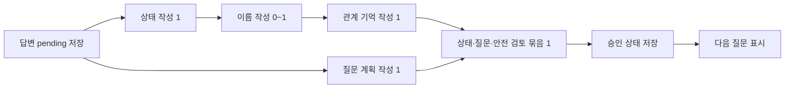
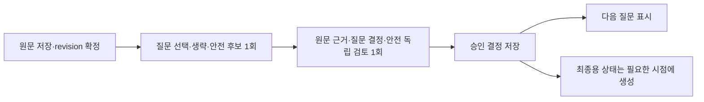
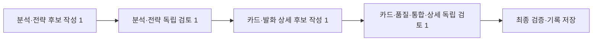

# 대화 실시간 응답·카드 10분 이내 생성 기획

후속 구현: 대화 전체 초안+독립 검토 2회와 카드 6회 선택 경로·검토 출력 압축을 추가했다. 사용자의 후속 요청으로 로컬 `.env`의 2/6회 빠른 경로를 활성화하고 Mac 로컬 대화→카드 검사를 완료했다. 단일 합성 사례의 최종 카드는 6회·249.291초, 마지막 답변부터 저장은 367.264초였다. 대화 실시간 목표는 미달했다. 최신 설정·검증은 [구현·테스트 기록](RESPONSE_LATENCY_OPTIMIZATION_2026-11-10.md)을 따른다. 아래 현재 구조·장부는 최초 기획 조사 시점의 비교 기준이며, 작은 질문 결정 전용 경로와 최종 4회 후보는 아직 구현된 것으로 표시하지 않는다. GPU 서버 재실행은 금지하며 이후 검증은 로컬만 사용한다.

작성일: 2026-11-10(KST) · 상태: 최신 로컬 코드 조사 및 구현 전 기획

사용자 요청: 대화는 실시간 수준으로, 카드는 10분 이내에 나오도록 모델 호출을 최대한 줄이는 방안을 최신 로컬 프로젝트에서 조사한다.

## 1. 제안과 목표

**대화는 질문 선택·안전 판단에 필요한 작은 출력만 작성·독립 검토하는 2회 경로를 목표로 한다. 최종 카드는 현재 정상 8회를 기준으로 6회, 이어서 4회 통합 경로를 비교한다.** 동일 원문에 대한 후속 카드의 재분석과 전체 작업 재시작도 줄인다. 호출 수만 줄이고 더 큰 JSON을 오래 생성하는 변경은 채택하지 않는다.

| 대상 | 목표 | 측정의 시작·끝 |
| --- | --- | --- |
| 입력 반응 | 답변 전송·대기 상태의 즉시 반영, 전경 탭 p95 100ms 이내 지향 | 보내기 동작 → 입력 상태·내 답변 표시. 모델 응답과 별도 지표 |
| 대화의 실시간 목표 | 워밍업·단독 이용에서 **다음 유효 질문 또는 후속 답변 표시 p95 2초 이내** 지향 | 보내기 동작 → 검토와 필요한 저장을 마친 실제 내용 표시 |
| 최종 카드 | **마지막 답변 전송부터 모든 필수 카드·상세 검토·최종 기록 저장·화면 반영까지 600초 이내** | 마지막 답변의 처리, 불씨, 큐·로딩·수정까지 포함 |
| 후속 카드 | 새 카드 요청부터 위 완료 조건까지 600초 이내 | 추가 상황 입력 시간은 제외. 요청 뒤 다시 하는 분석·검토는 포함 |
| 첫 카드 | 개별 승인된 핵심 카드가 준비되면 바로 표시. 전체 완료와 별도로 최소화 | 사용자 동작 → care/script/doList/avoid/next 중 실제로 읽을 수 있는 첫 카드 |

2초는 이 기획의 제품 목표이며 현재 달성 수치가 아니다. 600초도 성공 완료 목표다. 시간초과·실패·불완전 카드를 성공에 넣지 않는다. 고정 응답, 로딩 문구, 관계 요약만 먼저 표시한 것은 대화·첫 핵심 카드의 성공으로 세지 않는다.

단독·동시 이용, 긴 입력, 모델이 메모리에 없는 실행을 나눠 측정한다. 목표 밖 조건을 숨기거나 워밍업 수치로 최초 이용 시간을 대체하지 않는다. 요청 수 감소만으로 로컬 모델의 2초 응답이나 600초 완료를 보장할 수는 없다.

## 2. 조사 기준과 보존 범위

- 기준 HEAD: `a40a14de67766c3b0947bf84b86456f535cb13eb`. 2026-11-10 로컬 작업 트리와 `app/.env`를 읽는 **네트워크 없는 설정 검사**를 대조했다. 실행 중인 앱이 이 설정을 로딩했다는 확인은 아니다.
- 조사 시작 때 이미 변경된 `app/docs/RELATIONSHIP_AGENT.md`와 미추적 `app/docs/FINAL_CARD_PROGRESSIVE_DELIVERY.md`는 보존한다. 후자는 기존 첫 카드 표시 설계로 참조하고 완료된 구현으로 취급하지 않는다.
- 이번 산출물은 기획 문서다. 앱 코드·실행 설정·DB·모델·서비스를 변경하거나 재시작하지 않는다. GPU 서버·SSH·터널을 사용하지 않는다.
- 과거 문서의 서버 전용 추론 계획보다 현재 사용자 지정 GPU 사용 금지가 우선한다. 구현 검증도 로컬 Mac의 앱·DB·Ollama 범위에서 한다.
- 문맥상 불필요한 미응답 질문을 모델이 생략하는 기능, 근거 검증, 독립 검토, 암호화 저장·재조회·삭제·사용자 격리와 `conversation_detail` 저장 계약을 유지한다.
- 카드 디자인은 `85fe360` 기준을 유지한다. 두 열 실천 카드, 복사 버튼, 점 세 개 대기 표시, 연속 진행바를 바꾸지 않는다. 개발·모델 상세는 사용자 화면에 추가하지 않는다. [UI 기준](../app/docs/UI_CONTENT_POLICY.md)을 따른다.
- 속도는 사용자 요청에 따른 운영 개선 지표다. 대회 평가에서 모델 성능·처리시간을 제외한 기존 정책을 바꾸지 않는다.

## 3. 최신 로컬에서 이미 줄인 것과 남은 대기

### 3.1 설정 파일 기준 현황

`node --env-file-if-exists=.env scripts/check-model.js`를 `app/`에서 실행해 `configuration_only` 통과를 확인했다.

| 항목 | 로컬 파일의 유효 설정 | 해석 |
| --- | --- | --- |
| 대화 상태 모드 | `combined_blocks` | 질문 분기와 상태 분기가 병렬이지만 상태 내부는 순차 |
| 질문·블록 입력 범위 축소 | 활성 | 동일 개선을 신규 절감으로 다시 합산하지 않음 |
| 턴 검토 묶음·검토된 이름 재사용 | 활성 | 상태·질문·안전의 논리 검토를 한 POST로 전송 |
| 최종 초안 재사용·최종 검토 묶음 | 활성 | 정상 최종 경로가 이미 8 POST |
| 검토 입력 축소·지적 필드만 품질 수정 | 활성 | 이미 적용된 중복 입력·재출력 절감 |
| JSON 스트리밍·완성 JSON 조기 종료 | 활성 | 모델→서버 처리. 브라우저의 검토 완료 응답 스트림과 다름 |
| 토큰 정책 재사용 요청 | 활성 | revision 계약을 지원하는 서버에서만 유효. Ollama에서 캐시 적중을 확정하지 않음 |
| 상세 생략·단독 안전 승인 재사용 | 비활성 | 상세·검토를 없애서 줄인 경로가 아님 |
| `MODEL_TIMEOUT_MS` | `0` | 현재 작업 전체의 유한 시간 상한 없음 |

코드 기본값은 `combined`, 여러 최적화 기본값은 false다. 기본값·`.env.example`·실제 로컬 파일·실행 프로세스를 구분한다. 설정 근거는 [model-config.js](../app/src/model-config.js) 155~187행과 위 검사다. 과거 [호출 통합 비교](../app/docs/TURN_CALL_COMPARISON.md)의 “정상 2회” 기록을 현재 로컬 경로의 관측값으로 사용하지 않는다.

### 3.2 일반 대화: 정상 4~5 POST

최초 정상 시도에서 상태 1 + 이름 0~1 + 관계 기억 1 + 질문 1 + 검토 묶음 1 = **4~5회**다. 이름이 스키마상 null이거나 전체 입력·계약이 동일한 승인 이름을 재사용할 때 1회가 빠진다. 일반적인 새 답변은 이름이 같아도 전체 입력 지문을 바꾸므로 재사용을 보장하지 않는다.

블록 전용 검토 묶음·이름/안전 재사용 옵션을 해제한 유효 `combined` 구성에서는 통합 초안 1 + 상태 검토 1 + 안전 검토 1 + 조건부 질문 검토 0~1 = **3~4회**다. 현재 로컬 파일에서 상태 모드만 바꾸면 블록 전용 옵션과 충돌해 구성 검사부터 실패한다. 최초 조사 시점의 검토 묶음은 `combined_blocks`에만 연결돼 있었다. 이후 추가한 `MODEL_BUNDLE_COMBINED_TURN_REVIEWS=true` 선택 경로에서는 통합 초안·필수 독립 검토를 2회로 실행한다. 모드만 바꾸는 것으로는 이 새 경로가 활성화되지 않는다.

근거: [relationship-turn.js](../app/src/relationship-turn.js) 161~261, 704~845행; [server.js](../app/src/server.js) 313~346행; [conversation.js](../app/public/js/core/conversation.js) 170~187행. 다음 질문은 전체 상태·관계 기억·검토·저장을 기다린다. [model-stream.js](../app/src/model-stream.js)의 스트림 수집은 이 대기를 없애지 않는다.

### 3.3 최초 최종 카드: 정상 8 POST

| 순서 | 현재 모델 요청 | 요청 수 | 검토의 의미 |
| --- | --- | ---: | --- |
| 1 | 관계 분석 작성 → 분석 검토 | 2 | 분석 근거·해석 검증 |
| 2 | 대화 전략 작성 → 전략 검토 | 2 | 승인 분석에 따른 전략 검증 |
| 3 | 전체 카드 초안 작성 | 1 | 초안을 재사용해 카드별 중복 작성 제거 |
| 4 | 초기 최종 검토 묶음 | 1 | 카드 7 + 품질 1 + 전체 발화·돌봄·통합 3 = 논리 검토 11개 |
| 5 | 발화 상세 작성 → 상세 검토 | 2 | 확정 대화문에 맞춘 `conversation_detail` |
| 합계 | 정상·수정 없음·상태 준비됨 | **8** | 분석·전략·상세를 포함한 논리 검토 **14개** |

근거: [relationship-agent.js](../app/src/relationship-agent.js) 1145~1171, 1394~1440, 1666~1696행; [final-review-bundle.js](../app/src/final-review-bundle.js); [기존 최적화 기록](../app/docs/REVIEW_CALL_OPTIMIZATION.md).

현재는 전체 초안과 초기 검토 묶음이 끝나야 카드 worker가 시작한다. 개별 카드 공개 기능이 있어도 여러 카드가 함께 나올 수 있다. 카드 worker를 3개보다 늘리는 것만으로 이 정상 직렬 경로를 줄일 수 없다.

### 3.4 정상 호출 수에 포함되지 않은 비용

| 조건 | 추가 모델 요청 | 주의점 |
| --- | ---: | --- |
| 마지막 답변 처리 | 대화 4~5 | 사용자가 경험하는 카드 600초에 포함 |
| 불씨 캐시 미적중의 일반 독립 분류 | 2 | 1차 긴급이면 1, 유효 캐시·기존 긴급·원문 없음 등의 경로는 0 가능 |
| 최종에 유효한 상태·관계 기억이 없음 | 정상 3 | 현재 final 상태 보완은 staged 경로. 대화 비용을 뒤로 옮기면 여기 다시 붙음 |
| 최종 안전 재검토가 필요함 | 1 | 조건부. 모든 결과에 일괄 합산하지 않음 |
| 서버가 만든 후속 대화 문맥이 있음 | 정상 1 | `continuation_context_review`. 최초 결과에는 무조건 붙지 않음 |
| 수정·형식 재시도·묶음 분할·fallback | 가변 | 8회·4~5회는 최악 상한이 아님 |
| 작업 전체 재시작 | 유한 상한 없음 | 이미 성공한 분석·초안까지 다시 만들 수 있음 |

현재 `finish()`는 불씨 처리 뒤 결과 POST를 시작한다. 상태가 준비된 일반 경로도 **마지막 답변 4~5 + 불씨 2 + 카드 8 = 14~15회**가 사용자 대기에 들어갈 수 있다. 불씨 캐시·안전 분기에 따라 달라진다. 근거: [conversation.js](../app/public/js/core/conversation.js) 219~244행; [risk-classification.js](../app/src/risk-classification.js) 188~206행; [model.js](../app/src/model.js) 731~742행.

요청당 복구는 최대 3회이지만 그 바깥 [model.js](../app/src/model.js) 628~677행의 `operation()`은 재시도 가능한 오류에 `for(;;)`로 재시작한다. timeout을 설정해도 현재 deadline은 재시작마다 새로 만든다. 따라서 지금 코드에 유한한 최악 호출 수·완료시간이 있다고 주장할 수 없다.

### 3.5 후속 대화와 새 카드

후속 답변은 작성 1 + 사실·답변 검토 1 + 전체 사용자 메시지의 안전 검토 1 = **정상 3회**다. [continuation-model.js](../app/src/continuation-model.js)의 `generateContinuation()`에 해당한다.

`cards`는 앞서 승인된 대화가 있어도 다시 위 3회를 수행한다. 이후 원래 상태를 비운 문맥에서 상태 보완 3회, 카드 8회, 후속 문맥 검토 1회를 거치므로, 비긴급·실제 추가 사실 있음·수정 없음의 조건에서는 **새 카드 요청만 정상 15회**가 될 수 있다. 반면 `complete`와 원문 정정 자체는 모델 0회다. 이 두 동작을 새로운 절감 대상으로 잘못 잡지 않는다.

근거: [continuations.js](../app/src/continuations.js) 83~109, 146~159행; [continuation-model.js](../app/src/continuation-model.js)의 `continuationCardContext()`와 안전 검토; [card-context-review.js](../app/src/card-context-review.js).

## 4. 대화 설계: 전체 상태 재작성에서 작은 결정으로

### 4.1 1단계: 기존 전체 결과를 유지하는 2회 비교 경로

통합 초안 1회 뒤 **기존 상태·조건부 질문·안전 검토를 한 독립 요청에 모두 담는 새 경로**를 비교한다. 현재 combined에 부족한 검토 묶음 연결·복구·안전 전달을 구현해야 한다. 작성기의 자기 승인으로 대신하지 않는다.

이 단계는 기존 반환·저장 형식을 유지하기 쉬운 비교군이다. 다만 상태·관계 기억과 긴 검토 출력을 계속 만들므로, 요청이 2회가 되어도 실시간에 도달하지 못할 수 있다. 현재 4~5회 대비 정상 요청 수 50~60% 감소는 산술값이며 시간 절감률이 아니다.

### 4.2 권장 목표: 질문·안전 결정 작성 1 + 독립 검토 1

매 턴 모델 출력은 질문 ID·추가 확인·생략 결정·이유의 근거 ID·안전 후보와 필요한 이름 변경 후보로 제한한다. 기존 질문 문구·선택지·정적 안내는 서버 질문은행에서 가져온다. 상태 요약·모든 관계 finding·별도 이름 재추출 요청을 다음 질문 표시의 선행 조건에서 뺀다.

실제 대기식은 `큐 + 작성 입력처리·출력 + 검토 입력처리·출력 + 저장 + 표시`다. 두 요청이 직렬이므로 각각의 추론만 이미 1초를 넘는다면 그 상태에서 2초 목표를 충족할 수 없다. 출력의 중복 설명부터 줄이고, 필요한 원문 범위와 검토 항목은 보존한다. 허용 출력 토큰을 무작정 잘라 불완전 JSON·재시도를 늘리는 정책은 피한다. 경량 경로 실측도 2초를 넘으면 그 한계를 기록하고 입력·출력 예산과 자원 경합을 다시 조정한다.

현재 질문 작성은 생성 상태와 독립된 원래 입력을 사용한다. 이 사실은 분리의 근거지만, 새 작은 출력 경로가 기존 기능과 동등하다는 증거는 아니다. [relationshipQuestionRequest](../app/src/relationship-agent.js)와 `questionReviewRequest`, 안전 검토의 기존 원문 범위·validator를 보존해서 검증한다.

필수 조건:

1. 질문·안전 판단에 필요한 현재 원문과 기존 승인 근거를 제공한다. 최신 답변만 주거나, 요약만 보고 부정·정정·시점·주체를 놓치지 않는다. 원문을 몰래 절단하지 않는다.
2. 생략은 이미 답한 질문과 문맥상 불필요한 미응답 질문을 구분한다. 생략 이유에 실제 근거가 있어야 하며, 미응답이라는 사실만으로 생략하지 않는다. 생략한 질문의 답변·사실은 생성하지 않는다.
3. 안전 판단은 질문을 표시하기 전에 검토한다. 키워드 검사나 이전 턴의 `urgent=false`를 새 자유답변의 승인으로 쓰지 않는다. 현재 위험의 긴급 종료 흐름을 유지한다.
4. `source_revision`, 원문 지문, 질문 결정·안전 계약을 묶어 저장한다. 정정·뒤로가기·삭제·취소 이후 늦은 승인으로 다음 질문을 바꾸지 않는다. 현재 pending·revision·sharedRun 경로를 재사용한다.
5. 질문 표시 전에 승인된 결정과 원문을 저장한다. 이후 상태 생성 실패가 이미 저장된 원답변을 없애거나 승인되지 않은 사실을 저장하게 해서는 안 된다.
6. 이름은 대화의 호칭·`state.name`·`chatTitle`·귀속에도 쓰인다. 문장형 호칭 추출이나 다른 답변의 이름 정정을 최종까지 미루지 않는다. 모든 새 자유답변에 정정 가능성이 있으므로 필요한 이름 후보·원문 근거를 같은 2회 작성·검토에 포함하거나 동등한 안전 경로를 정의한다. 이전 이름을 최신 승인처럼 재사용하지 않으며 문장형 입력·도중 정정·제목·최종 귀속의 회귀 검사를 둔다. 근거: [intake.js](../app/src/intake.js) 168, 367행과 [이름 입력 범위](../app/src/turn-input-scope.js).

### 4.3 매 턴 백그라운드 호출로 옮기지 않는다

상태·관계 메모리를 뒤에서 매번 다시 생성하면 표시만 빨라지고 총 호출은 줄지 않는다. 기본안은 **원문은 매번 저장하고, 상세 상태는 최종 진입에서 한 번 생성**하는 것이다. 대화 중 다른 기능이 실제 최신 상태를 요구할 때만 요청을 합쳐 가장 최신 revision 한 개를 만든다.

기존 상태를 최신인 것처럼 전달하지 않는다. `materialized_revision`과 `source_revision`이 다르면 미완성으로 표시하고, 최종 생성·후속 카드의 입력 경계에서 같은 revision의 검토 완료를 기다린다. 최초 전환에는 기존 상태 보완 **3회**가 최종에 추가됨을 예산에 반영한다. 이를 0회로 계산하지 않는다.

공유 로컬 모델에서 백그라운드 작업이 다음 대화를 막지 않도록 새 작업을 먼저 보류한다. 이미 실행 중인 긴 요청을 매번 취소·재시작하는 정책은 낭비와 starvation을 만들므로, 길이·슬롯·최대 대기 측정 후 정한다.

### 4.4 대화 0~1회 후보의 허용 범위

기록 재조회, 서버의 정적 질문 문구 조회, **동일 원문·동일 계약의 이미 승인된 결정 재전달**은 0회가 가능하다. 새로운 자유답변의 문맥 생략·안전 판단까지 0회로 해결할 수 있다고 가정하지 않는다.

후속 대화의 사실·답변 검토와 전체 원문 안전 검토는 서로 다른 입력 범위를 유지하면서 한 독립 요청으로 묶는 **3→2회 후보**다. facts에 선택되지 않은 위험 원문도 안전 검토에 포함한다. 작성 1회만으로 승인하는 경로는 채택하지 않는다. 더 작은 로컬 모델이 필요해지는지는 위 경량 2회 경로를 먼저 실측한 뒤 별도 판단하며, 이번 기획을 모델 교체·다운로드·학습 요청으로 확장하지 않는다.

## 5. 카드 설계: 8회에서 6회, 4회로

### 5.1 6회 후보 — 분석·전략 묶음부터

| 순서 | 제안 요청 | 요청 수 |
| --- | --- | ---: |
| 1 | 관계 분석 + 그 분석을 전제로 한 대화 전략 후보 작성 | 1 |
| 2 | 분석·전략 각각의 원래 검토를 담은 독립 검토 | 1 |
| 3 | 전체 카드 초안 | 1 |
| 4 | 기존 논리 검토 11개 묶음 | 1 |
| 5 | 확정 대화문의 상세 작성·독립 검토 | 2 |
| 합계 | 정상 최종 생성 본체 | **6** |

지금은 **분석 승인 후** 전략을 작성한다. 두 후보를 한 번에 쓰는 변경은 기존 독립 요청을 단순 병렬화하는 것과 다르다. 독립 검토에서 분석과 전략을 각각 판정하고, 분석 반려 시 그 분석을 전제로 한 전략·후속 결과를 무효화한다. 기존 검토 입력·판정 항목을 정확히 재구성할 수 있어야 한다. 정상 요청 수는 25% 감소하며 시간 효과는 실측한다.

### 5.2 4회 후보 — 카드와 상세를 같은 후보로 작성

위 6회 경로에서 전체 카드 초안과 `conversation_detail`을 한 응답으로 작성하고, 기존 최종 검토 11개와 상세 검토를 다음 독립 요청에 담는다. 분석·전략 검토 2개까지 **총 논리 검토 14개를 유지**한다.

이 경로는 아직 구현되지 않았다. 상세를 생략하거나 저장 뒤 무검토로 채우는 방식이 아니다. 초안 대화문과 상세의 연결, 전체 발화 일치, 원문·주체·행동·이유의 근거를 기존 저장 계약으로 검증한다. 대화문이 수정되면 해당 상세와 그 승인도 무효화한다. 다른 카드나 분석 변경도 실제 의존성을 따라 무효화한다.

큰 JSON·긴 검토로 형식 실패와 재수정이 늘면 6회 경로가 더 빠를 수 있다. 입력·출력 예산에 맞지 않는 묶음은 원문 절단 없이 분할하고 실제 POST 수를 기록한다. 형식상 승인과 의미상 정당성을 분리해 검증한다. 현재 고정 합성 응답 검사만으로 새 통합 생성의 의미 품질을 입증하지 않는다.

### 5.3 전체 2회는 탐색용, 우선 도입안은 4~6회

분석·전략·카드·상세 전부 작성 1 + 모든 독립 검토 1의 최저 호출 후보도 가능성은 조사한다. 다만 승인 전 분석에 모든 결과가 종속되고 출력·검토가 커지며, 한 오류가 전체 재생성을 부를 수 있다. **2회가 최단 시간이라는 보장은 없고, 이 경로를 600초 달성의 선행 조건으로 삼지 않는다.** 작성·검토 1회씩의 물리적 분리를 유지해도 서로 다른 모델의 독립 판단을 확보한 것은 아니라는 한계도 남긴다.

### 5.4 첫 카드 공개와 전체 호출 최소화의 선택

현재 묶음은 전체 검토가 끝나야 첫 핵심 카드가 나온다. 4회 경로도 같은 문제가 남을 수 있다. 두 후보를 비교한다.

| 후보 | 장점 | 비용·채택 조건 |
| --- | --- | --- |
| 전체 묶음 유지 | 정상 호출·중복 입력 최소화 | 첫 카드 대기가 목표에 맞는지 확인 |
| 먼저 완성된 핵심 카드의 작은 검토를 우선 실행 | 사용자가 먼저 읽기 시작 가능 | 공개용 추가 POST·전체 시간이 늘 수 있음. 같은 승인을 정확한 대상에만 재사용 |

작은 검토에서 모든 카드의 승인을 얻었다고 간주하지 않는다. 후속 통합 검토가 반려하면 관련 부분 카드를 철회·교체한다. 버전·원자적 공개·철회·재접속·복사 동작은 기존 [반 스트리밍 설계](FINAL_CARD_PROGRESSIVE_DELIVERY.md)를 따른다. 첫 카드가 빨라져도 전체 저장이 600초를 넘기거나 실패가 늘면 이번 목표를 달성한 것이 아니다.

## 6. 중복 호출·재시작부터 줄일 지점

### 6.1 후속 카드: 같은 원문을 다시 답변시키지 않기

현재 `messages` 처리에서 승인한 draft가 있어도 `cards`는 `continueConversation()`을 다시 호출한다. 원문이 같다면 재사용 후보지만, 현재 저장에는 draft와 `safety_urgent`만 있고 **전체 안전 승인·근거·검토 계약**이 없다. boolean만 보고 3회를 제거하면 안 된다.

구현 순서는 전체 승인 snapshot과 원문 지문을 먼저 보존하고, `cards`가 동일한 보고·정정·질문 문맥·기준 record·검토 정책에서만 재사용하게 하는 것이다. 권한·계약·기한이 맞지 않거나 새 메시지·정정이 있으면 다시 검토한다. 사용자나 대화가 다른 승인을 공유하지 않는다.

현재 `messages` 응답 뒤에는 assistant 메시지가 추가되므로 사용자 원문이 같아도 다음 `cards`의 전체 모델 입력은 동일하지 않다. 추출·안전 판단의 입력 계약을 원문·명시적 요청/추가 확인 연결에 맞춰 분리하거나, 추가된 assistant 문맥이 결정에 미치는 영향을 검증해야 한다. 단순 원문 해시만으로 현재 요청의 캐시 적중을 선언하지 않는다.

이 문맥·전체 안전 승인 재사용이 검증된 조건에서 후속 카드 본체는 **15→12회**가 1차 후보다. 상태 보완 3 + 6회 최종 + 후속 문맥 검토 1이면 **10회**, 4회 최종이면 **8회**가 계산값이다. 새 상태 보완을 없앤다고 가정하지 않는다. 실제 재사용과 검토 통합이 검증되기 전에는 이 숫자를 현재 호출 수로 표시하지 않는다.

완료된 동일 `request_id`의 재요청은 이미 0회다. 별도 개선 후보는 같은 원문에서 **새 request ID로 누른 카드 요청**의 중복 제거다. 사용자가 명시적으로 재생성을 요구한 경우와 통신·화면 복원 중복을 구분하고, 이전 승인 결과를 권한·기준 원문·현재 정책에 맞춰 반환한다.

### 6.2 성공 단계의 재사용과 실패 단계만 수리

- 이미 승인된 분석·전략·초안은 **이번 owner·대화·원문·모델·프롬프트·스키마·검토 정책·출력 지문**이 같은 범위에서만 재사용한다. 모델명만 같거나 글자가 같은 것만으로 승인하지 않는다.
- 현재 sharedRun·완성 record 재조회는 이미 중복을 막는다. 추가 대상은 전체 작업 실패 뒤 중간 성공 단계의 재사용이다. `finalDraftSeed`는 신뢰된 로컬 테스트 경로이며 일반 서비스의 영속 checkpoint가 아니다.
- 먼저 같은 실행의 메모리 내 단계 재사용을 비교하고, 새 영속 저장이 필요하면 기존 암호화·보존 기간·삭제·격리에 맞춰 설계한다. 원문·중간 카드를 평문 로그나 공유 전역 캐시에 두지 않는다.
- 분석 변경은 종속 전략·카드·상세 승인을 무효화한다. 카드만 바뀌면 그 카드·관련 전체 검토·종속 상세를 다시 검토한다. 이전 승인을 덮어써서 재검토를 생략하지 않는다.
- 의미 반려는 필요한 수정으로, 형식·통신 실패는 해당 요청의 복구로 처리한다. fallback을 탔다고 이미 승인된 독립 단계까지 무조건 다시 생성하지 않는다.

### 6.3 불씨·전송·로컬 모델 자원

일반 상담의 독립 분류 2회는 사용자 지정 계약이므로 하나로 합치지 않는다. 현재의 원문·정책·revision·기한 캐시는 유지한다. 최종 카드 생성과 별개인 비긴급 작업으로 분리 가능한지 먼저 확인한 뒤, 전체 600초 예산 안에서 순서를 조정한다.

단순히 `await ReferralGuide.observe()`를 제거하면 최종 저장의 revision 갱신이 진행 중 분류를 취소해 재호출할 수 있다. source revision과 saved revision 연결·취소 경계를 함께 설계한다. 새 원문을 보지 않은 이전 안전 판단으로 긴급 처리를 늦추지 않는다. 안전 확인에 필요한 선행 작업은 먼저 수행하고, 분리된 비긴급 안내도 누락·실패를 완료로 숨기지 않는다.

현재 첫 progress 조회는 250ms 후, 이후 조회 완료 후 1,500ms다. 모델 응답 스트리밍을 켜는 것과 승인 결과를 브라우저에 즉시 전달하는 것은 별개다. 승인→표시 지연이 병목이면 인증·재연결·철회·revision을 지키는 SSE나 적응형 조회를 비교한다. 전송 개선은 모델 POST 절감으로 세지 않는다.

공유 로컬 모델에는 다음 대화·안전 검토와 이미 작성된 첫 카드 검토가 실행 기회를 얻도록 공정한 큐를 둔다. 긴 final의 starvation도 막는다. 앱의 동시 요청과 실제 물리 추론 병렬성은 다르며, 다른 앱 프로세스의 작업까지 제어한다고 가정하지 않는다. 병렬 수는 1부터 측정하고 처리량·메모리·대화 지연이 함께 좋아질 때만 높인다. Ollama도 병렬 요청에 추가 메모리가 필요하다고 설명한다. [공식 동시성 문서](https://docs.ollama.com/faq#how-does-ollama-handle-concurrent-requests)

모델 상주·예열은 로딩 지연을 줄이는 별도 후보다. 예열 요청도 호출·자원 사용에 포함하고, 매 턴 예열하거나 현재 세션을 방해하지 않는다. 현재 앱은 `/v1/chat/completions`를 쓰므로 native API의 `keep_alive`·시간 필드를 그대로 지원한다고 가정하지 않는다. API 호환성을 확인한 로컬 경로에서만 시험한다. [Ollama 예열·상주 문서](https://docs.ollama.com/faq#how-do-i-keep-a-model-loaded-in-memory-or-make-it-unload-immediately), [호환 API](https://docs.ollama.com/api/openai-compatibility)

## 7. 전체 호출 장부와 600초 예산

### 7.1 비용을 뒤로 옮긴 것과 없앤 것을 구분

정상 N개 턴, 불씨 R회, 추가 복구 없음이라는 단순 조건의 비교다. R은 일반 캐시 미적중이면 2이며 분기에 따라 달라진다.

| 경로 | 상담 전체 정상 POST 계산 |
| --- | --- |
| 현재 로컬 | `각 턴 4~5회의 합 + 최종 8 + R` |
| 전체 상태를 매번 만드는 통합 2회 후보 | `2N + 최종 6 또는 4 + R` |
| 권장 작은 결정 2회 + 최종 상태 1회 생성 | `2N + 상태 보완 M + 최종 6 또는 4 + R` |

M은 같은 revision의 승인 상태가 있으면 0, **현재 보완 경로를 그대로 쓰면 3**이다. 추가 안전·후속 문맥 검토·수정·재시도는 모두 별도 합산한다. 대화 중 실제로 materialization을 수행했다면 그 비용도 상담 전체 장부에 넣는다.

작은 결정 2회·기존 상태 보완 3회·4회 최종·불씨 2회의 예시에서는 마지막 답변 전송 이후만 **2 + 3 + 4 + 2 = 11회**다. “카드 4회”를 전체 대기 4회라고 홍보하지 않는다. 현재 같은 일반 조건은 14~15회지만, 이 차이도 시간 단축률은 아니다.

### 7.2 4회 최종 후보를 위한 첫 시간 배분안

아래는 **측정 전의 설계 예산**이다. 현재 로컬 처리속도나 확률적 보장값이 아니다. 같은 작업의 단조 증가 시계로 추적하며, 개별 단계 p95를 더해 전체 p95를 입증하지 않는다.

| 구간 | 최초 배분 |
| --- | ---: |
| 마지막 답변 승인 + 필요한 최신 상태 보완 | 60초 |
| 큐 대기·모델 로딩 합계 | 30초 |
| 분석·전략 후보 작성 | 60초 |
| 분석·전략 독립 검토 | 45초 |
| 카드·상세 후보 작성 | 150초 |
| 카드·품질·통합·상세 독립 검토 | 105초 |
| 필요한 불씨 분류·반영 | 45초 |
| 추가 수리·재검토 여유 | 90초 |
| 최종 검증·저장·화면 반영 | 15초 |
| 합계 | **600초** |

이 배분은 전체 완료용이다. 대화의 2초 목표와 별도로, 첫 카드 대기는 더 줄여야 한다. 실제 측정에서 지켜지지 않는 구간은 입력·출력·재시도·큐를 다시 분해한다. 동시 이용 수와 모델 처리량이 맞지 않으면 입장 제한·대기 안내가 필요하며 무제한 큐로 목표를 보장할 수 없다.

### 7.3 목표와 강제종료 정책을 분리

기존 `MODEL_TIMEOUT_MS=0`을 600,000으로 바꾸는 것을 속도 개선으로 제시하지 않는다. 기존 문서에 총 시간 제한을 제거한 사용자 계약이 있으므로, **이번 문서 작성으로 강제 timeout이나 자동 실패 정책을 활성화하지 않는다.**

대신 실험에서는 사용자 동작부터 저장까지 누적되는 시간·전체 POST·재시작·같은 내용 재작성 횟수를 기록한다. 재시작해도 같은 장부를 이어 간다. 불필요한 전체 재시작을 줄이고 남은 예산으로 다음 수리가 가능한지 관측한다. 유한 복구 예산·과부하 처리·진행 보존 재개는 구현 정책으로 별도 명시하며, 실패로 빨리 끝내는 것과 성공을 10분 안에 만드는 것을 구분한다.

600초 성공 기준은 입장한 모든 대상 요청에서 확인한다. 초과·중단·실패 수와 비율을 함께 제시한다. p95만 통과하고 느린 5%를 숨기거나, 600초에 작업을 잘라 실패시키고 성공이라고 하지 않는다. 현재 코드에는 최악 완료시간 보장이 없다는 한계는 유지한다.

## 8. 구현 순서와 완료 기준

| 단계 | 작업·주요 파일 | 완료 기준 |
| --- | --- | --- |
| P0 | `model-operation-metrics.js`, `model.js`, `server.js`, `conversation.js`: 원문 없는 end-to-end 계측 | 마지막 답변·후속 요청부터 큐/로딩/모델/수리/저장/표시까지 한 실행으로 연결 |
| P1 | `relationship-turn.js`, 검토 묶음 모듈: 전체 통합 2회 비교군과 작은 결정 2회 경로 | 정상 실제 POST 확인, 기존 질문 생략·정정·안전·저장 회귀 유지. 둘 중 실제 빠른 후보 선택 |
| P1 | `continuation-model.js`, `continuations.js`: 후속 3→2 검토 묶음, 같은 원문의 cards 재처리 방지 | 전체 안전 승인·근거·계약을 보존한 재사용만 허용. 새 메시지·정정은 무효화 |
| P2 | `model.js`, `relationship-agent.js`: 성공 단계 재사용·필요 시 최종 상태 materialization | 동기 경로에서 뺀 비용까지 장부 반영, 정정/취소 경합·암호화/삭제 유지 |
| P2 | `relationship-agent.js`, 프롬프트·스키마·검토 모듈: 최종 6회 후보 | 분석·전략 두 검토 및 종속 결과 무효화, 정상 저장 계약 동일 |
| P3 | 같은 모듈: 카드+상세 통합 4회 후보 | 논리 검토 14개 전체 coverage, 변경 대화문·상세 불일치 차단, 실패 포함 실측에서 6회보다 유리 |
| P3 | `referral-guidance.js`, `server.js`, `conversation.js`: 안전한 선행 대기 축소 | 독립 분류·안전 유지, revision 갱신 뒤 유실·중복 분류 없음 |
| P4 | `generation-progress.js`, 기존 결과 컴포넌트: 첫 카드 검토 우선·전달 지연 개선 | 첫 유효 카드가 실제 빨라지고 전체 완료·다른 사용자 대기가 악화되지 않음, 기존 디자인 유지 |

새 플래그 이름·활성화 범위는 구현 시 확정한다. 기존 모드와 계약을 조용히 바꾸지 않고 비교 가능한 별도 경로로 만든다. 새 의존성은 필요하지 않다. 되돌릴 때는 새 실행부터 기존 검증 경로를 사용하고 진행 중 승인·저장 기록을 덮어쓰지 않는다.

## 9. 검증과 채택 조건

### 기능·검토

- 이미 답한 질문 생략, 문맥상 불필요한 미응답 질문 생략, 유사하지만 여전히 필요한 질문 유지, 실제 모름·거절 보존을 각각 검사한다. 생략 사실과 답변 생성 여부를 별도로 검증한다.
- 이름·사람·시점·부정·긴 답변 말미 정정·최신 전언·가정을 확인한다. 원문 없는 사실·도움 의사·약속을 카드 근거로 만들지 않는다.
- 질문·facts에 선택되지 않은 위험 원문, 긴급 전환, 정정 뒤 안전 판단 변경을 확인한다. 작은 출력·검토 묶음에서도 기존 검토 coverage를 ID별로 대조한다.
- 분석 반려·카드 수정·상세 불일치·묶음 형식 실패·통신 오류·취소·삭제·정정 경합에 실패를 주입한다. 반려된 카드 부활, 늦은 저장, 다른 owner의 승인 재사용을 차단한다.
- 최종 가이드·분석·메모리·상세의 저장·재조회 일치와 재조회 모델 0회를 확인한다. 부분 표시는 저장 완료로 오표시하지 않는다.
- 결과·기록·생성 중·모바일에서 기존 카드 형태, 두 열, 복사 내용·철회 동작을 검사한다.

### 시간·호출

같은 합성 입력, 같은 로컬 모델·설정, 원문·검토 정책을 고정하고 현재 4~5/8회 경로와 후보를 교차 순서로 비교한다. 짧은 입력뿐 아니라 긴 정정, 후속 대화, 수리·묶음 분할 경로를 포함한다. 원천 상담·학습 원문을 문서나 로그에 복사하지 않는다.

단독 기준은 일반/생략/정정/긴급/후속의 고정 시나리오를 반복한다. 초기 5회씩은 병목 탐색용으로만 쓰고, 채택 후보는 워밍업 일반 대화 최소 100턴, 카드 요청 최소 30회를 수집한다. 카드 30회만으로 안정적인 p95나 임의 동시성의 보장을 주장하지 않는다. 동시 2·3개 이용과 최초 로딩은 별도 표로 공개하고, 더 많은 용량을 약속하려면 그 조건을 추가 검증한다.

기존 attempt 로그의 `http_attempt_index`, `operation_id`, `operation_restart`, `duration_ms`, `usage`, writer/reviewer/classifier 구분을 재사용한다. stage family 합계는 중복 집계될 수 있으므로 **물리 POST는 고유 attempt ID로 센다.** GET·예열·검토 항목 수·토큰·응답시간은 별도 항목이다. 서버 로그와 브라우저 시계는 trace ID로 연결하고 시계 차이를 그대로 빼지 않는다.

브라우저에는 submit, answer 저장 확인, next 내용 표시, result 요청, 첫 승인 카드의 실제 표시, 최종 저장 응답·최종 화면 표시 시각을 기록한다. DOM에만 있거나 화면 아래·로딩 덮개 뒤에 있는 카드는 visible로 세지 않는다. 모델의 첫 토큰과 검토 완료 후 사용자가 읽는 첫 내용을 구분한다.

native Ollama의 `load_duration`, `prompt_eval_duration`, `eval_duration` 등은 지원되는 실험 경로에서만 수집한다. 현재 `/v1`의 `usage`만으로 로딩·큐·prefill·decode 시간을 모두 안다고 가정하지 않는다. [공식 응답 필드](https://docs.ollama.com/api/chat)

채택은 **검토·기능을 유지하면서 실제 다음 응답과 전체 카드 완료가 빨라지는가**로 결정한다. 대화 2초는 별도 통과 여부를 남긴다. 카드 실험에서 600초 초과·실패가 있으면 해당 조건의 목표 미달로 기록하고 호출 수만으로 완료 처리하지 않는다. 모델의 전부 승인 응답도 원문 대조·기존 로컬 검증을 면제하지 않는다.

## 10. 이번 문서 작성의 검증 기록

- 최신 소스·설정 전용 검사와 대화/카드 흐름의 독립 코드 조사를 대조했다. 최초 최종 카드의 8 POST, 일반 턴의 4~5 POST는 정상 경로의 코드·고정 응답 검사 근거다.
- 문서의 독립 재검토에서 상태 모드만 변경할 때의 설정 충돌과 경량 대화의 이름·호칭 정정 보존 조건을 보완했다.
- 기존 `turn-review-bundle`, `final-review-bundle`, `model-operation-metrics`, `final-draft-reuse` 검사: **92 통과, 실패·건너뜀 0**. 실제 Gateway·mock HTTP에서 호출·검토·무효화·저장 payload 계약을 확인한 검사이며 실모델 시간 측정은 아니다.
- 사용자 지정 병행 검토 API `192.168.123.175:11434`의 `gemma4:12b`에 원문·비밀값 없는 기술 요약을 보냈으나 연결 timeout으로 결과를 받지 못했다. 응답이 없으므로 모델 검토 완료로 주장하지 않는다. 로컬 코드·기존 검사와 독립 조사로 사실을 대조했다.
- 새 2/6/4회 경로는 미구현이며 **실시간·600초 달성은 아직 미검증**이다. 현재 동작의 새로운 실모델 지연 기준선도 이번 문서 작업에서 측정하지 않았다. 앱·DB·모델 설정·실행 서비스·GPU 서버는 변경하지 않았다.

관련 기준: [현재 문서 목차](../docs/README.md), [모델 입력 최적화](../app/docs/MODEL_INPUT_OPTIMIZATION.md), [검토 호출 최적화](../app/docs/REVIEW_CALL_OPTIMIZATION.md), [첫 카드 공개 상세 설계](FINAL_CARD_PROGRESSIVE_DELIVERY.md).
