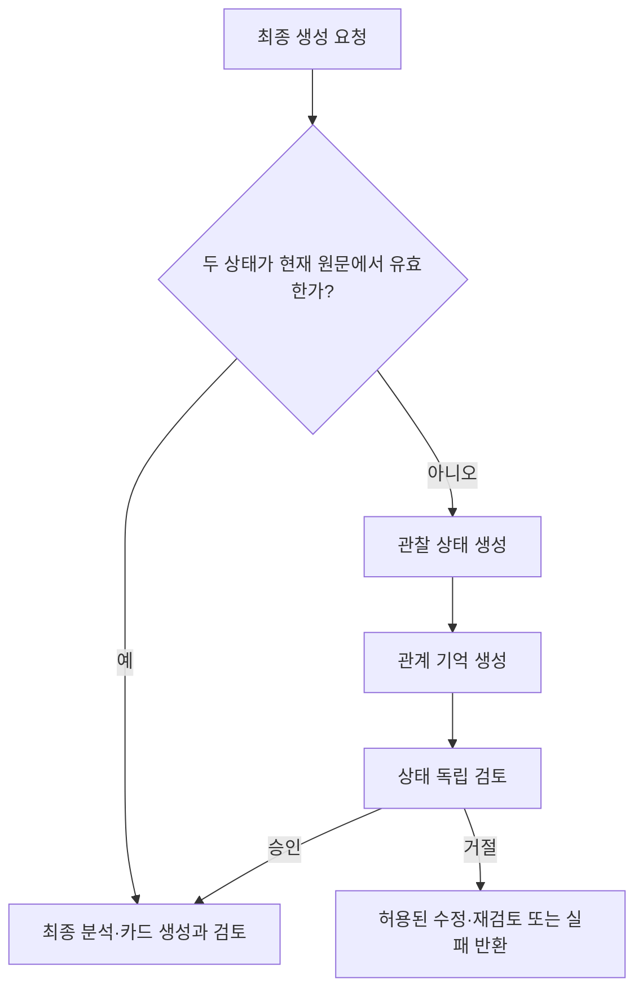

# 모델 JSON·컨텍스트·상태 준비 현상의 원인과 해결 방안

작성일: 2026-11-11 · 대상: HOP-Final 현재 main 코드와 저장된 2026-11-10 실행 기록.

이 문서는 원인 검토와 후속 구현 계획에 이어, 사용자의 적대적 검증·해결 요청으로 반영한 수정까지 기록한다. 초기 검토는 읽기 전용이었고 후속 검증에서는 재현된 결함을 수정했다(8절). 로컬 Mac Ollama에는 합성 진단만 실행했으며 서비스 상담·학습·GPU 서버 작업은 하지 않았다. Mac 12B 형식 오류와 과거 31B 컨텍스트 초과는 서로 다른 실행의 증거다. 합쳐서 하나의 모델 실패율로 계산하지 않는다.

## 1. 먼저 알아야 할 결론

| 현상 | 확인된 의미·원인 | 현재 상태 | 우선 대응 |
|---|---|---|---|
| JSON·스키마 오류 | 응답이 JSON 문법 또는 출력 계약을 위반함. 저장된 12B 응답에서 관계 기억의 `unknowns` 누락 확인 | 요청별 최초 포함 최대 3회. strict schema·필수 키 안내·정확한 오류 피드백은 이미 있음 | 실행기의 스키마 준수 조건을 재현하고 상태 추출 설정·조건부 복구를 비교 |
| 컨텍스트 초과 | 전체 입력과 출력 예약의 합이 실행 한도를 초과함. 31B의 큰 검토 묶음에서 발생 | 당시에는 용량 오류를 일반 upstream 오류로 분류해 분할 복구에 도달하지 못함. 현재 코드에는 인식·분할 처리 반영 | 현재 코드의 실제 31B 재검증은 별도 허용 후 진행. 요청 전 토큰 계측·예산별 묶음 구성 설계 |
| 상태가 준비되지 않음 | 최종 생성에 쓸 유효한 관찰 상태·관계 기억이 없어 준비하는 정상 분기일 수 있음 | 관찰 → 관계 기억 → 상태 검토를 먼저 실행. 후속 새 카드는 의도적으로 이전 상태를 비움 | 정상 재구성과 상태 유실을 구분해 기록하고, 같은 원문에 대해 검증된 상태만 재사용 |

최대 3회는 **개별 모델 요청의 시도 상한**이다. 블록 복구·의미 수정·독립 재검토·컨텍스트 분할·상태 준비는 별도 요청을 만들 수 있다. 따라서 전체 사용자 작업이 최대 3회라는 뜻은 아니다.

## 2. JSON·스키마 오류

### 2.1 실제로 확인된 현상

Mac `gemma4:12b`의 저장된 HTTP 전체 흐름에서 대화 답변 6개를 처리할 때 모델 POST는 22회였다. 오류·복구가 없으면 같은 통합 경로는 12회다. 형식 실패는 7회이며, 실패한 시도에만 합계 205.056초가 걸렸다.

| 분류 | 횟수 | 확인 범위 |
|---|---:|---|
| `agent_schema` | 6 | 모두 `turn_draft`. 이 중 4건은 `output.state.relationship_memory / objectKeys` 경로가 기록됨 |
| `content_json` | 1 | JSON 문법·파싱 단계의 실패. 세부 원인은 저장된 메타데이터만으로 확정할 수 없음 |
| 최종 카드 단계 형식 실패 | 0 | 최종 6 POST는 모두 첫 시도 성공 |

별도 저장된 마지막 검증 실패에는 다음 구조 차이가 남아 있다. 실제 상담 문구는 옮기지 않았다.

```text
위치: output.state.relationship_memory
필수 키: patient, supporter, relationship, unknowns
실제 키: patient, supporter, relationship
누락 키: unknowns
요청 형식: json_schema, strict=true
해당 객체: required에 네 키 모두 지정, additionalProperties=false
```

이 기록은 필수 키 누락 자체를 확인한다. 6개 스키마 실패가 모두 같은 키 누락이었다고 확대 해석하지 않는다. 추가 POST 10회에는 실패 시도뿐 아니라 블록 복구도 포함된다.

근거: [12B 실행 설명](RESPONSE_LATENCY_OPTIMIZATION_2026-11-10.md), 로컬 증거 `runtime/response-latency-20261110/local-fast-e2e-http-fixed/run.log` 및 `last-model-failure.json`. 후자는 입력·응답을 포함할 수 있으므로 Git에 추가하거나 문서에 복사하지 않는다.

### 2.2 이미 구현된 방어와 아직 모르는 부분

- 현재 생성·검토 설정 모두 `json_schema`다. [model.js](../app/src/model.js)의 `agentComplete()`는 `strict:true`와 스키마를 요청하고 프롬프트에도 출력 스키마를 전달한다.
- [relationship-turn.js](../app/src/relationship-turn.js)의 `draftPrompt()`는 네 필수 키와 빈 배열도 생략하지 말라는 지시를 이미 포함한다.
- 재시도는 오류 위치·필수 키·누락 키 등의 피드백과 실패 후보를 사용한다. 단순히 같은 요청을 아무 설명 없이 다시 보내는 구조가 아니다.
- `MODEL_SCHEMA_STRING_LIMITS=false`는 추론용 스키마의 문자열 최대 길이 제약을 제거한다. 필수 객체 키를 제거하지 않으며 앱의 최종 검증은 원래 스키마를 유지한다.
- 스트리밍 JSON 종료 감지는 JSON 문법의 완결 여부를 확인한다. 스키마 승인과는 별개이며, 이후 검증에서 필수 키 누락은 거절된다.

따라서 "JSON 강제를 켠다", "필수 키 안내를 추가한다"만으로 해결됐다고 할 수 없다. 스키마가 요청에 존재하는데도 위반한 원인이 실행기의 문법 제약 적용, 복잡한 스키마 조합, 스트리밍 경로 중 어디에 있는지는 추가 재현이 필요하다. 출력 토큰 부족이나 조기 종료가 이번 필수 키 누락의 원인이라는 증거도 확보되지 않았다.

### 2.3 권장 해결 방안

1. **실행기 호환성 재현부터 한다.** 상담 원문 없는 합성 사례로 필수 네 배열만 가진 최소 스키마와 실제 중첩·분기 구조를 비교한다. 같은 모델·버전에서 스트리밍 켬/끔을 비교하고, 필요할 때만 호환 API와 native API 차이를 조사한다. 실제 전송 형식·스키마 해시·종료 사유를 남긴다. 이 결과로 문제를 일으키는 제약 조합을 좁힌다.
2. **상태 초안의 temperature 0을 비교한다.** 현재 `agentComplete()`는 0.2를 사용한다. 구조화된 상태 추출 단계에 한정해 0과 비교한다. [Ollama 공식 구조화 출력 문서](https://docs.ollama.com/capabilities/structured-outputs)는 낮은 temperature를 권장하지만, 필수 키 준수나 이 프로젝트의 개선률을 보장하지 않는다.
3. **반복 구조 오류에만 복구 전략을 바꾼다.** 초기에는 합본 초안이 구조 실패 3회 후 기존 블록 생성으로 전환했다. 후속 수정에서는 strict `json_schema` 요청의 첫 두 시도에서 관계 기억의 `unknowns`만 연속 누락되고 여분 키가 없을 때 2회 후 기존 전체 블록 복구로 전환한다. 다른 오류는 기존 상한을 유지하며, 첫 실패가 다음 시도에 해결되면 합본 경로를 유지한다. `json_object`의 세 번째 스키마 강제 기회도 보존한다. 이는 재발 시 낭비 한 번을 줄이는 조치이며 최초 생성 오류의 제거를 보장하지 않는다.
4. **부분 복구는 후속 설계로 제한한다.** 실패한 관계 기억 블록만 새로 만들고 나머지를 재사용하려면 원문·스키마·후보 버전 결속, 다른 블록과의 모순 검사, 조합 후 전체 검증과 독립 검토가 필요하다. 현재 동작으로 오해하지 않도록 별도 구현·검증 대상으로 둔다.
5. **개인정보 없는 진단을 보강한다.** 현재 로그의 `path/keyword`에 실제 응답 형식, 스키마 해시, 허용된 고정 키의 누락 목록, 여분 키 개수를 추가하는 방안을 검토한다. 임의 키 이름·인용·응답 전문은 기록하지 않는다.

누락 배열을 서버가 자동으로 `[]`로 채우면 "미확인 사항이 없다"는 의미를 만들어낼 수 있다. 필수 필드 삭제, 스키마 완화, 검토 생략, 질문 생략 기능 제거는 해결책으로 채택하지 않는다.

## 3. 컨텍스트 초과

### 3.1 무엇이 한도를 사용하는가

```text
실제 토큰화된 입력 + 요청한 출력 예약 ≤ 실행기의 전체 컨텍스트 한도
```

입력은 사용자 답변만이 아니다. 시스템 지시, 전체 원문과 근거 후보, 상태·분석·전략·카드 초안, 출력 스키마, 각 검토 과제의 지시·claims, 재시도 시 실패 후보와 오류 피드백도 포함한다. 채팅 템플릿 등 실행기가 붙이는 내용까지 실제 tokenizer로 계산해야 한다. JSON bytes나 글자 수는 토큰 수가 아니다. API의 스키마 인자가 문맥에 추가되는 방식도 실행기별로 확인해야 하며 임의로 두 번 계산하지 않는다.

여러 검토를 한 POST로 묶으면 호출 수는 줄지만 요청 한 개의 입력·출력 계약이 커진다. 병렬 실행이나 GPU 두 대 사용이 단일 요청의 컨텍스트 한도를 자동으로 늘리지는 않는다.

### 3.2 31B에서 확인된 실패와 현재 코드의 차이

저장된 31B 실행은 전체 한도 32,768토큰, 출력 예약 8,192토큰이었다. 이 조건에서 입력에 남는 예산은 **24,576토큰**이다. 이것은 계산된 허용량이지 실제 실패 입력의 측정값이 아니다.

정확한 실패 입력 토큰 수는 저장되지 않았다. worker의 실제 토큰 검사 조건으로 입력이 24,576토큰보다 컸다는 것까지 확인할 수 있다. 결과 JSON의 `prompt_tokens: 0`은 누락된 usage를 집계 코드가 0으로 합산한 값으로, 실제 입력이 없었다는 뜻이 아니다.

`final_review_bundle_initial`에서 입력과 출력 예약이 전체 한도를 넘어 worker가 `context_length_exceeded`를 반환했다. 카드 구간 8 POST 중 7회는 생성했고 마지막 1회는 입력 예산 검사에서 거절됐다. 602.795초는 완료 시간이 아니라 실패까지 걸린 시간이다.

당시 앱은 이를 `MODEL_UPSTREAM_ERROR / http_rejected`로 분류했다. 묶음 분할은 `MODEL_CONTEXT_TOO_LONG / context_budget`에 반응하므로 해당 실행은 분할 복구로 이어지지 못했다. 즉 **요청이 실제로 컸던 문제와, 그 용량 오류를 복구 경로에 전달하지 못했던 문제가 함께 있었다.**

현재 [model.js](../app/src/model.js)의 `contextBudgetError()`는 HTTP 400 + `invalid_request_error` + `context_length_exceeded`를 메시지 문구와 무관하게 인식한다. 이 코드의 오류에서는 출력 예약을 임의로 줄이지 않고 상위 분할 경로로 전달한다. [relationship-agent.js](../app/src/relationship-agent.js)의 검토 묶음 처리는 과제 단위로 재귀 분할하고, 공동 분석·전략 생성은 기존 분리 경로로 복구한다. 분할된 검토는 현재 순차 실행되므로 동시 추론과 구분한다.

별도로, 구형 backend의 정확한 숫자형 오류 문구와 검증된 정책이 일치하면 입력을 유지하고 남은 용량으로 출력 예약만 줄여 재시도하는 기존 경로가 있다. 따라서 모든 공급자·오류에서 출력 축소가 없다고 일반화하지 않는다. 생성이 실제 출력 한도에 도달해 `finish_reason: length`로 끝난 경우도 정상 완료로 저장하지 않는다.

이 처리는 현재 합성 회귀검사에서 검증됐다. **같은 31B 실모델의 전체 성공은 아직 재검증하지 않았다.** 단일 검토 과제 자체가 너무 크면 묶음 분할만으로 해결되지 않고 계속 실패해야 한다.

근거: [31B 상세 기록](Gemma4_31B_모델_학습과_추론_검증_2026-11-10.md), [현재 용량 오류 회귀검사](../app/tests/model-context-code.test.js), 로컬 `runtime/gpu-lora31b-bundled-fixed-20261110/runs/b731/RESULT.json`.

### 3.3 권장 해결 방안

1. **현재 오류 분류·분할 경로를 유지하고 실제 실행 연결을 확인한다.** 동일 오류에 같은 큰 요청을 3회 반복하지 않는다. 31B 재실행은 GPU 서버 사용이 다시 허용된 뒤 별도 진행한다.
2. **서버 한도 조회와 실제 입력 계측을 구분한다.** 현재 token policy 조회로 한도를 알아도 개별 요청이 들어갈지는 보장되지 않는다. 모델·tokenizer·채팅 템플릿·정책 revision이 일치하는 정확한 계측으로 입력, 출력 예약, 여유량을 남기는 경로를 설계한다.
3. **초과 후 분할에서 요청 전 예산별 분할로 발전시킨다.** 공통 원문·검토 대상·필수 감사 항목을 보존하면서 들어갈 수 있는 과제 수를 계산한다. 각 과제의 출력 요구량도 예약한다. 나눈 뒤 모든 논리 검토가 빠짐없이 완료됐는지 검사한다.
4. **중복 표현을 줄이되 원문을 자르지 않는다.** 이미 존재하는 공유 원문 전달·근거 ID·검토 압축 경로의 적용 범위를 확인한다. 압축은 잘못된 ID나 누락을 만들 수 있으므로 디코딩 후 원래 계약으로 검증한다. 압축 옵션 전체 활성화는 별도 실측 전에는 해결 완료로 취급하지 않는다.
5. **단일 과제 초과를 별도로 처리한다.** 근거 보존 가능한 과제 재설계나 검증된 더 큰 컨텍스트 실행기가 필요하다. 출력 예약 축소는 필요한 응답을 끝낼 수 있다는 단계별 측정 없이 적용하지 않는다. 컨텍스트 확장은 메모리 요구량도 늘리므로 설정 숫자만 바꿔 해결됐다고 하지 않는다. [Ollama 컨텍스트 안내](https://docs.ollama.com/context-length)

형식 재시도 때 붙는 실패 후보·피드백은 입력을 더 키울 수 있다. 따라서 두 번째·세 번째 시도에도 예산을 다시 검사해야 한다. 이 가능성은 코드 구조에서 도출한 것이며, 저장된 31B 초과가 형식 재시도 때문에 발생했다는 뜻은 아니다.

## 4. 상태 준비가 먼저 필요한 이유

### 4.1 두 종류의 준비 상태를 구분한다

| 구분 | 의미 | 동작 |
|---|---|---|
| 상담 진행 상태 `ready` | 입력·질문 흐름이 완료됐는가 | 완료되지 않으면 결과 API는 409 `INTAKE_NOT_READY`를 반환할 수 있음 |
| 최종 생성에 쓸 모델 상태 | 현재 원문에서 재검증할 수 있는 관찰 상태와 관계 기억이 있는가 | 없거나 유효하지 않으면 내부 상태 준비를 실행 |

"관찰·관계 기억·상태 검토가 먼저 필요"는 두 번째 조건을 설명한다. 사용자에게 모든 미응답 질문을 다시 답하게 해야 한다는 뜻이 아니다. 맥락상 불필요한 질문을 모델이 생략하는 기존 정책을 유지한다.

### 4.2 현재 준비 조건과 호출 흐름

[model.js](../app/src/model.js)의 `respond()`는 기존 `patient_state`와 관계 기억을 현재 문맥으로 검증한다. 둘 중 하나라도 사용할 수 없으면 `relationshipState(..., final=true)`를 실행한다.



- 유효한 일반 대화 상태는 답변 처리 후 저장되고 최종 생성에 전달된다. 이 경우 준비 3회가 추가되지 않는다.
- 상태 없는 내부 테스트는 준비가 필요하다. 일부 테스트의 카드 호출 수가 준비된 정상 경로 6회보다 큰 이유다.
- `final=true`의 준비는 combined 설정과 관계없이 관찰 → 관계 기억 → 상태 검토 **3회 순차**다. 각 단계의 형식 재시도나 검토 거절 후 재작성은 별도로 늘어날 수 있다.
- 상태가 존재해도 현재 목표·원문·인용·주체·구조 검증을 통과하지 못하면 재구성한다. 단순히 시간이 지났다는 이유로 무효화하는 것은 아니다. 이름 검증 실패만으로 이 준비 분기가 실행되는 것도 아니다.
- [continuation-model.js](../app/src/continuation-model.js)의 후속 새 카드 문맥은 원래 관찰 상태와 관계 기억을 의도적으로 비운다. 정정·추가된 사실에 과거 해석을 그대로 적용하지 않기 위한 처리다.
- 답변 처리 중 모델 검토가 실패하면 성공한 상태로 저장하거나 다음 질문으로 진행하지 않는다. 결과 API의 입력 완료 검사와 내부 준비가 서로 다른 안전장치다.

### 4.3 해결·개선 방향

1. **정상 준비와 상태 유실을 구분한다.** 내부에 `missing_patient_state`, `invalid_patient_state`, `missing_relationship_memory`, `invalid_relationship_memory`, `continuation_rebuild` 같은 제한된 사유를 기록하는 방안을 추가한다. 현재 모두 구현된 코드명은 아니며 제안이다.
2. **일반 대화 완료 직후 반복 준비가 생길 때 저장·전달을 추적한다.** 요청 revision, 저장된 상태의 존재, 검증 결과, 최종 문맥 전달 여부를 확인한다. 정상 모델 연결 경로의 상태 유실은 확인되지 않았다. 후속 적대적 검증에서 모델 갱신 없이 답변을 저장하는 분기에 과거 상태가 남는 별도 결함을 확인하고 무효화 처리했다(8절).
3. **재사용은 동일 원문·정정·목표·계약에 결속한다.** 재사용 확대 시 원문 revision과 프롬프트·스키마·검증 계약을 연결하고 다시 검증한다. 다른 상담·오래된 근거·이전 승인을 재사용하지 않는다.
4. **후속 새 카드의 준비 생략은 별도 설계다.** 변경된 전체 문맥에서 상태를 새로 생성·검토해 보존한 경우에만 재사용한다. 기존 상태 초기화 코드를 단순 제거하지 않는다.
5. **사용자 안내는 간결하게 유지한다.** 정상 준비 중에는 내부 단계 이름·오류처럼 보이는 문구보다 결과 준비 중임을 알리는 기존 표현을 사용한다. 개발 상세는 내부 진단에 둔다. 기존 카드 디자인을 변경하지 않는다.

## 5. 세 현상의 관계

형식 오류가 나면 검증된 상태를 만들지 못하고 재시도·복구가 필요하다. 이때 실패 후보와 피드백이 추가되어 요청이 커질 수 있다. 상태가 없으면 최종 생성 전에 준비 요청이 추가된다. 큰 검토 묶음은 별도로 컨텍스트 초과를 일으킬 수 있다.

그러나 세 현상이 반드시 한 번에 발생하는 것은 아니다. 상태 준비는 정상 흐름일 수 있고, 컨텍스트 초과는 올바른 JSON 요청에서도 발생한다. 따라서 오류별로 처리해야 한다.

| 조건 | 유지할 동작 |
|---|---|
| JSON 문법·출력 구조 실패 | 해당 요청의 제한된 재시도와 조건부 구조 복구 |
| 내용·근거 검토 거절 | 근거에 따른 수정과 새 독립 검토 |
| 확인된 컨텍스트 초과 | 예산에 맞게 과제를 분할하거나 명시적 실패 |
| 현재 문맥의 유효 상태 없음 | 상태 생성·검토 후 최종 생성 |
| 상담 입력 자체 미완료 | 결과 생성을 막고 기존 질문 흐름 유지 |

## 6. 실행 우선순위와 완료 기준

| 순서 | 작업 | 완료 기준 | 현황 |
|---|---|---|---|
| P0 | 용량 오류 코드 분류와 분할 경로 확인 | 모든 14개 논리 검토·원문·출력 예약 보존, 불가분 과제 초과는 실패 | 현재 코드·합성 회귀 통과. 실제 31B 미검증 |
| P1 | 구조·상태 준비 사유 진단 | 원문 노출 없이 실패 형식·누락 키·재준비 원인을 구분 | 제안 |
| P1 | JSON 최소/실제 스키마 및 streaming A/B | 같은 조건의 반복 사례로 최초 형식 통과율·실패 경로 측정 | 최소·복잡 합성 구조 진단 완료. 넓은 시나리오의 통계 평가는 미실행 |
| P1 | 상태 추출 temperature 0 A/B | 형식 실패 감소와 의미·근거 검증 유지 확인 | 작은 합성 비교에서 0.2·0 모두 구조 실패. 설정 변경 안 함 |
| P2 | 반복 오류의 조기 블록 복구 | 정상 2 POST 흐름 유지, 복구 포함 총 POST·총시간 비교 | 특정 연속 unknowns 누락 조건에 구현·회귀 통과. 전체 실모델 복구 성능은 미측정 |
| P2 | 실제 토큰 계측과 요청 전 분할 | 재시도·출력 예약까지 포함한 예산 준수, 검토 누락 없음 | 제안 |
| P3 | 부분 상태 복구·재사용 확대 | 정정·다른 revision·다른 상담의 상태 재사용 차단 | 별도 설계 필요 |

실모델 비교에서는 답변 길이·정정·unknowns·질문 생략·긴 근거·현재 위험을 포함한 여러 합성 사례를 같은 모델 버전·설정으로 반복한다. 한 번의 성공을 보장으로 표현하지 않는다. 지표는 최초 JSON 통과율, 최초 스키마 통과율, 오류별 재시도 수, 복구 포함 총 POST·총시간, 입력/출력 예약 토큰, 상태 준비 사유, 검토 누락·근거 없는 승인 여부다. 동시 실행 수는 고정해 형식 개선과 병렬 효과를 혼동하지 않는다.

필수 회귀에는 누락 키·중복 키·잘못된 enum·문자열/배열 상한, 수정 후보의 잘못된 근거, 초과 오류 코드·불가분 과제, 상태 없음·유효 상태·정정된 상태·후속 새 카드, 취소·다른 owner 격리를 포함한다. 존재하지 않는 사실을 만들어 통과시키거나 검토 항목을 없애서는 안 된다.

## 7. 초기 문서 검토에서 수행한 확인

- 형식 복구·오류 피드백·분기 피드백·컨텍스트 코드·토큰 정책의 기존 테스트 78개 통과.
- 후속 문맥·통합 대화 검토·최종 6회 경로의 기존 테스트 47개 통과.
- 합계 **125개 통과, 실패·건너뜀 0**. 모델 응답을 제어한 회귀검사이며 실제 모델의 오류 감소율을 입증하지 않는다.
- 지정된 Ollama 보조 검토 API는 연결 오류로 결과를 받지 못했다. 판단은 로컬 코드·저장 증거·회귀검사와 공식 문서를 근거로 했다.
- 초기 산출물은 본 검토 문서와 최신 목차 연결이었다. 후속 코드 수정과 실제 합성 진단 결과는 8절을 따른다.
- 현재 수정 이후의 31B 전체 생성·저장 검증, 광범위한 12B 평가, 부분 복구 구현, 재사용 확대는 남아 있다. GPU 서버는 재허용 전까지 사용하지 않는다.

검사 파일:

```text
app/tests/model-context-code.test.js
app/tests/model-review-format-recovery.test.js
app/tests/model-schema-feedback.test.js
app/tests/schema-branch-feedback.test.js
app/tests/model-token-policy.test.js
app/tests/model-token-policy-discovery.test.js
app/tests/continuation-model.test.js
app/tests/final-six-call.test.js
app/tests/combined-turn-review-bundle.test.js
```

추가 코드 근거: [상태 검증](../app/src/agent-state.js), [상태 저장·문맥 구성](../app/src/intake.js), [결과 API 준비 조건](../app/src/server.js), [토큰 정책 조회](../app/src/model-token-policy.js), [기존 미완료 목록](미완료목록.md).

## 8. 후속 적대적 검증과 실제 수정 — 2026-11-11

### 재현 후 수정한 결함

| 대상 | 수정 전 반례 | 반영한 해결 |
|---|---|---|
| 컨텍스트 오류 분류 | `code: invalid_model`인데 message만 구형 용량 문구와 같으면 용량 초과로 오분류. 불필요한 2 POST와 출력 예약 8,192→6,768 축소 발생 | 명시된 code가 있으면 그 값을 우선한다. 코드 없는/null인 구형 응답만 문구 호환을 허용. 출력 예약 계산도 같은 경계를 사용 |
| JSON 중복 키 | 일반 비압축 검토에서 `approved:false` 뒤 같은 키를 `true`로 다시 쓰면 JSON.parse가 앞 판정을 덮어씀. Unicode escape로 같은 키를 써도 발생 | 모든 `agentComplete` 출력에 기존 중복 키 검사를 적용. 압축 여부·출력 형식과 무관하게 모호한 JSON은 거절하고 한도 내 재시도 |
| 새 답변과 과거 상태 | 모델 미연결로 기존 상담에 답변을 추가하면 이전 기억·검토 상태·안전 신호·결과가 남음. 이후 모델 재연결 시 과거 상태를 재사용할 여지 | 모델 갱신 없는 답변/뒤로가기 분기에서 파생 상태 6종과 연결 상태를 무효화. 실제 원문·답변과 정상 모델 갱신 경로는 보존 |

위 반례는 수정 전 실패하는 회귀로 확인했다. 새 검사는 [모델 계약 적대적 검사](../app/tests/model-adversarial-contract.test.js), [답변 상태 무효화 HTTP 검사](../app/tests/state-invalidation-api.test.js)에 보관했다. HTTP 검사는 실제 라우팅과 합성 메모리 저장소를 사용하며 SQL·실제 DB 검증을 대체하지 않는다.

일반 `respond()`의 상태 검증은 구조와 현재 원문 인용을 검사하며 전체 원문의 승인 fingerprint를 강제하지 않는다. 따라서 직접 호출자가 오래된 기억을 넣고 같은 인용을 포함한 정정을 함께 제공하면 준비를 건너뛸 수 있다. 실제로 잘못된 최종 카드까지 입증한 것은 아니며, 정상 API는 매 답변 갱신·검토와 후속 카드 초기화를 유지한다. 전체 fingerprint 필수화는 저장 기록 호환성까지 고려한 별도 설계로 남겼다.

### 실제 로컬 모델 진단과 복구 수정

- Ollama `0.40.15`, `gemma4:12b`, 합성 입력만 사용했다. GPU 서버는 사용하지 않았다.
- 작은 네 배열 스키마에 필수 키 생략을 지시한 반례는 streaming OFF/ON 각각 1회 모두 네 키를 보존했다. 소요 시간은 6.033초/1.543초이며 워밍업 조건이 달라 속도 비교로 사용하지 않는다.
- 저장소의 합성 `scopeProbe` 문맥으로 조립한 복잡한 스키마는 temperature 0.2에서 40.441초 후, 0에서 23.898초 후 모두 `output.state.relationship_memory / objectKeys` 검증에 실패했다. 각각 한 사례이므로 일반 실패율이나 temperature 효과를 추정하지 않는다. 운영 temperature는 변경하지 않았다.
- 추가 동일 합성 구조 확인은 23.725초 후 `unknowns`만 누락·여분 키 0으로 실패했다. 조기 복구가 대상으로 삼은 조건과 실제 모델의 구조 오류가 일치함을 확인했다.
- 이 결과와 기존 unknowns 누락 증거를 바탕으로, 동일 필수 키 누락이 strict schema 요청에서 연속될 때 기존 전체 블록 복구로 한 번 일찍 전환하도록 수정했다. 실패 출력의 누락 필드를 서버가 채우지 않으며, 네 블록을 모델이 생성한 뒤 전체 검증·독립 검토를 수행한다.
- 한 번 실패 후 두 번째에 통과하는 경우는 합본을 유지한다. 서로 다른 키 누락, 의미 검토 거절, JSON-object 형식의 세 번째 스키마 전환은 이 조기 복구 조건에 포함하지 않는다. 최대 3회 상한을 늘리지 않았다.
- 실제 모델의 복잡한 구조 생성 오류는 재현됐지만 실행기 내부 원인과 장기적인 오류율 개선은 아직 확정하지 않았다. 조기 복구의 호출 감소는 통제된 회귀에서 확인했다. 실제 상태 복구·독립 검토는 아래 확장 검증에서 완료했으며, 카드 생성·DB 저장까지의 완주는 이번 진단 범위 밖이다.
- 실제 로컬 연결의 첫 전체 상태 검증에서는 합본 3회가 서로 다른 키 오류로 실패한 뒤 네 블록이 각각 첫 시도에 통과했다. 독립 검토 묶음 중 진단용 180초 제한에 도달해 총 8 POST·180.003초로 종료했다. 이 제한은 해당 진단 스크립트에만 적용했으며 운영 timeout 설정을 변경한 것이 아니다. 완료된 상태나 저장 성공으로 집계하지 않는다. 기록: `runtime/model-adversarial-20261111/live-turn-summary.json`.
- 진단 제한만 360초로 늘린 재검증은 **8 POST·198.706초, 상태 독립 검토 승인**으로 완료했다. 합본 3회는 root `unknowns` 누락에서 내부 항목 키 오류로 바뀌었으므로 조기 복구 조건에 해당하지 않았다. 기존 3회 경계 이후 관찰·질문·이름·관계 기억의 네 블록과 독립 검토 묶음이 모두 첫 시도에 통과했다. 이 실행은 전체 블록 복구가 실제 모델에서도 검증된 상태를 만들 수 있음을 확인하며, 이번 사례에서 조기 복구로 호출 수가 줄었다는 증거는 아니다. 기록: `runtime/model-adversarial-20261111/live-turn-extended-summary.json`.

로컬 진단 메타데이터: `runtime/model-adversarial-20261111/schema-probe.json`, `synthetic-complex-summary.json`. 런타임 자료는 Git 제외 상태를 유지한다.

자동 승인 검토가 기존 실패 요청 전체의 재전송을 거절했다. 상담 원문·민감한 파생 데이터가 포함될 수 있다는 이유였다. 해당 재전송은 실행하지 않았고 스크립트를 제거했다. 이후 복잡한 스키마 진단은 기존 요청을 읽지 않는 저장소 합성 fixture로 수행했다.

### 수정 후 회귀 결과

- 전체 앱 테스트: 2,659개 중 **2,551 통과·실패 0·DB 의존 108개 건너뜀**. 결과 로그는 `runtime/model-adversarial-20261111/app-tests-final.log`에 보관했다.
- 신규 적대적 검사 12개 포함. 명시적 코드 우선순위, Unicode로 표현한 중복 키, 한 번만 실패 후 복구, 연속 누락의 조기 분리, 다른 누락의 기존 재시도 유지, 미연결 답변·건너뛰기 후 상태 무효화를 검사한다.
- JavaScript·JSON 구문 검사, 문서 링크·코드 블록 검사, `git diff --check` 통과.
- 독립 코드 검토에서 차단 결함 없음. 실제 PostgreSQL 저장·잠금 검증과 31B 실모델 재검증은 이번 결과에 포함하지 않는다.
